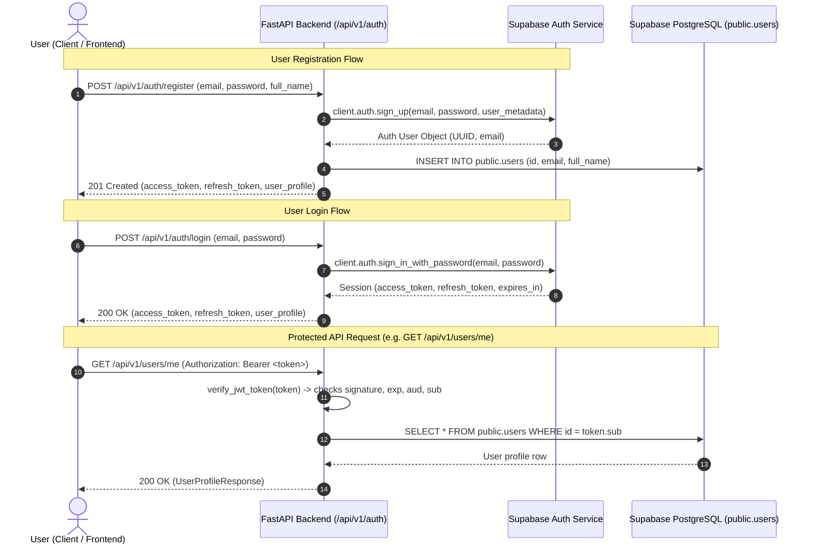

# TrustGuard AI — Authentication & Session Management Implementation

**Identity & Auth Provider:** Supabase Authentication (GoTrue engine)  
**API Layer:** FastAPI with `HTTPBearer` JWT Dependency Injection  
**Data Synchronization:** PostgreSQL `public.users` table synchronized with `auth.users`

---

## 1. Authentication Architecture

TrustGuard AI implements a zero-trust, token-based authentication architecture leveraging Supabase Auth:

1. **Authentication Delegated to Supabase:** Passwords are never hashed, stored, or processed by custom application databases. Supabase Auth handles bcrypt/Argon2 hashing, salts, rate limiting, and email confirmation flows.
2. **Stateless JWT Verification:** The FastAPI backend verifies Supabase-issued Bearer JWTs via cryptographic signature verification (`HS256` or `RS256`) and checks expiration (`exp`), audience (`aud`), and user identifier (`sub`).
3. **Database Profile Synchronization:** When a user registers, their profile record in `public.users` is initialized and linked to `auth.users(id)` via Foreign Key with `ON DELETE CASCADE`.
4. **Guest Access Support:** Unauthenticated visitors can execute immediate URL scans as guests without registration. Guest scans are strictly isolated and cannot be viewed in private history.



---

## 2. API Endpoint Catalog

| Method | Endpoint | Auth Required | Description |
|---|---|---|---|
| `POST` | `/api/v1/auth/register` | None | Registers user, creates Supabase Auth credentials and public profile |
| `POST` | `/api/v1/auth/login` | None | Authenticates email + password, returns JWT session tokens |
| `POST` | `/api/v1/auth/logout` | `Bearer JWT` | Revokes the current active session |
| `POST` | `/api/v1/auth/refresh` | None | Exchanges refresh token for a newly signed access token |
| `POST` | `/api/v1/auth/forgot-password` | None | Sends password reset email (generic response prevents user enumeration) |
| `POST` | `/api/v1/auth/reset-password` | `Bearer JWT` | Sets new password for authenticated recovery session |
| `GET` | `/api/v1/auth/me` | `Bearer JWT` | Returns authenticated user token claims and Auth identity |
| `GET` | `/api/v1/users/me` | `Bearer JWT` | Returns user database profile from `public.users` |
| `PATCH` | `/api/v1/users/me` | `Bearer JWT` | Updates own profile fields (`full_name`, `avatar_url`) |

---

## 3. JWT Verification Methodology

All protected endpoints inject the `get_current_user` FastAPI dependency:

```python
async def get_current_user(
    credentials: Optional[HTTPAuthorizationCredentials] = Depends(_bearer_scheme),
) -> AuthenticatedUser:
```

### Verification Checks Performed:
1. **Bearer Format:** Rejects requests missing the `Authorization: Bearer <token>` header with HTTP `401 Unauthorized`.
2. **Signature & Secret Verification:** Validates the cryptographic signature against `SUPABASE_JWT_SECRET`.
3. **Expiration (`exp`):** Evaluates token expiration time against current UTC timestamp. Expired tokens raise `TokenExpiredError` (`401 TOKEN_EXPIRED`).
4. **Audience (`aud`):** Validates audience matches `authenticated`.
5. **Subject Identity (`sub`):** Extracts user UUID from `sub`. If missing or invalid UUID format, raises `InvalidTokenError` (`401 INVALID_TOKEN`).

---

## 4. Guest vs. Authenticated Access Matrix

| Feature / Action | Guest Users (No Token) | Authenticated Users (`Bearer JWT`) |
|---|---|---|
| Submit URL for Scan (`POST /api/v1/scan`) | ✅ Allowed (`is_guest=True`) | ✅ Allowed (`is_guest=False`, tied to `user_id`) |
| View Immediate Scan Result (`GET /api/v1/scan/{id}`) | ✅ Allowed (with exact `scan_id`) | ✅ Allowed (owner access verified) |
| View Personal Scan History (`GET /api/v1/history`) | ❌ Blocked (`401 Unauthorized`) | ✅ Allowed (returns own scans only) |
| View / Edit Profile (`GET/PATCH /api/v1/users/me`) | ❌ Blocked (`401 Unauthorized`) | ✅ Allowed (own profile only) |
| Submit Community Threat Report (`POST /api/v1/reports`) | ❌ Blocked (`401 Unauthorized`) | ✅ Allowed |
| Browse Verified Community Reports | ✅ Allowed | ✅ Allowed |
| Administrative Modifications | ❌ Blocked | ❌ Blocked unless role is `admin` |

---

## 5. Security & Protection Measures

- **No Password Exposure:** Passwords are never logged, echoed in API responses, or stored in application state.
- **Enumeration Protection:** `POST /api/v1/auth/forgot-password` returns a consistent message regardless of whether the email exists. `POST /api/v1/auth/login` returns generic `"Invalid email or password."`.
- **Role Isolation:** Users cannot update their account role via `PATCH /api/v1/users/me`. Role authorization is checked server-side (`require_admin_user`).
- **Input Sanitization:** Email validation enforces RFC 5322 syntax via `email-validator`. Passwords require at least 8 characters, with letters and numbers/symbols.
- **Service Role Protection:** The Supabase `service_role` key is strictly loaded server-side in `app/core/config.py` and never sent to the browser.

---

## 6. Environment Configuration

In `backend/.env`:

```env
# Supabase Configuration
SUPABASE_URL=https://your-project.supabase.co
SUPABASE_ANON_KEY=your-supabase-anon-key-here
SUPABASE_SERVICE_ROLE_KEY=your-supabase-service-role-key-here
SUPABASE_JWT_SECRET=your-supabase-jwt-secret-here
```

---

## 7. Testing Instructions

Run the authentication test suite:

```bash
# Run authentication tests
pytest tests/test_auth.py -v

# Run entire backend test suite
pytest -v
```

Verified test scenarios:
- ✅ `test_successful_registration` (201 Created with tokens & profile)
- ✅ `test_registration_invalid_inputs` (password mismatch, weak password, invalid email)
- ✅ `test_duplicate_registration_rejected` (409 Conflict)
- ✅ `test_successful_login` (200 OK with session tokens)
- ✅ `test_invalid_login_credentials` (401 Invalid credentials)
- ✅ `test_missing_auth_token_rejected` (401 Unauthorized on protected routes)
- ✅ `test_invalid_jwt_rejected` (401 Invalid token)
- ✅ `test_expired_jwt_rejected` (401 Token expired)
- ✅ `test_protected_profile_endpoint_and_ownership` (GET & PATCH `/api/v1/users/me`)
- ✅ `test_logout_endpoint` (200 OK session termination)
- ✅ `test_token_refresh` (200 OK token rotation)
- ✅ `test_forgot_password_generic_response` (generic safe message)

