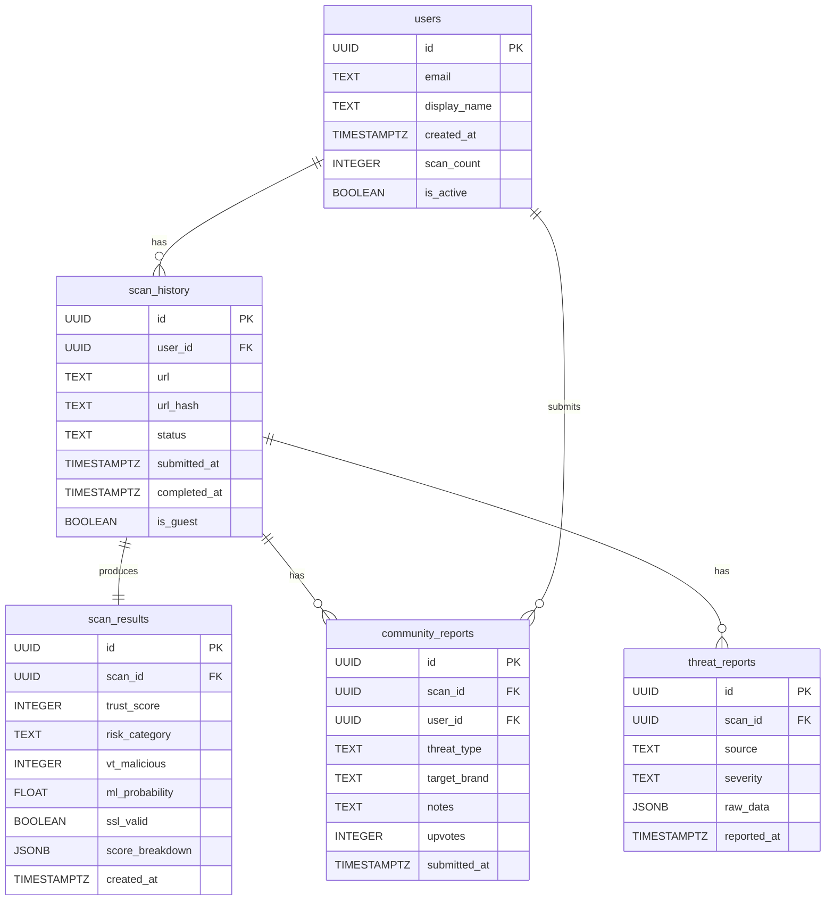

# TrustGuard AI — Database Design

---

## Table of Contents

1. [Overview](#1-overview)
2. [Table Definitions](#2-table-definitions)
3. [Entity Relationship Diagram](#3-entity-relationship-diagram)
4. [SQL DDL — Create Tables](#4-sql-ddl--create-tables)
5. [Index Definitions](#5-index-definitions)
6. [Row Level Security Policies](#6-row-level-security-policies)
7. [Guest User Design](#7-guest-user-design)
8. [Supabase Setup Instructions](#8-supabase-setup-instructions)

---

## 1. Overview

TrustGuard AI uses **PostgreSQL** hosted and managed by **Supabase**. Supabase provides:
- A fully managed PostgreSQL 15 instance with automatic backups.
- Built-in **Row Level Security (RLS)** at the database level, ensuring users can only access their own data regardless of application-layer bugs.
- An **Auth service** that issues industry-standard JWTs, eliminating the need to build authentication infrastructure.
- A **Python SDK** (`supabase-py`) and a **JavaScript SDK** (`@supabase/supabase-js`) for seamless integration with both backend and frontend.
- A **service-role key** for backend-only privileged operations (bypasses RLS) and an **anon key** for client-side operations (enforces RLS).

The database schema consists of **five tables** that model users, scan lifecycle, analysis results, and community-contributed threat intelligence.

> [!IMPORTANT]
> The service-role key **must never** be used in frontend code or committed to version control. It is loaded exclusively from environment variables on the backend server.

---

## 2. Table Definitions

### 2.1 `users`

Extends Supabase's built-in `auth.users` table with application-specific profile data.

| Column | Type | Constraints | Description |
|---|---|---|---|
| `id` | `UUID` | PRIMARY KEY | Matches `auth.users.id` exactly; set by Supabase Auth on registration |
| `email` | `TEXT` | NOT NULL, UNIQUE | User's email address; synced from `auth.users` |
| `display_name` | `TEXT` | | Optional display name shown in the UI |
| `created_at` | `TIMESTAMPTZ` | NOT NULL, DEFAULT `now()` | Account creation timestamp |
| `updated_at` | `TIMESTAMPTZ` | NOT NULL, DEFAULT `now()` | Last profile update timestamp |
| `scan_count` | `INTEGER` | NOT NULL, DEFAULT `0` | Cached count of scans performed; updated via trigger |
| `is_active` | `BOOLEAN` | NOT NULL, DEFAULT `TRUE` | Soft-disable account without deletion |

**Primary Key:** `id`  
**Foreign Key:** `id` → `auth.users(id)` ON DELETE CASCADE  
**Relationships:** One user has many `scan_history` rows; one user has many `community_reports` rows.

---

### 2.2 `scan_history`

Tracks every URL scan request, including lifecycle status and user association.

| Column | Type | Constraints | Description |
|---|---|---|---|
| `id` | `UUID` | PRIMARY KEY, DEFAULT `gen_random_uuid()` | Unique scan identifier returned to the client immediately |
| `user_id` | `UUID` | NULLABLE, FK → `users(id)` | NULL for guest scans; set for authenticated users |
| `url` | `TEXT` | NOT NULL | The raw URL submitted for analysis (max 2048 chars enforced at app layer) |
| `url_hash` | `TEXT` | NOT NULL | SHA-256 hash of the normalised URL; used for deduplication lookups |
| `status` | `TEXT` | NOT NULL, DEFAULT `'pending'` | Scan lifecycle: `pending`, `processing`, `complete`, `error` |
| `submitted_at` | `TIMESTAMPTZ` | NOT NULL, DEFAULT `now()` | When the scan request was received |
| `completed_at` | `TIMESTAMPTZ` | NULLABLE | When analysis finished; NULL while pending/processing |
| `is_guest` | `BOOLEAN` | NOT NULL, DEFAULT `FALSE` | TRUE if submitted without authentication |
| `ip_address` | `INET` | NULLABLE | Client IP for rate-limiting audit; stored hashed in production |
| `error_message` | `TEXT` | NULLABLE | Human-readable error if status = 'error' |

**Primary Key:** `id`  
**Foreign Key:** `user_id` → `users(id)` ON DELETE SET NULL  
**Relationships:** One `scan_history` row produces one `scan_results` row; one `scan_history` row can have many `community_reports` and `threat_reports`.

---

### 2.3 `scan_results`

Stores the full analysis output for a completed scan. One-to-one with `scan_history`.

| Column | Type | Constraints | Description |
|---|---|---|---|
| `id` | `UUID` | PRIMARY KEY, DEFAULT `gen_random_uuid()` | Result record ID |
| `scan_id` | `UUID` | NOT NULL, UNIQUE, FK → `scan_history(id)` | Links back to the parent scan; UNIQUE enforces 1:1 |
| `trust_score` | `INTEGER` | NOT NULL, CHECK (0–100) | Final Digital Trust Score (0 = most dangerous, 100 = safest) |
| `risk_category` | `TEXT` | NOT NULL | One of: `SAFE`, `LOW`, `MEDIUM`, `HIGH`, `CRITICAL`, `UNKNOWN` |
| `vt_malicious` | `INTEGER` | NULLABLE | Number of VirusTotal engines flagging the URL as malicious |
| `vt_total` | `INTEGER` | NULLABLE | Total VirusTotal engines that analysed the URL |
| `vt_score` | `INTEGER` | NULLABLE | Normalised VirusTotal sub-score (0–100) |
| `vt_raw` | `JSONB` | NULLABLE | Full VirusTotal API response (last_analysis_stats + engine verdicts) |
| `ml_probability` | `FLOAT` | NULLABLE, CHECK (0.0–1.0) | Phishing probability from Random Forest (1.0 = definitely phishing) |
| `ml_label` | `TEXT` | NULLABLE | `phishing` or `benign` |
| `ml_features` | `JSONB` | NULLABLE | Dictionary of URL features used for prediction |
| `ml_score` | `INTEGER` | NULLABLE | Normalised ML sub-score (0–100) |
| `ssl_valid` | `BOOLEAN` | NULLABLE | TRUE if certificate is valid and not expired |
| `ssl_issuer` | `TEXT` | NULLABLE | Certificate issuer organisation (e.g., "Let's Encrypt") |
| `ssl_expiry` | `TIMESTAMPTZ` | NULLABLE | Certificate expiry date |
| `ssl_days_remaining` | `INTEGER` | NULLABLE | Days until certificate expires |
| `ssl_score` | `INTEGER` | NULLABLE | Normalised SSL sub-score (0–100) |
| `ssl_raw` | `JSONB` | NULLABLE | Full parsed certificate fields |
| `url_score` | `INTEGER` | NULLABLE | Normalised URL heuristics sub-score (0–100) |
| `url_flags` | `JSONB` | NULLABLE | List of triggered heuristic flags with descriptions |
| `urlhaus_match` | `BOOLEAN` | NULLABLE | TRUE if URL/domain matched URLhaus blocklist |
| `score_breakdown` | `JSONB` | NOT NULL | JSON object with per-dimension weights, scores, and explanations |
| `created_at` | `TIMESTAMPTZ` | NOT NULL, DEFAULT `now()` | Result persistence timestamp |

**Primary Key:** `id`  
**Foreign Key:** `scan_id` → `scan_history(id)` ON DELETE CASCADE  
**Relationships:** One `scan_results` row belongs to exactly one `scan_history` row.

---

### 2.4 `community_reports`

Stores user-submitted annotations and threat context for a completed scan.

| Column | Type | Constraints | Description |
|---|---|---|---|
| `id` | `UUID` | PRIMARY KEY, DEFAULT `gen_random_uuid()` | Report ID |
| `scan_id` | `UUID` | NOT NULL, FK → `scan_history(id)` | The scan being annotated |
| `user_id` | `UUID` | NOT NULL, FK → `users(id)` | Reporter (must be authenticated) |
| `threat_type` | `TEXT` | NOT NULL | Category: `phishing`, `malware`, `scam`, `spam`, `safe`, `other` |
| `target_brand` | `TEXT` | NULLABLE | Brand being impersonated (e.g., "PayPal", "Google") |
| `attack_vector` | `TEXT` | NULLABLE | How the URL was delivered: `email`, `sms`, `social_media`, `ad`, `other` |
| `notes` | `TEXT` | NULLABLE | Free-text notes (max 1000 chars; sanitised before display) |
| `upvotes` | `INTEGER` | NOT NULL, DEFAULT `0` | Community upvote count for report quality |
| `submitted_at` | `TIMESTAMPTZ` | NOT NULL, DEFAULT `now()` | Submission timestamp |

**Primary Key:** `id`  
**Foreign Keys:**  
- `scan_id` → `scan_history(id)` ON DELETE CASCADE  
- `user_id` → `users(id)` ON DELETE SET NULL  
**Relationships:** Many reports can annotate one scan; one user submits many reports.

---

### 2.5 `threat_reports`

Machine-generated threat intelligence records, written exclusively by the backend service role (not by users directly).

| Column | Type | Constraints | Description |
|---|---|---|---|
| `id` | `UUID` | PRIMARY KEY, DEFAULT `gen_random_uuid()` | Threat report ID |
| `scan_id` | `UUID` | NOT NULL, FK → `scan_history(id)` | Associated scan |
| `source` | `TEXT` | NOT NULL | Data source: `virustotal`, `urlhaus`, `internal_ml` |
| `threat_name` | `TEXT` | NULLABLE | Specific threat name from the source (e.g., "Phishing.Generic") |
| `severity` | `TEXT` | NOT NULL | `critical`, `high`, `medium`, `low`, `info` |
| `raw_data` | `JSONB` | NULLABLE | Full raw response from the threat intelligence source |
| `reported_at` | `TIMESTAMPTZ` | NOT NULL, DEFAULT `now()` | When the threat was recorded |

**Primary Key:** `id`  
**Foreign Key:** `scan_id` → `scan_history(id)` ON DELETE CASCADE  
**Relationships:** One scan can produce many threat report entries (one per source).

---

## 3. Entity Relationship Diagram



---

## 4. SQL DDL — Create Tables

```sql
-- Enable UUID generation extension (already enabled in Supabase)
CREATE EXTENSION IF NOT EXISTS "pgcrypto";

-- ============================================================
-- TABLE: users
-- ============================================================
CREATE TABLE IF NOT EXISTS public.users (
    id           UUID         PRIMARY KEY REFERENCES auth.users(id) ON DELETE CASCADE,
    email        TEXT         NOT NULL UNIQUE,
    display_name TEXT,
    created_at   TIMESTAMPTZ  NOT NULL DEFAULT now(),
    updated_at   TIMESTAMPTZ  NOT NULL DEFAULT now(),
    scan_count   INTEGER      NOT NULL DEFAULT 0,
    is_active    BOOLEAN      NOT NULL DEFAULT TRUE
);

-- Auto-update updated_at on row change
CREATE OR REPLACE FUNCTION update_updated_at_column()
RETURNS TRIGGER AS $$
BEGIN
    NEW.updated_at = now();
    RETURN NEW;
END;
$$ LANGUAGE plpgsql;

CREATE TRIGGER set_users_updated_at
    BEFORE UPDATE ON public.users
    FOR EACH ROW EXECUTE FUNCTION update_updated_at_column();

-- ============================================================
-- TABLE: scan_history
-- ============================================================
CREATE TABLE IF NOT EXISTS public.scan_history (
    id            UUID         PRIMARY KEY DEFAULT gen_random_uuid(),
    user_id       UUID         REFERENCES public.users(id) ON DELETE SET NULL,
    url           TEXT         NOT NULL,
    url_hash      TEXT         NOT NULL,
    status        TEXT         NOT NULL DEFAULT 'pending'
                               CHECK (status IN ('pending', 'processing', 'complete', 'error')),
    submitted_at  TIMESTAMPTZ  NOT NULL DEFAULT now(),
    completed_at  TIMESTAMPTZ,
    is_guest      BOOLEAN      NOT NULL DEFAULT FALSE,
    ip_address    INET,
    error_message TEXT
);

-- ============================================================
-- TABLE: scan_results
-- ============================================================
CREATE TABLE IF NOT EXISTS public.scan_results (
    id                UUID         PRIMARY KEY DEFAULT gen_random_uuid(),
    scan_id           UUID         NOT NULL UNIQUE REFERENCES public.scan_history(id) ON DELETE CASCADE,
    trust_score       INTEGER      NOT NULL CHECK (trust_score BETWEEN 0 AND 100),
    risk_category     TEXT         NOT NULL CHECK (risk_category IN ('SAFE','LOW','MEDIUM','HIGH','CRITICAL','UNKNOWN')),
    vt_malicious      INTEGER,
    vt_total          INTEGER,
    vt_score          INTEGER,
    vt_raw            JSONB,
    ml_probability    FLOAT        CHECK (ml_probability BETWEEN 0.0 AND 1.0),
    ml_label          TEXT,
    ml_features       JSONB,
    ml_score          INTEGER,
    ssl_valid         BOOLEAN,
    ssl_issuer        TEXT,
    ssl_expiry        TIMESTAMPTZ,
    ssl_days_remaining INTEGER,
    ssl_score         INTEGER,
    ssl_raw           JSONB,
    url_score         INTEGER,
    url_flags         JSONB,
    urlhaus_match     BOOLEAN,
    score_breakdown   JSONB        NOT NULL,
    created_at        TIMESTAMPTZ  NOT NULL DEFAULT now()
);

-- ============================================================
-- TABLE: community_reports
-- ============================================================
CREATE TABLE IF NOT EXISTS public.community_reports (
    id             UUID         PRIMARY KEY DEFAULT gen_random_uuid(),
    scan_id        UUID         NOT NULL REFERENCES public.scan_history(id) ON DELETE CASCADE,
    user_id        UUID         NOT NULL REFERENCES public.users(id) ON DELETE SET NULL,
    threat_type    TEXT         NOT NULL CHECK (threat_type IN ('phishing','malware','scam','spam','safe','other')),
    target_brand   TEXT,
    attack_vector  TEXT         CHECK (attack_vector IN ('email','sms','social_media','ad','other')),
    notes          TEXT         CHECK (char_length(notes) <= 1000),
    upvotes        INTEGER      NOT NULL DEFAULT 0,
    submitted_at   TIMESTAMPTZ  NOT NULL DEFAULT now()
);

-- ============================================================
-- TABLE: threat_reports
-- ============================================================
CREATE TABLE IF NOT EXISTS public.threat_reports (
    id           UUID         PRIMARY KEY DEFAULT gen_random_uuid(),
    scan_id      UUID         NOT NULL REFERENCES public.scan_history(id) ON DELETE CASCADE,
    source       TEXT         NOT NULL CHECK (source IN ('virustotal','urlhaus','internal_ml')),
    threat_name  TEXT,
    severity     TEXT         NOT NULL CHECK (severity IN ('critical','high','medium','low','info')),
    raw_data     JSONB,
    reported_at  TIMESTAMPTZ  NOT NULL DEFAULT now()
);
```

---

## 5. Index Definitions

```sql
-- Fast user lookup by email (login flow)
CREATE INDEX IF NOT EXISTS idx_users_email
    ON public.users (email);

-- Fast history retrieval per user
CREATE INDEX IF NOT EXISTS idx_scan_history_user_id
    ON public.scan_history (user_id);

-- Dashboard: most recent scans first
CREATE INDEX IF NOT EXISTS idx_scan_history_submitted_at
    ON public.scan_history (submitted_at DESC);

-- Filter history by risk category
CREATE INDEX IF NOT EXISTS idx_scan_results_risk_category
    ON public.scan_results (risk_category);

-- Retrieve all community reports for a scan
CREATE INDEX IF NOT EXISTS idx_community_reports_scan_id
    ON public.community_reports (scan_id);

-- URL hash deduplication lookup
CREATE INDEX IF NOT EXISTS idx_scan_history_url_hash
    ON public.scan_history (url_hash);
```

---

## 6. Row Level Security Policies

> [!IMPORTANT]
> RLS must be **explicitly enabled** per table. Having policies without enabling RLS has no effect.

### Enable RLS on All Tables

```sql
ALTER TABLE public.users              ENABLE ROW LEVEL SECURITY;
ALTER TABLE public.scan_history       ENABLE ROW LEVEL SECURITY;
ALTER TABLE public.scan_results       ENABLE ROW LEVEL SECURITY;
ALTER TABLE public.community_reports  ENABLE ROW LEVEL SECURITY;
ALTER TABLE public.threat_reports     ENABLE ROW LEVEL SECURITY;
```

---

### `scan_history` Policies

```sql
-- Authenticated users see only their own rows
CREATE POLICY "auth_users_own_scans"
    ON public.scan_history
    FOR SELECT
    TO authenticated
    USING (auth.uid() = user_id);

-- Guest (anon) users can see guest scan rows (no user_id)
-- Note: We only expose via scan_id lookup, not full table scans
CREATE POLICY "anon_see_guest_scans"
    ON public.scan_history
    FOR SELECT
    TO anon
    USING (is_guest = TRUE);

-- Authenticated users can insert their own scans
CREATE POLICY "auth_users_insert_scans"
    ON public.scan_history
    FOR INSERT
    TO authenticated
    WITH CHECK (auth.uid() = user_id);

-- Anon users can insert guest scans
CREATE POLICY "anon_insert_guest_scans"
    ON public.scan_history
    FOR INSERT
    TO anon
    WITH CHECK (is_guest = TRUE AND user_id IS NULL);
```

---

### `scan_results` Policies

```sql
-- Scan results are visible if the calling user can see the linked scan_history row
CREATE POLICY "see_results_if_scan_visible_auth"
    ON public.scan_results
    FOR SELECT
    TO authenticated
    USING (
        EXISTS (
            SELECT 1 FROM public.scan_history sh
            WHERE sh.id = scan_results.scan_id
            AND sh.user_id = auth.uid()
        )
    );

CREATE POLICY "see_results_if_guest_scan_anon"
    ON public.scan_results
    FOR SELECT
    TO anon
    USING (
        EXISTS (
            SELECT 1 FROM public.scan_history sh
            WHERE sh.id = scan_results.scan_id
            AND sh.is_guest = TRUE
        )
    );
```

---

### `community_reports` Policies

```sql
-- Anyone (anon + authenticated) can read community reports
CREATE POLICY "public_read_community_reports"
    ON public.community_reports
    FOR SELECT
    TO anon, authenticated
    USING (TRUE);

-- Only authenticated users can submit community reports
CREATE POLICY "auth_insert_community_reports"
    ON public.community_reports
    FOR INSERT
    TO authenticated
    WITH CHECK (auth.uid() = user_id);
```

---

### `threat_reports` Policies

```sql
-- Public read access (threat data is not sensitive)
CREATE POLICY "public_read_threat_reports"
    ON public.threat_reports
    FOR SELECT
    TO anon, authenticated
    USING (TRUE);

-- Only the backend service role can insert threat reports
-- (service role bypasses RLS by default; this policy is a belt-and-suspenders guard)
-- No INSERT policy for anon/authenticated = insert denied for all non-service roles
```

---

## 7. Guest User Design

TrustGuard AI supports **unauthenticated (guest) scans** to lower the barrier to entry for first-time users. The design works as follows:

1. **No `auth.users` row is created** for guest users. Guest scans are identified by `is_guest = TRUE` and `user_id = NULL` in `scan_history`.
2. **Scan ID is the access token**: The frontend stores the `scan_id` in `sessionStorage`. As long as the guest knows their `scan_id`, they can retrieve their scan result via `GET /api/v1/scan/{scan_id}`.
3. **Anon RLS policy**: The `anon` Supabase role (used by unauthenticated JS SDK calls) can only read `scan_history` rows where `is_guest = TRUE`. It cannot read other users' scans.
4. **Guest scans are ephemeral**: Guest scan data is retained for 7 days, after which a scheduled Supabase function deletes rows where `is_guest = TRUE AND submitted_at < now() - interval '7 days'`.
5. **Upgrade path**: If a guest creates an account, the frontend prompts to associate the guest `scan_id` with the new account. The backend offers a `PATCH /api/v1/scan/{scan_id}/claim` endpoint that sets `user_id` on the scan history row.

> [!NOTE]
> Guest scans do **not** appear in the History page, which is authenticated-only. This creates a natural incentive to register.

---

## 8. Supabase Setup Instructions

### Step 1: Create a Supabase Project
1. Log in at [supabase.com](https://supabase.com) and create a new project.
2. Record the **Project URL**, **anon/public key**, and **service-role key** from Project Settings → API.

### Step 2: Run the DDL

Paste the full DDL from Section 4 into the **Supabase SQL Editor** and execute it. Run each `CREATE TABLE` block in order (users → scan_history → scan_results → community_reports → threat_reports) to satisfy foreign-key dependencies.

### Step 3: Enable RLS

Run the `ALTER TABLE ... ENABLE ROW LEVEL SECURITY;` statements from Section 6.

### Step 4: Apply RLS Policies

Run all `CREATE POLICY` statements from Section 6.

### Step 5: Create Indexes

Run all `CREATE INDEX` statements from Section 5.

### Step 6: Configure Auth

In Supabase Dashboard → Authentication:
- Enable **Email/Password** provider.
- Set **Site URL** to your Vercel frontend URL (e.g., `https://trustguard.vercel.app`).
- Add `http://localhost:5173` to **Redirect URLs** for local development.
- Enable **Email Confirmation** for production (can disable during hackathon development).

### Step 7: Populate Environment Variables

**Backend (`.env` file or Render dashboard):**
```
SUPABASE_URL=https://your-project.supabase.co
SUPABASE_SERVICE_ROLE_KEY=eyJ...your-service-role-key...
```

**Frontend (`.env.local` or Vercel dashboard):**
```
VITE_SUPABASE_URL=https://your-project.supabase.co
VITE_SUPABASE_ANON_KEY=eyJ...your-anon-key...
VITE_BACKEND_URL=https://your-backend.onrender.com
```

> [!CAUTION]
> The **service-role key** bypasses all RLS policies. Never expose it in frontend code, browser console, or public repositories. Treat it like a root database password.
