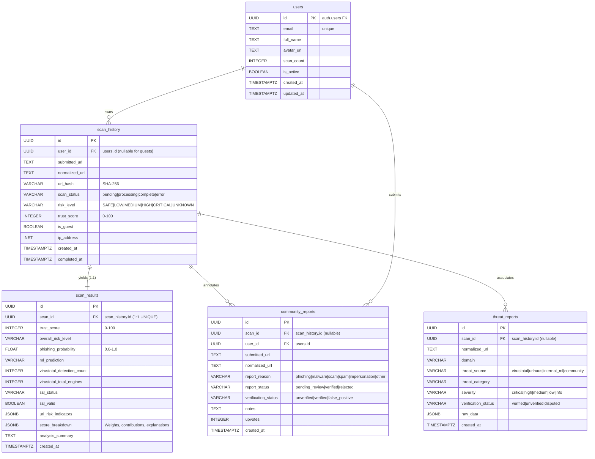

# TrustGuard AI — Database Implementation Guide

**Target Architecture:** Supabase (PostgreSQL 15+) with Row Level Security (RLS)  
**ORM / Data Layer:** SQLAlchemy 2.x + Pydantic v2 + Supabase Python SDK  
**Environment:** 48-Hour Hackathon Standard

---

## 1. Database Overview

TrustGuard AI relies on **Supabase PostgreSQL** as its single, unified production database. The architecture is engineered around the principle of **defense-in-depth**:
1. **Application-Layer Validation:** Pydantic v2 validates all URLs, UUIDs, risk scores (0–100), and categorical enums before any database operation executes.
2. **Database-Layer Integrity:** PostgreSQL foreign keys, check constraints, unique constraints, and automatic triggers prevent inconsistent data states.
3. **Row Level Security (RLS):** Database policies ensure that even if an application bug exists, authenticated users can never query another user's private scan history or submit reports on their behalf.
4. **Service-Role Isolation:** The Supabase `service_role` key is strictly kept in backend environment variables and is never transmitted to the frontend or checked into version control.

---

## 2. Entity Relationships & Architecture



---

## 3. Implemented Database Tables

| Table | Purpose | Primary Key | Foreign Keys | Key Constraints |
|---|---|---|---|---|
| `users` | Profiles extending Supabase Auth (`auth.users`) | `id` (UUID) | `id` → `auth.users(id)` | `email` unique, `scan_count >= 0` |
| `scan_history` | Lifecycle tracking of submitted URLs | `id` (UUID) | `user_id` → `users(id)` (NULL for guests) | `status` IN (pending, processing, complete, error), `trust_score` (0–100) |
| `scan_results` | Deep analysis metrics & explainable breakdown | `id` (UUID) | `scan_id` → `scan_history(id)` (UNIQUE 1:1) | `trust_score` (0–100), `phishing_probability` (0.0–1.0) |
| `community_reports` | Crowdsourced threat annotations & reports | `id` (UUID) | `user_id` → `users(id)`, `scan_id` → `scan_history(id)` | `notes` max 1000 chars, status enum checks |
| `threat_reports` | Verified threat intelligence records | `id` (UUID) | `scan_id` → `scan_history(id)` | `threat_source` enum, `severity` enum |

---

## 4. Row Level Security (RLS) Policy Architecture

All tables have Row Level Security enabled. The database enforces these strict rules:

### A. User Profile Privacy (`users`)
- **SELECT / UPDATE:** `auth.uid() = id` (authenticated users can only view and edit their own profile).
- **Service Role:** Full management permissions for backend worker jobs.

### B. Private Scan History Isolation (`scan_history`)
- **SELECT:** `auth.uid() = user_id AND is_guest = FALSE` (registered users can only query their own private scan history).
- **Guest Protection:** Anon users **cannot** run batch queries to discover guest scans. Guest scans can only be fetched through backend route validation with exact `scan_id` knowledge.
- **INSERT:** Authenticated users insert rows matching `auth.uid() = user_id`.

### C. Detailed Results Confidentiality (`scan_results`)
- **SELECT:** Restricted to users who own the parent scan:
  ```sql
  EXISTS (
      SELECT 1 FROM public.scan_history sh
      WHERE sh.id = scan_results.scan_id
        AND sh.user_id = auth.uid()
        AND sh.is_guest = FALSE
  )
  ```
- **INSERT / UPDATE:** Restricted exclusively to the `service_role`.

### D. Community Threat Reports (`community_reports`)
- **SELECT:** Public read access for `verified` reports; authenticated users can read their own submissions regardless of status.
- **INSERT:** Authenticated users only, with `auth.uid() = user_id`.
- **UPDATE:** Authenticated users can modify their own report while `report_status = 'pending_review'`.
- **ADMIN / MODERATION:** Restricted to `service_role`.

### E. Threat Intelligence (`threat_reports`)
- **SELECT:** Public read access for verified threat intelligence.
- **INSERT / UPDATE / DELETE:** Strictly restricted to `service_role`. Regular users cannot inject arbitrary threat intel.

---

## 5. SQL Migrations

The full executable SQL DDL and RLS policies are located in:
- [`backend/migrations/001_initial_schema.sql`](file:///d:/HackMatrix'26/backend/migrations/001_initial_schema.sql)
- [`backend/migrations/002_row_level_security.sql`](file:///d:/HackMatrix'26/backend/migrations/002_row_level_security.sql)

---

## 6. Supabase Setup Instructions

1. **Create Supabase Project:**
   - Log in to [Supabase Console](https://supabase.com/dashboard) and create a new project (e.g. `trustguard-ai`).
   - Select your preferred region and create a strong database password.

2. **Execute Migrations:**
   - In the Supabase Dashboard, open the **SQL Editor**.
   - Copy and paste the contents of `backend/migrations/001_initial_schema.sql` and click **Run**.
   - Copy and paste the contents of `backend/migrations/002_row_level_security.sql` and click **Run**.

3. **Retrieve API Keys:**
   - Go to **Project Settings** → **API**.
   - Copy `Project URL` → set as `SUPABASE_URL` in backend `.env`.
   - Copy `anon public` key → set as `SUPABASE_ANON_KEY`.
   - Copy `service_role secret` key → set as `SUPABASE_SERVICE_ROLE_KEY`.

4. **Verify Table Setup:**
   - Go to **Table Editor** in Supabase and confirm all 5 tables (`users`, `scan_history`, `scan_results`, `community_reports`, `threat_reports`) show the **RLS Enabled** badge.

---

## 7. Testing Instructions

The database repository layer includes an automated test suite supporting both live Supabase connections and isolated in-memory testing for offline development.

From the `backend/` directory:

```bash
# Run the complete test suite
pytest tests/test_database.py -v

# Run all backend tests (database + health)
pytest -v
```

Verified test coverage includes:
- ✅ Database health status inspection
- ✅ User profile creation, lookup, and updates
- ✅ Scan record lifecycle (pending → complete)
- ✅ Scan result calculation and persistence
- ✅ Ownership enforcement (owner allowed, non-owner denied 403, missing scan 404)
- ✅ Guest scan isolation (not exposed in batch history)
- ✅ Community report submission and query
- ✅ Threat intelligence record storage and domain lookup
- ✅ Input validation rejection (malformed URLs, invalid scores)

