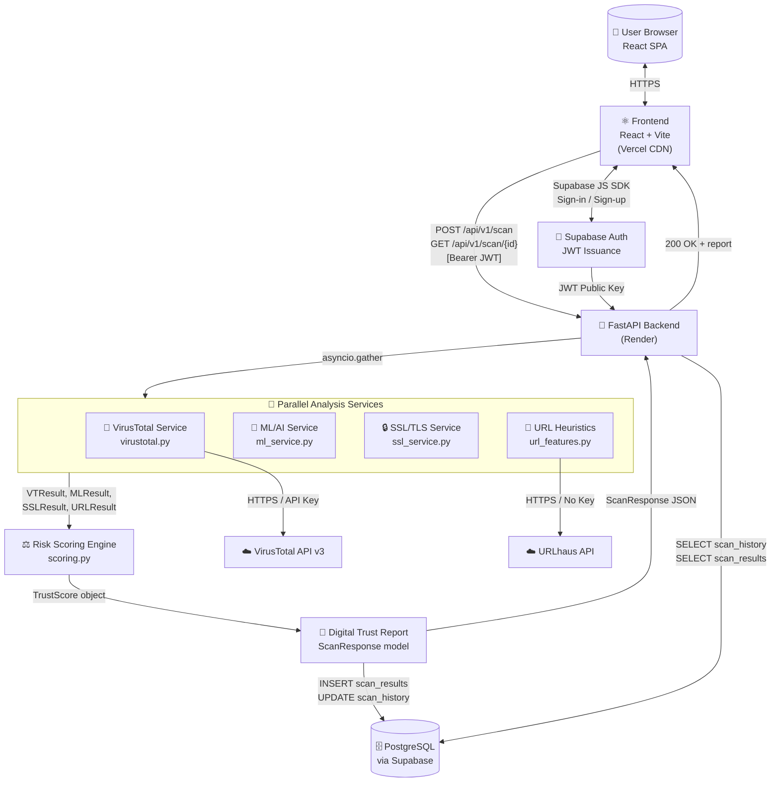
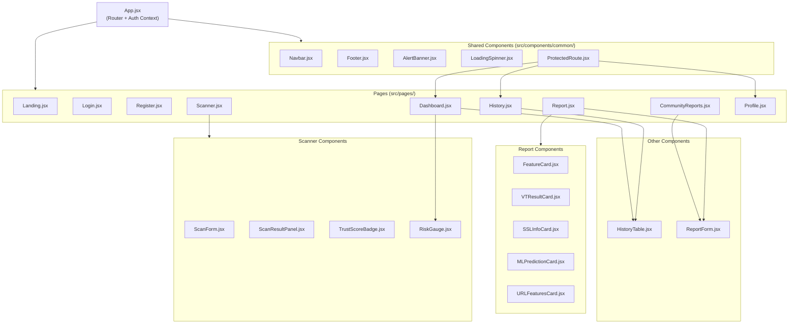

# TrustGuard AI — System Architecture

---

## Table of Contents

1. [System Overview](#1-system-overview)
2. [Data Flow Description](#2-data-flow-description)
3. [System Architecture Diagram](#3-system-architecture-diagram)
4. [Frontend Page Architecture](#4-frontend-page-architecture)
5. [Frontend Component Hierarchy](#5-frontend-component-hierarchy)
6. [Backend Module Architecture](#6-backend-module-architecture)
7. [Key Architectural Decisions](#7-key-architectural-decisions)
8. [Complete Folder Structure](#8-complete-folder-structure)

---

## 1. System Overview

TrustGuard AI is built on a **three-layer architecture**:

### Layer 1 — Frontend (React SPA)
A single-page application served from Vercel's global CDN. The frontend handles all UI rendering, user authentication state (via Supabase JS SDK), form submission, polling for scan results, and data visualisation. It **never** calls external threat-intelligence APIs directly — all such calls are proxied through the backend to prevent API key exposure.

### Layer 2 — Backend (FastAPI)
A Python async web service hosted on Render. The backend is the sole orchestrator of URL analysis. It receives scan requests, validates and sanitises input, fans out four parallel analysis tasks (VirusTotal, ML, SSL, URL Heuristics), aggregates results into a Digital Trust Score, persists everything to the database, and returns the report to the frontend.

### Layer 3 — External Services
- **Supabase** — Managed PostgreSQL database and Auth service. Supabase handles user JWT issuance; the backend verifies these JWTs on protected routes.
- **VirusTotal API v3** — Commercial threat-intelligence feed. Free tier supports 4 requests/minute, sufficient for demo scale.
- **URLhaus API** — Abuse.ch malware URL database. No key required; queried by domain or URL hash.

---

## 2. Data Flow Description

### Guest Scan Flow
1. User submits a URL on the Scanner page.
2. Frontend sends `POST /api/v1/scan` with `{"url": "...", "guest": true}`.
3. Backend validates URL (Pydantic + SSRF guard).
4. Backend creates a `scan_history` row with `status = "pending"` and returns `scan_id`.
5. Frontend begins polling `GET /api/v1/scan/{scan_id}` every 2 seconds.
6. Backend runs four services concurrently via `asyncio.gather`:
   - VirusTotal service → VTResult
   - ML service → MLResult
   - SSL service → SSLResult
   - URL Heuristics → URLResult
7. Scoring engine computes `trust_score` from the four results.
8. Backend writes `scan_results` row and updates `scan_history.status = "complete"`.
9. Next poll from frontend receives `status = "complete"` with full report.
10. Frontend renders the Digital Trust Report.

### Authenticated Scan Flow
Steps 1–10 are identical except:
- Frontend includes `Authorization: Bearer <JWT>` header.
- Backend verifies JWT and associates scan with the authenticated `user_id`.
- Scan appears in the user's History page.

### Community Report Submission Flow
1. Authenticated user views a completed scan report.
2. User fills the ReportForm with threat type and notes.
3. Frontend sends `POST /api/v1/reports` with `scan_id` and report payload.
4. Backend inserts a `community_reports` row.
5. All users can view community reports via `GET /api/v1/reports/{scan_id}`.

---

## 3. System Architecture Diagram



---

## 4. Frontend Page Architecture

| Page | Route | Auth Required | Key Components | Description |
|---|---|---|---|---|
| **Landing** | `/` | No | `Navbar`, `FeatureCard`, `Footer` | Marketing hero page; explains the product and CTA to scan or register |
| **Login** | `/login` | No (redirects if authed) | `Navbar`, `AlertBanner`, `LoadingSpinner` | Supabase email/password sign-in form |
| **Register** | `/register` | No (redirects if authed) | `Navbar`, `AlertBanner`, `LoadingSpinner` | Supabase sign-up form with email confirmation |
| **Dashboard** | `/dashboard` | Yes | `Navbar`, `RiskGauge`, `HistoryTable`, Recharts | Personal overview: recent scans, risk distribution pie chart, scan count |
| **Scanner** | `/scan` | No (guest allowed) | `Navbar`, `ScanForm`, `ScanResultPanel`, `TrustScoreBadge`, `RiskGauge`, `LoadingSpinner` | Primary scan interface; supports polling and live status updates |
| **Report** | `/report/:id` | No (public if guest scan) | `Navbar`, `TrustScoreBadge`, `RiskGauge`, `VTResultCard`, `SSLInfoCard`, `MLPredictionCard`, `URLFeaturesCard`, `ReportForm` | Full detailed scan report with all sub-scores and community report section |
| **History** | `/history` | Yes | `Navbar`, `HistoryTable`, `AlertBanner` | Paginated list of all past scans for the authenticated user |
| **Community Reports** | `/reports` | No (read); Yes (write) | `Navbar`, `ReportForm`, `HistoryTable` | Browse all community-submitted threat annotations |
| **Profile** | `/profile` | Yes | `Navbar`, `AlertBanner` | Account settings: change email, password, and view usage stats |

---

## 5. Frontend Component Hierarchy



---

## 6. Backend Module Architecture

| Module | File | Purpose |
|---|---|---|
| **API — Scan** | `app/api/scan.py` | `POST /api/v1/scan` (submit URL), `GET /api/v1/scan/{id}` (poll results) |
| **API — History** | `app/api/history.py` | `GET /api/v1/history` (authenticated user's scan list) |
| **API — Reports** | `app/api/reports.py` | `POST /api/v1/reports` (submit community report), `GET /api/v1/reports/{scan_id}` |
| **Core — Config** | `app/core/config.py` | Loads all env vars via `pydantic-settings` BaseSettings; single source of truth for secrets |
| **Core — Security** | `app/core/security.py` | JWT verification middleware; SSRF IP-guard function; scheme whitelist |
| **Core — Rate Limiter** | `app/core/rate_limiter.py` | Token-bucket rate limiter via `slowapi`; 5 req/min per IP on `/scan` |
| **DB — Supabase Client** | `app/db/supabase_client.py` | Initialises Supabase Python client with service-role key; singleton pattern |
| **DB — CRUD** | `app/db/crud.py` | All database read/write helpers; never constructs raw SQL strings |
| **Models — Scan** | `app/models/scan.py` | `ScanRequest`, `ScanResponse`, `ScanStatus` Pydantic models |
| **Models — Report** | `app/models/report.py` | `ReportRequest`, `ReportResponse` Pydantic models |
| **Service — VirusTotal** | `app/services/virustotal.py` | Async VirusTotal API v3 wrapper; returns `VTResult` dataclass |
| **Service — URLhaus** | `app/services/urlhaus.py` | Async URLhaus lookup; returns blocklist match status |
| **Service — ML** | `app/services/ml_service.py` | Loads `model.pkl` at startup; exposes `predict(url) -> MLResult` |
| **Service — SSL** | `app/services/ssl_service.py` | Connects to target host, retrieves and parses certificate; returns `SSLResult` |
| **Service — URL Features** | `app/services/url_features.py` | Extracts 20+ lexical/structural features; returns `URLResult` |
| **Service — Scoring** | `app/services/scoring.py` | Weighted aggregation engine; returns `TrustScore` with per-dimension breakdown |
| **ML — Trainer** | `app/ml/trainer.py` | Offline script to train and serialise Random Forest model to `model.pkl` |
| **Entry Point** | `app/main.py` | FastAPI app instantiation, router registration, CORS middleware, lifespan event (model load) |

---

## 7. Key Architectural Decisions

### Decision 1: Backend-Only External API Calls
**Problem:** Calling VirusTotal directly from the browser would expose the API key in network traffic and violate CORS restrictions.  
**Decision:** All external API calls are made exclusively from the FastAPI backend.  
**Consequence:** Adds one network hop but provides complete API key protection and centralised SSRF guard.

### Decision 2: Parallel Async Execution with `asyncio.gather`
**Problem:** Running four analysis services sequentially would take 10–15 seconds per scan.  
**Decision:** Use `asyncio.gather(*[vt_task, ml_task, ssl_task, url_task])` to run all four concurrently.  
**Consequence:** Total latency is bounded by the slowest service (~3–5 seconds for VirusTotal), not the sum. Requires all service functions to be `async def`.

### Decision 3: Supabase as Backend-as-a-Service
**Problem:** Building and securing a Postgres instance, an auth system, and RLS from scratch requires significant ops knowledge.  
**Decision:** Use Supabase, which provides managed Postgres, JWT-based Auth, Row Level Security, and a Python/JS client SDK.  
**Consequence:** Reduces infrastructure work to near-zero; Supabase free tier handles hackathon scale comfortably.

### Decision 4: Polling Model for Scan Results
**Problem:** WebSockets add complexity; server-sent events require persistent connections.  
**Decision:** Frontend polls `GET /api/v1/scan/{id}` every 2 seconds until `status = "complete"`.  
**Consequence:** Simpler implementation; acceptable latency for a 3–8 second analysis window. Polling stops automatically when complete.

### Decision 5: Modular Service Pattern
**Problem:** Four developers need to work independently without merge conflicts.  
**Decision:** Each analysis capability is an isolated module with a typed interface contract. No service imports from another service.  
**Consequence:** Clean separation of concerns; services can be unit-tested with mocks independently.

---

## 8. Complete Folder Structure

### Frontend

```
frontend/
├── public/
│   └── favicon.ico
├── src/
│   ├── api/
│   │   ├── supabaseClient.js       # Supabase Auth + DB client (anon key)
│   │   ├── backendClient.js        # Axios instance with base URL + auth interceptor
│   │   └── endpoints.js            # API URL constants (BASE_URL, SCAN, HISTORY, REPORTS)
│   ├── components/
│   │   ├── common/
│   │   │   ├── Navbar.jsx          # Top navigation with auth state
│   │   │   ├── Footer.jsx          # Site-wide footer
│   │   │   ├── AlertBanner.jsx     # Error/success notification bar
│   │   │   ├── LoadingSpinner.jsx  # Animated loading indicator
│   │   │   └── ProtectedRoute.jsx  # Redirects unauthenticated users to /login
│   │   ├── scanner/
│   │   │   ├── ScanForm.jsx        # URL input form with validation
│   │   │   ├── ScanResultPanel.jsx # Container for scan result display
│   │   │   ├── TrustScoreBadge.jsx # Coloured badge showing 0-100 score
│   │   │   └── RiskGauge.jsx       # Recharts radial gauge for risk level
│   │   ├── report/
│   │   │   ├── FeatureCard.jsx     # Generic card for a feature/metric
│   │   │   ├── VTResultCard.jsx    # VirusTotal engine results table
│   │   │   ├── SSLInfoCard.jsx     # Certificate details display
│   │   │   ├── MLPredictionCard.jsx # Phishing probability + feature bar chart
│   │   │   └── URLFeaturesCard.jsx # URL heuristic flags list
│   │   ├── history/
│   │   │   └── HistoryTable.jsx    # Sortable, paginated scan history table
│   │   └── community/
│   │       └── ReportForm.jsx      # Community threat annotation form
│   ├── hooks/
│   │   ├── useAuth.js              # Auth state, sign-in, sign-out helpers
│   │   ├── useScan.js              # Submit scan + polling logic
│   │   ├── useHistory.js           # Fetch paginated scan history
│   │   └── useReports.js           # Fetch and submit community reports
│   ├── pages/
│   │   ├── Landing.jsx             # /  — Hero + feature highlights
│   │   ├── Login.jsx               # /login
│   │   ├── Register.jsx            # /register
│   │   ├── Dashboard.jsx           # /dashboard — Charts + recent scans
│   │   ├── Scanner.jsx             # /scan — Primary scan UI
│   │   ├── Report.jsx              # /report/:id — Full report
│   │   ├── History.jsx             # /history
│   │   ├── CommunityReports.jsx    # /reports
│   │   └── Profile.jsx             # /profile
│   ├── utils/
│   │   ├── validators.js           # URL format checks, input sanitisation
│   │   └── formatters.js           # Date formatting, score-to-colour mapping
│   ├── App.jsx                     # Router definition + AuthContext provider
│   ├── main.jsx                    # React DOM render entry point
│   └── index.css                   # Tailwind base directives
├── index.html                      # Vite HTML entry
├── vite.config.js                  # Vite + React plugin config
├── tailwind.config.js              # Tailwind content paths + custom theme
└── package.json
```

### Backend

```
backend/
├── app/
│   ├── api/
│   │   ├── __init__.py
│   │   ├── scan.py                 # POST /scan, GET /scan/{id}
│   │   ├── history.py              # GET /history
│   │   └── reports.py              # POST/GET /reports
│   ├── core/
│   │   ├── __init__.py
│   │   ├── config.py               # Settings (env vars via pydantic BaseSettings)
│   │   ├── security.py             # JWT verification, SSRF guard
│   │   └── rate_limiter.py         # Token-bucket rate limiting via slowapi
│   ├── db/
│   │   ├── __init__.py
│   │   ├── supabase_client.py      # Supabase Python client (service-role key)
│   │   └── crud.py                 # DB read/write helpers (parameterised queries)
│   ├── models/
│   │   ├── __init__.py
│   │   ├── scan.py                 # ScanRequest, ScanResponse Pydantic models
│   │   └── report.py               # ReportRequest, ReportResponse Pydantic models
│   ├── services/
│   │   ├── __init__.py
│   │   ├── virustotal.py           # VT API v3 async wrapper → VTResult
│   │   ├── urlhaus.py              # URLhaus async lookup → URLhausResult
│   │   ├── ml_service.py           # Random Forest predictor → MLResult
│   │   ├── ssl_service.py          # SSL/TLS certificate checker → SSLResult
│   │   ├── url_features.py         # URL heuristic feature extractor → URLResult
│   │   └── scoring.py              # Digital Trust Score engine → TrustScore
│   ├── ml/
│   │   ├── model.pkl               # Pre-trained Random Forest (committed to repo)
│   │   ├── feature_names.json      # Ordered feature column list (must match model)
│   │   └── trainer.py              # Offline training script (run locally, not in prod)
│   └── main.py                     # FastAPI app entry, router registration, CORS, lifespan
├── tests/
│   ├── test_scan.py                # API endpoint tests (httpx TestClient)
│   ├── test_ml_service.py          # ML feature extraction + prediction tests
│   ├── test_ssl_service.py         # SSL checker tests with mocked socket
│   ├── test_url_features.py        # Heuristic extractor tests
│   └── test_scoring.py             # Score calculation tests
├── Dockerfile                      # Multi-stage Python 3.11-slim image
├── requirements.txt                # Pinned dependency versions
├── .env.example                    # Template for local development secrets
└── README.md                       # Backend setup and run instructions
```
