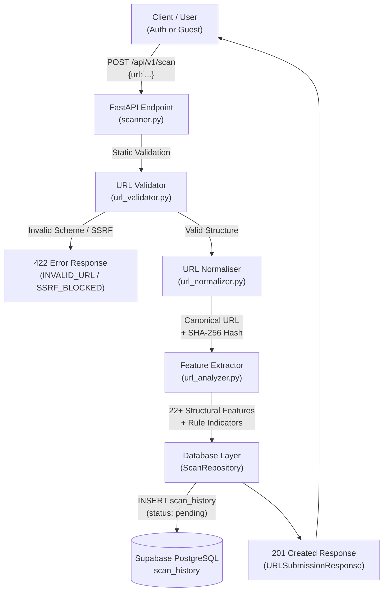

# TrustGuard AI — URL Analysis & Preliminary Threat Detection

**Module:** URL Submission, Static Validation, Canonical Normalisation & Heuristic Analysis  
**Location:** `backend/app/services/url_validator.py`, `backend/app/services/url_analyzer.py`, `backend/app/utils/url_normalizer.py`  
**Endpoint:** `POST /api/v1/scan`

---

## 1. Overview & Architectural Role

The URL Analysis Engine forms the initial defense and feature ingestion layer of TrustGuard AI. It operates **strictly as a static analysis engine** — it does not fetch the target website, follow redirects, or trigger arbitrary DNS queries that could be abused for Server-Side Request Forgery (SSRF).



---

## 2. Static URL Validation Workflow

Implemented in [`app/services/url_validator.py`](file:///d:/HackMatrix'26/backend/app/services/url_validator.py).

### Validation Checks:
1. **Length Boundaries:** Rejects URLs exceeding 2048 characters (`URL_TOO_LONG`) or shorter than 3 characters (`URL_TOO_SHORT`).
2. **Whitespace & Control Characters:** Rejects control characters (ASCII 0–31, 127) and raw unencoded whitespace (`INVALID_WHITESPACE`).
3. **Encoding Safety:** Rejects malformed percent-encoding sequences (e.g. `%zz` or trailing incomplete `%`).
4. **Permitted Schemes:** Strictly allows `http` and `https`. Explicitly blocks:
   - `file:///` (local file inclusion)
   - `javascript:` (cross-site scripting vector)
   - `data:` (inline execution vector)
   - `ftp://`, `gopher://`, `ws://`, `blob:`, `vbscript:`
5. **Port Validation:** Validates that explicit ports are numeric and within the valid range `1` to `65535`.
6. **Domain Syntax (RFC 1123):** Validates domain labels (maximum 63 characters per label, valid alphanumeric and hyphen characters, FQDN requirement).

---

## 3. SSRF & Network Security Safeguards

To prevent TrustGuard AI from being used as a network proxy or probe:

- **Static IP Network Rejection:** IP addresses provided as hostnames are statically parsed via Python's `ipaddress` module and rejected if they fall into:
  - Loopback (`127.0.0.0/8`, `::1`)
  - Private networks (`10.0.0.0/8`, `172.16.0.0/12`, `192.168.0.0/16`)
  - Link-local APIPA (`169.254.0.0/16`)
  - Cloud metadata targets (`169.254.169.254`, `metadata.google.internal`, `metadata.azure.com`)
  - Localhost aliases (`localhost`, `localhost.localdomain`, `0.0.0.0`)
- **No Outbound HTTP Requests:** This module performs static analysis exclusively. No TCP connection or HTTP request is initiated against the submitted URL.

---

## 4. URL Normalisation Rules (RFC 3986)

Implemented in [`app/utils/url_normalizer.py`](file:///d:/HackMatrix'26/backend/app/utils/url_normalizer.py).

| Transformation | Input Example | Normalised Output | Rationale |
|---|---|---|---|
| Scheme & Host Lowercasing | `HTTPS://EXAMPLE.COM/Page` | `https://example.com/Page` | Schemes and hostnames are case-insensitive |
| Default Port Stripping | `http://example.com:80/` | `http://example.com/` | Default ports are redundant and fragment caches |
| Non-Default Port Retention | `https://example.com:8443/` | `https://example.com:8443/` | Non-default ports target distinct server processes |
| Trailing Dot Removal | `https://example.com./` | `https://example.com/` | Root DNS trailing dots represent the identical host |
| Empty Path Normalisation | `https://example.com` | `https://example.com/` | HTTP clients request `/` on empty paths |
| IDNA Punycode Conversion | `http://münchen.de/` | `http://xn--mnchen-3ya.de/` | Maps international domain names to canonical ASCII |
| Fragment Stripping | `https://example.com/page#sec` | `https://example.com/page` | Fragments are client-only and not sent to HTTP servers |
| Query Preservation | `https://example.com?id=2&q=1` | `https://example.com?id=2&q=1` | **Preserved:** Query parameters are critical for phishing detection |

---

## 5. Feature Extraction (22+ Metrics)

Implemented in [`app/services/url_analyzer.py`](file:///d:/HackMatrix'26/backend/app/services/url_analyzer.py).

```json
{
  "url_length": 76,
  "hostname_length": 34,
  "path_length": 18,
  "path_depth": 2,
  "dot_count": 4,
  "hyphen_count": 2,
  "underscore_count": 0,
  "digit_count": 3,
  "special_char_count": 4,
  "subdomain_count": 3,
  "query_param_count": 1,
  "uses_https": true,
  "is_ip_address": false,
  "is_shortened": false,
  "contains_suspicious_keywords": true,
  "suspicious_keywords": ["login", "verify"],
  "excessive_subdomains": true,
  "has_at_symbol": false,
  "has_double_slash_in_path": false,
  "has_punycode": false,
  "has_suspicious_tld": true,
  "has_non_standard_port": false,
  "has_brand_in_subdomain": true
}
```

---

## 6. Preliminary Risk Indicators

The engine flags transparent, explainable indicators:

| Indicator Code | Severity | Description | Cybersecurity Explanation |
|---|---|---|---|
| `IP_BASED_HOSTNAME` | High | Hostname is a raw IP address | Bypasses domain reputation; rare for legitimate public services |
| `AT_SYMBOL_OBFUSCATION` | High | Contains `@` in authority | Obfuscates destination: browsers discard text before `@` |
| `BRAND_NAME_IN_SUBDOMAIN` | High | Known brand keyword in subdomain | Impersonates brand (e.g. `paypal.com.attacker.com`) on mobile address bars |
| `PUNYCODE_HOMOGRAPH` | Medium | Hostname uses `xn--` encoding | Visual spoofing attack using look-alike international characters |
| `SUSPICIOUS_KEYWORDS` | Medium | Authentication / credential terms | Frequent in phishing lures (`login`, `verify`, `banking`, `security`) |
| `SUSPICIOUS_TOP_LEVEL_DOMAIN` | Medium | TLD frequently abused in spam | Low-cost TLDs (`.xyz`, `.top`, `.click`, `.tk`) have high malicious telemetry |
| `EXCESSIVE_SUBDOMAINS` | Medium | $\ge 3$ subdomain levels | Characteristic of dynamic DNS phishing campaign hosts |
| `URL_SHORTENER_DETECTED` | Low | Shortening service used | Masks true target URL from the user |
| `INSECURE_HTTP_SCHEME` | Low | Uses plain HTTP | Traffic vulnerable to eavesdropping and manipulation |

---

## 7. API Request & Response Example

### Request
```http
POST /api/v1/scan HTTP/1.1
Host: localhost:8000
Content-Type: application/json

{
  "url": "http://paypal.com.verify-account.xyz/login?redirect=portal"
}
```

### Response (`201 Created`)
```json
{
  "success": true,
  "scan_id": "a8f3b4c1-9d2e-4b6a-8e7c-1f5d2b3c4e5a",
  "original_url": "http://paypal.com.verify-account.xyz/login?redirect=portal",
  "normalized_url": "http://paypal.com.verify-account.xyz/login?redirect=portal",
  "validation_status": "SUSPICIOUS",
  "is_guest": true,
  "preliminary_analysis": {
    "risk_level": "HIGH_CONCERN",
    "indicators": [
      {
        "name": "BRAND_NAME_IN_SUBDOMAIN",
        "description": "A well-known brand keyword was found in the subdomain structure.",
        "severity": "high",
        "evidence": "paypal.com.verify-account.xyz",
        "reason": "Phishing sites frequently embed trusted brand names to deceive mobile users viewing truncated address bars."
      },
      {
        "name": "SUSPICIOUS_KEYWORDS",
        "description": "URL contains security-sensitive action keywords: login, verify",
        "severity": "medium",
        "evidence": "login, verify",
        "reason": "Keywords related to authentication, credentials, and verification are prevalent in phishing URLs."
      },
      {
        "name": "SUSPICIOUS_TOP_LEVEL_DOMAIN",
        "description": "The URL uses a top-level domain frequently associated with spam or low-cost malicious operations.",
        "severity": "medium",
        "evidence": "xyz",
        "reason": "Certain TLDs have disproportionately high abuse rates according to global threat intelligence telemetry."
      },
      {
        "name": "INSECURE_HTTP_SCHEME",
        "description": "The website uses plain unencrypted HTTP.",
        "severity": "low",
        "evidence": "http://",
        "reason": "Modern legitimate websites use HTTPS to protect user traffic from interception."
      }
    ],
    "features": {
      "url_length": 62,
      "hostname_length": 30,
      "uses_https": false,
      "contains_suspicious_keywords": true,
      "has_brand_in_subdomain": true,
      "has_suspicious_tld": true
    }
  },
  "message": "URL accepted for multi-layer security analysis.",
  "submitted_at": "2026-11-07T12:50:30.123456Z"
}
```

---

## 8. Known Limitations

1. **Static Analysis Only:** The engine inspects URL strings. A website hosted on a clean-looking URL (e.g. compromised WordPress sub-page) requires subsequent machine learning and VirusTotal scanning (covered in Prompts 06–08).
2. **Shortener Masking:** URL shorteners hide the real destination; full unshortening requires safe HEAD requests with redirect tracing in a sandboxed environment.
3. **No Definitive Verdict:** As mandated by the architecture, this module provides preliminary concern levels, not a final Digital Trust Score.

