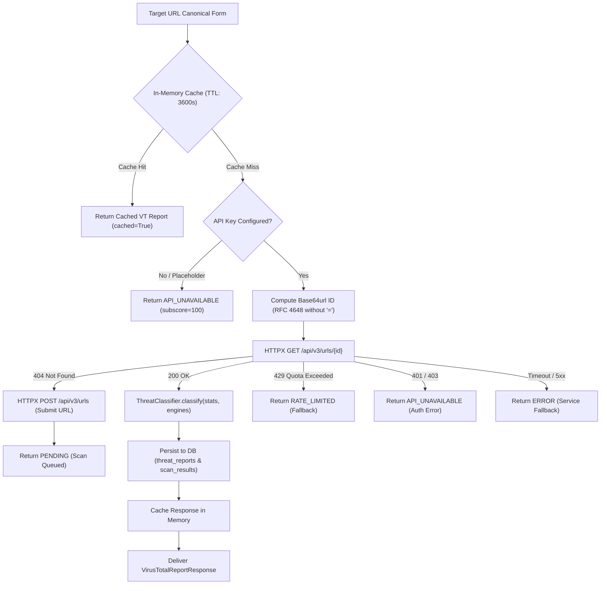

# TrustGuard AI — VirusTotal API Integration & Threat Intelligence Engine

**Document Version:** 1.0.0  
**Implementation Phase:** Prompt 06 — Threat Intelligence Integration  
**Status:** COMPLETED & VERIFIED  

---

## 1. Architectural Overview & Purpose

In the TrustGuard AI multi-layer threat detection pipeline, **VirusTotal Threat Intelligence** serves as the authoritative external reputation layer. It correlates submitted URLs against 70+ commercial antivirus engines, domain blocklists, and threat intelligence feeds (including Kaspersky, Sophos, Google Safe Browsing, Bitdefender, and Microsoft Defender).



---

## 2. VirusTotal v3 Technical Specifications

### 2.1 Base URL & Authentication
- **Base URL:** `https://www.virustotal.com/api/v3`
- **Header:** `x-apikey: {settings.VIRUSTOTAL_API_KEY}`
- **Rate Limit:** Free tier allows **4 requests per minute** and **500 requests per day**.

### 2.2 Resource Identifier Encoding
Per VirusTotal API v3 specification, the resource identifier for a URL is the URL string encoded in Base64 (URL-safe alphabet, RFC 4648) with all trailing padding characters (`=`) stripped:

$$\text{id} = \text{base64url}(\text{canonical\_url})\text{.rstrip}('=')'$$

Example:
```python
import base64
url = "https://example.com/test"
url_id = base64.urlsafe_b64encode(url.encode("utf-8")).decode("utf-8").rstrip("=")
# Result: aHR0cHM6Ly9leGFtcGxlLmNvbS90ZXN0
```

### 2.3 Endpoints Used
1. **Reputation Lookup:**  
   `GET /api/v3/urls/{id}`  
   Retrieves `last_analysis_stats`, `last_analysis_results`, and `last_analysis_date`.
2. **URL Submission:**  
   `POST /api/v3/urls`  
   Submits an unseen URL for asynchronous scanning when a 404 is encountered.
3. **Analysis Status Polling:**  
   `GET /api/v3/analyses/{id}`  
   Checks analysis progress for queued submissions.

---

## 3. Threat Classification Decision Matrix

Rather than exposing raw vendor counts directly to non-technical users, TrustGuard AI's `ThreatClassifier` converts telemetry into clear, human-understandable classifications:

| Status | Trigger Criteria | Confidence | Default Subscore | Explanation Narrative |
| :--- | :--- | :--- | :--- | :--- |
| **MALICIOUS** | $\ge 3$ malicious engines OR $\ge 1$ priority vendor (Kaspersky, Google Safe Browsing, Sophos) | HIGH / MEDIUM | $\max(0, 100 - (m \times 20 + s \times 5 + 30))$ | High-confidence active threat confirmed by multiple independent security vendors. |
| **SUSPICIOUS** | $1-2$ malicious engines OR $\ge 2$ suspicious engines | MEDIUM | $\max(20, 100 - (m \times 25 + s \times 10))$ | Potential security risk or newly emerging malicious infrastructure flagged by vendor feeds. |
| **NO_DETECTIONS** | $0$ malicious and $\le 1$ suspicious (total engines $> 0$) | HIGH ($\ge 50$ engines) / MEDIUM | $100$ | Zero security vendors currently flag this URL. Security advisory applied. |
| **NOT_FOUND** | Total engines evaluated $= 0$ (unindexed domain) | INSUFFICIENT | $100$ | URL has not been previously analyzed by any VirusTotal engines. Submission queued. |
| **PENDING** | URL submitted; analysis in progress | INSUFFICIENT | $100$ | Threat analysis scan is queued or running on external sandboxes. |
| **RATE_LIMITED** | HTTP 429 received from VirusTotal | INSUFFICIENT | $100$ | VirusTotal 4 req/min free-tier quota reached. Query gracefully deferred. |
| **API_UNAVAILABLE** | Key unconfigured or HTTP 401/403 | INSUFFICIENT | $100$ | VirusTotal integration inactive or unauthorized. Threat score operates on local heuristics & ML. |
| **ERROR** | Network timeout or 5xx server failure | INSUFFICIENT | $100$ | Threat feed lookup failed; non-blocking fallback preserves application stability. |

---

## 4. Fundamental Security Principle: $\text{NO\_DETECTIONS} \neq \text{SAFE}$

A common rookie mistake in cybersecurity tools is treating a clean VirusTotal report ($0$ detections) as proof that a website is benign.

> [!WARNING]
> **Zero-Day Phishing Threat:** Freshly spun up phishing campaigns (especially spear-phishing and credential harvesting clones) take between 2 to 24 hours to be detected, ingested, and distributed across threat intelligence blocklists.
> Therefore, TrustGuard AI **strictly enforces** the following safety disclaimer on every zero-detection report:
>
> *"Notice: Absence of detections (NO_DETECTIONS) does not guarantee that a website is safe. Zero-day threats and newly registered phishing campaigns may not yet be listed in external security vendor signatures."*
>
> Subsequent pipeline stages (Scikit-Learn ML Phishing Classifier and Static Lexical Heuristics) provide orthogonal protection to catch new attack surfaces that VirusTotal misses.

---

## 5. In-Memory Caching & Rate Limit Preservation

Because VirusTotal's public API key provides only **4 requests per minute**, TrustGuard AI utilizes an in-memory cache (`_cache`) indexed by the base64url `url_identifier`:
- **Default TTL:** 3,600 seconds (1 hour).
- **Behavior:** If a URL is submitted by multiple users, re-scanned, or queried via the threat intelligence endpoint within 1 hour, the result is served directly from memory with `cached=True`, without making outbound HTTP calls.
- **Cache Invalidation:** Timestamps older than `VIRUSTOTAL_CACHE_TTL_SECONDS` are purged on access.

---

## 6. Database Storage & Persistence

When a `scan_id` is supplied:
1. **Threat Reports Table (`threat_reports`):**  
   If `malicious > 0` or `suspicious > 0`, a verified threat record is persisted:
   - `threat_source`: `"virustotal"`
   - `threat_category`: e.g. `"phishing"`, `"malware"`
   - `severity`: `"critical"` ($\ge 5$ engines), `"high"` ($\ge 3$), `"medium"` ($\ge 1$)
   - `raw_data`: Full engine statistics, detection ratios, and flagged vendor names.
2. **Scan Results Table (`scan_results`):**  
   The existing scan result record is enriched with:
   - `virustotal_detection_count`: Aggregate malicious count.
   - `virustotal_total_engines`: Total participating engines.
   - `threat_intelligence_status`: High-level classification status.
   - `vt_score`: Subscore calculated on 0–100 scale.
   - `vt_raw`: JSON telemetry metadata.

---

## 7. API Endpoints

### 7.1 Get Threat Intelligence by Scan ID
```http
GET /api/v1/threat-intelligence/{scan_id}
```
- **Access Control:** Guest scans accessible via ID; authenticated user scans strictly enforce ownership ($403\text{ Forbidden}$ for other users).
- **Response Model:** `VirusTotalReportResponse`

### 7.2 Direct Threat Intelligence Lookup
```http
GET /api/v1/threat-intelligence/lookup?url={target_url}
```
- **Description:** Allows direct URL inspection without requiring a pre-existing scan record.

---

## 8. Automated Verification & Quality Assurance

All 16 VirusTotal test cases in `backend/tests/test_virustotal.py` were executed and verified against mocked HTTP responses:

| Test Case | Scenario Verified | Outcome |
| :--- | :--- | :--- |
| `test_url_identifier_computation` | Base64url encoding without padding | PASSED |
| `test_threat_classifier_malicious_threshold` | Malicious classification on $\ge 3$ detections | PASSED |
| `test_threat_classifier_suspicious_threshold` | Suspicious classification on low consensus | PASSED |
| `test_threat_classifier_no_detections` | Zero detection classification & advisory disclaimer | PASSED |
| `test_threat_classifier_not_found` | Unseen URL returns NOT_FOUND | PASSED |
| `test_virustotal_service_missing_api_key` | Graceful fallback on unconfigured key | PASSED |
| `test_virustotal_service_successful_lookup` | 200 OK parsing & vendor mapping | PASSED |
| `test_virustotal_service_in_memory_caching` | Cache hit prevents duplicate HTTP request | PASSED |
| `test_virustotal_service_rate_limit_429` | 429 quota exhaustion handled gracefully | PASSED |
| `test_virustotal_service_unauthorized_401` | 401 invalid key handled gracefully | PASSED |
| `test_virustotal_service_timeout_handling` | Network timeout caught with ERROR status | PASSED |
| `test_virustotal_service_404_submission` | 404 triggers async submission to POST /urls | PASSED |
| `test_virustotal_service_database_persistence` | Database persistence to `threat_reports` verified | PASSED |
| `test_threat_intelligence_lookup_endpoint` | Endpoint `/api/v1/threat-intelligence/lookup` | PASSED |
| `test_threat_intelligence_by_scan_id_endpoint` | Endpoint `/api/v1/threat-intelligence/{scan_id}` | PASSED |
| `test_threat_intelligence_ownership_isolation` | Ownership authorization ($403\text{ Forbidden}$) | PASSED |

**Complete backend test suite status:**  
`56 passed, 1 warning in 0.63s`  
`Ruff linter:` 0 errors, clean code formatting.

