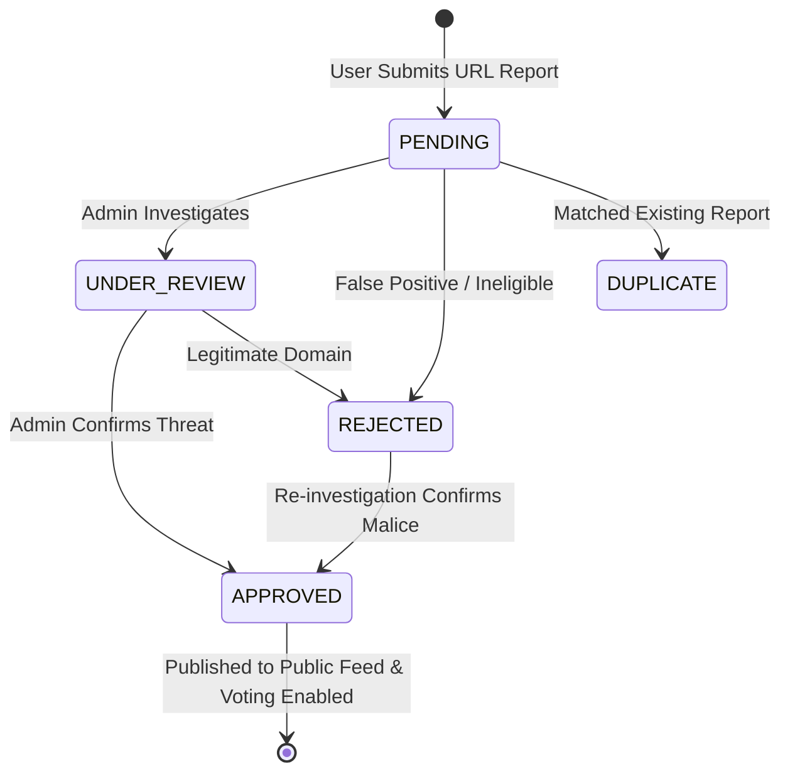

# TrustGuard AI — Community Threat Reporting & Collaborative Intelligence System

**Module Name:** Community Threat Reporting & Admin Moderation  
**Implementation Date:** 2026-11-07  
**Version:** 1.0.0  
**Test Coverage:** 14 dedicated test cases (136 total backend tests passing, 0 errors)

---

## 1. Executive Summary & Core Purpose

The **Community Threat Reporting Module** establishes a crowdsourced intelligence channel for TrustGuard AI. It allows authenticated security researchers, analysts, and everyday users to submit suspicious URLs, classify threat categories, record delivery vectors, and share non-sensitive evidentiary references.

### Non-Negotiable Architectural Policy: Non-Authoritative Decoupling
> [!IMPORTANT]
> **Community threat reports are user-submitted observations and evidence, NEVER automated verdicts.**
> A community report cannot unilaterally alter a website's Digital Trust Score, force high-severity risk overrides, or declare a domain malicious without formal administrative review or consensus verification. This decoupling protects the platform against adversarial brigading, competitive sabotage, and false positive denial-of-service.

---

## 2. Database Schema & Migration 004

Enhanced table `public.community_reports` via `backend/migrations/004_community_reporting_enhancements.sql`:

```sql
ALTER TABLE public.community_reports
    ADD COLUMN IF NOT EXISTS domain VARCHAR(255),
    ADD COLUMN IF NOT EXISTS description TEXT,
    ADD COLUMN IF NOT EXISTS evidence_url TEXT,
    ADD COLUMN IF NOT EXISTS moderation_status VARCHAR(32) NOT NULL DEFAULT 'PENDING',
    ADD COLUMN IF NOT EXISTS moderation_notes TEXT,
    ADD COLUMN IF NOT EXISTS moderator_id UUID REFERENCES public.users(id) ON DELETE SET NULL,
    ADD COLUMN IF NOT EXISTS reviewed_at TIMESTAMPTZ,
    ADD COLUMN IF NOT EXISTS duplicate_of UUID REFERENCES public.community_reports(id) ON DELETE SET NULL,
    ADD COLUMN IF NOT EXISTS updated_at TIMESTAMPTZ NOT NULL DEFAULT now();
```

### Performance & Deduplication Indexes
- `idx_community_reports_domain`: Fast case-insensitive prefix/subdomain lookup.
- `idx_community_reports_mod_status`: Fast segregation of `APPROVED` vs `PENDING` queues.
- `idx_community_reports_norm_url`: Exact hash/string equality for deduplication.
- `idx_community_reports_user_created`: Instant listing of user's personal submission history.
- `idx_community_reports_duplicate_of`: Cluster navigation between duplicate reports and primary canonical submissions.

### Row-Level Security (RLS) Rules
1. **Public Reading:** `moderation_status IN ('APPROVED', 'verified')` is readable by anonymous clients through sanitized views.
2. **User Isolation:** `auth.uid() = user_id` allows users to view all their own reports regardless of moderation status.
3. **Submit Permission:** Only authenticated sessions (`auth.uid() = user_id`) may insert new reports.
4. **Service Role / Admin:** Superuser access for automated moderation scripts and admin endpoints.

---

## 3. Workflow & Lifecycle State Machine



### Moderation Statuses
- `PENDING`: Initial state upon user submission. Hidden from public view.
- `UNDER_REVIEW`: Locked for analyst investigation and sandbox detonation.
- `APPROVED`: Confirmed threat; visible on the public collaborative threat feed.
- `REJECTED`: Declared false positive or invalid submission.
- `DUPLICATE`: Linked to an existing canonical report via `duplicate_of`.

### Verification Statuses
- `UNVERIFIED`: Default state for crowdsourced submissions.
- `COMMUNITY_SUPPORTED`: Received multiple independent user confirmations and high upvotes.
- `ADMIN_VERIFIED`: Confirmed by TrustGuard security personnel or threat feed consensus.
- `DISPUTED`: Contested by domain owners or conflicting intelligence.

---

## 4. Privacy Boundary & Anti-Enumeration Design

TrustGuard implements strict differential visibility based on client authentication:

| Client Identity | Unapproved Reports (`PENDING`, `REJECTED`) | Approved Reports (`APPROVED`) | Sensitive Metadata Masking |
| :--- | :--- | :--- | :--- |
| **Anonymous / Public** | `404 Not Found` (Anti-enumeration) | `200 OK` (Public Schema) | Strips `user_id`, `email`, `moderator_id`, `moderation_notes` |
| **Submitting User** | `200 OK` (User Schema) | `200 OK` (User Schema) | Displays submitter's own metadata and moderation status |
| **Administrator** | `200 OK` (Admin Schema) | `200 OK` (Admin Schema) | Full audit trails, reviewer IDs, timestamps, moderation notes |

> [!NOTE]
> Returning `404 Not Found` instead of `403 Forbidden` for unapproved reports to unauthorized users prevents malicious actors from probing report UUIDs to discover which targets are under active community review.

---

## 5. Deduplication & Anti-Spam Strategy

1. **RFC 3986 URL Normalisation:** All submitted URLs pass through `normalize_url()`, stripping port defaults (`:80`, `:443`), trailing dots, fragment identifiers, and lowercasing hostnames.
2. **Per-User Spam Rejection:** If an authenticated user attempts to report the exact same normalized URL twice, the system raises `409 Conflict` ("You have already submitted a threat report for this website.").
3. **Cross-User Canonical Linking:** If User B reports a URL already submitted by User A, the report is saved but automatically tagged with `duplicate_of = report_a.id`. This clusters community signals without skewing threat metrics or generating duplicate clutter.

---

## 6. API Reference

### 1. Submit Threat Report
- **Endpoint:** `POST /api/v1/community/reports`
- **Auth:** Bearer Token (Authenticated user)
- **Status:** `201 Created`
- **Request:**
```json
{
  "submitted_url": "https://secure-chase-update.com/login",
  "category": "PHISHING",
  "target_brand": "Chase Bank",
  "attack_vector": "email",
  "description": "Credential harvesting page sent via phishing email",
  "evidence_url": "https://pastebin.com/raw/sample"
}
```

### 2. List Public Threat Reports
- **Endpoint:** `GET /api/v1/community/reports`
- **Auth:** Optional / Public
- **Query Params:** `domain`, `category`, `search`, `page`, `page_size`
- **Response:** Paginated list of sanitized approved reports.

### 3. Submitter Personal History
- **Endpoint:** `GET /api/v1/community/my-reports`
- **Auth:** Bearer Token (Authenticated user)
- **Response:** Paginated list of user's own submissions across all moderation stages.

### 4. Admin Moderation Queue & Action
- **List Queue:** `GET /api/v1/admin/community/reports?moderation_status=PENDING`
- **Auth:** Bearer Token (`role="admin"`)
- **Moderate Report:** `PATCH /api/v1/admin/community/reports/{report_id}`
- **Payload:**
```json
{
  "moderation_status": "APPROVED",
  "verification_status": "ADMIN_VERIFIED",
  "moderation_notes": "Confirmed malicious spoofing domain targeting financial consumers."
}
```

### 5. Upvote Community Report
- **Endpoint:** `POST /api/v1/community/reports/{report_id}/upvote`
- **Auth:** Optional
- **Action:** Increments community consensus count for approved reports.

---

## 7. Verification & Quality Standards

- **Linting:** 100% compliant with `ruff check .` (0 errors) and formatted with `ruff format .`.
- **Test Suite:** `backend/tests/test_community_reporting.py` (14 automated tests covering validation, auth boundaries, moderation transitions, duplicate prevention, and score isolation).
- **Full Backend Test Run:** 136 tests passing in 6.20s across all modules.

