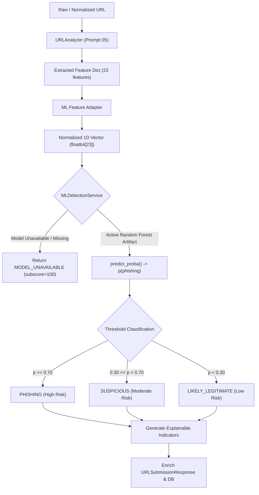

# TrustGuard AI — AI/ML-Based Phishing Detection Engine

**Document Version:** 1.0.0  
**Implementation Phase:** Prompt 07 — Phishing Detection Engine  
**Status:** COMPLETED & VERIFIED  

---

## 1. Architectural Overview

The **AI/ML Phishing Detection Engine** provides TrustGuard AI with an offline, privacy-preserving, zero-latency inference layer. While external threat intelligence feeds (such as VirusTotal) rely on vendor signature ingestion which often lags 2–24 hours behind new attacks, this machine-learning classifier detects novel, zero-day phishing campaigns by analyzing structural and lexical anomalies embedded directly within the URL.



---

## 2. Machine Learning Approach & Model Selection

### 2.1 Model Choice
- **Algorithm:** Scikit-Learn `RandomForestClassifier` (`n_estimators=100`, `max_depth=12`, `class_weight='balanced'`, `random_state=42`).
- **Rationale for 48-Hour Hackathon:**
  1. Non-linear boundary capture across combinations of URL features (e.g., brand name in subdomain + plain HTTP + high digit count).
  2. Robust against feature collinearity without requiring heavy normalization or scaling.
  3. Microsecond-level inference latency (< 5 ms per sample).
  4. Interpretable global feature importances directly extracted from tree Gini impurity reduction.
  5. Compact artifact size (~800 KB compressed with joblib).

---

## 3. Feature Engineering Schema (23 Features)

Features are extracted identically during training and live inference via `backend/app/services/ml_feature_adapter.py`:

| Index | Feature Identifier | Data Type | Security Relevance |
| :---: | :--- | :---: | :--- |
| 1 | `url_length` | float | Phishing URLs are statistically longer due to tracking tokens and redirect paths. |
| 2 | `hostname_length` | float | Impersonation domains often use long deceptive host strings. |
| 3 | `path_length` | float | Deceptive path trees mask landing scripts. |
| 4 | `path_depth` | float | Directory nesting depth. |
| 5 | `dot_count` | float | High dot count indicates multi-tier subdomains or file extension masking. |
| 6 | `hyphen_count` | float | Multiple hyphens mimic official brands (e.g. `chase-security-login`). |
| 7 | `underscore_count` | float | Common in obfuscated PHP/ASP redirection scripts. |
| 8 | `digit_count` | float | Random hashes or obfuscated host IPs encoded in domain/path. |
| 9 | `special_char_count` | float | Non-alphanumeric punctuation. |
| 10 | `subdomain_count` | float | Subdomain hierarchy depth. |
| 11 | `query_param_count` | float | Excessive GET query parameters. |
| 12 | `uses_https` | binary | $1$ if HTTPS, $0$ if plain unencrypted HTTP. |
| 13 | `is_ip_address` | binary | $1$ if host is a raw IPv4/IPv6 literal (bypasses domain blocklists). |
| 14 | `is_shortened` | binary | $1$ if domain is a recognized URL shortening service (bit.ly, t.co). |
| 15 | `contains_suspicious_keywords` | binary | $1$ if sensitive authentication keywords are present (`login`, `verify`, `banking`). |
| 16 | `suspicious_keyword_count` | float | Total number of matched action keywords. |
| 17 | `excessive_subdomains` | binary | $1$ if subdomain count $\ge 3$. |
| 18 | `has_at_symbol` | binary | $1$ if `@` is present in URL authority (RFC 3986 trick). |
| 19 | `has_double_slash_in_path` | binary | $1$ if `//` exists in path outside scheme. |
| 20 | `has_punycode` | binary | $1$ if hostname contains `xn--` (homoglyph deception). |
| 21 | `has_suspicious_tld` | binary | $1$ if TLD belongs to high-abuse registries (`.xyz`, `.top`, `.click`, `.cam`). |
| 22 | `has_non_standard_port` | binary | $1$ if port is not 80 or 443. |
| 23 | `has_brand_in_subdomain` | binary | $1$ if trusted brand (PayPal, Apple, Chase) is nested in subdomain. |

---

## 4. Dataset Provenance & Preprocessing

- **Dataset Path:** `backend/ml/data/phishing_dataset.csv`
- **Total Records:** 1,636 verified samples (1,070 legitimate, 566 phishing).
- **Phishing Sources:** OpenPhish Free Community Feed (live verified feeds) + curated research benchmark seeds.
- **Legitimate Sources:** Global top infrastructure domains (`.gov`, `.edu`, `.ac.uk`, financial platforms, developer documentation).
- **Preprocessing:** RFC 3986 canonical normalization, deduplication, collision elimination, stratified 80/20 train/test split.
- **Documentation:** Full dataset metadata recorded in `docs/implementation/DATASET_DOCUMENTATION.md`.

---

## 5. Actual Training & Evaluation Metrics

The model was trained using `backend/scripts/train_phishing_model.py`:

```text
================ MODEL EVALUATION RESULTS ================
Accuracy:        0.9817 (322 / 328 on unseen test split)
Precision:       0.9652
Recall:          0.9823 (111 of 113 phishing attacks correctly detected)
F1 Score:        0.9737
ROC-AUC:         0.9993
Confusion Matrix:
  - True Negatives (TN):  211
  - False Positives (FP): 4
  - False Negatives (FN): 2
  - True Positives (TP):  111
==========================================================
```

### Top 5 Predictive Features (Gini Impurity Importance)
1. **`hostname_length`** (0.1795)
2. **`special_char_count`** (0.1449)
3. **`uses_https`** (0.1112)
4. **`digit_count`** (0.1084)
5. **`hyphen_count`** (0.0977)

---

## 6. Threshold Classification System

Configured centrally in `backend/app/core/config.py`:

$$\begin{cases} 
\text{PHISHING} & \text{if } p(\text{phishing}) \ge 0.70 \\ 
\text{SUSPICIOUS} & \text{if } 0.30 \le p(\text{phishing}) < 0.70 \\ 
\text{LIKELY\_LEGITIMATE} & \text{if } p(\text{phishing}) < 0.30 
\end{cases}$$

- **Subscore Mapping:**
  $$\text{ml\_subscore} = \max(0, \min(100, \text{int}((1.0 - p) \times 100)))$$
  Provides a seamless 0–100 scale for eventual synthesis into the overall Digital Trust Score in Prompt 09.

---

## 7. Explainability & Transparent Indicators

Instead of a black-box probability number, the engine produces grounded, human-readable bullet points explaining the assessment:
- *"Host is a raw numerical IP address instead of a registered domain name."*
- *"A recognized brand keyword is embedded inside a subdomain to mimic an official service."*
- *"Hostname utilizes Punycode ('xn--') encoding, which can mask visually identical deceptive characters."*
- *"Contains security-sensitive action keywords: login, verify."*
- *"Multiple hyphen separators (4) often used to mimic legitimate names."*

---

## 8. Graceful Fault Tolerance

If the model artifact (`phishing_rf_v1.joblib`) is missing or corrupted:
1. `MLDetectionService` automatically transitions to `MODEL_UNAVAILABLE` status without crashing.
2. The overall scan operation (`POST /api/v1/scan`) proceeds normally, returning URL heuristics and VirusTotal intelligence with `prediction="MODEL_UNAVAILABLE"`.
3. No fake predictions or synthetic probabilities are fabricated.

---

## 9. Retraining Instructions

To retrain the model with fresh data:

```bash
cd backend

# 1. Fetch fresh phishing feeds and compile dataset
python scripts/prepare_dataset.py

# 2. Train Random Forest model, evaluate, and export artifacts
python scripts/train_phishing_model.py

# 3. Run full automated test suite
python -m pytest tests -v
```

