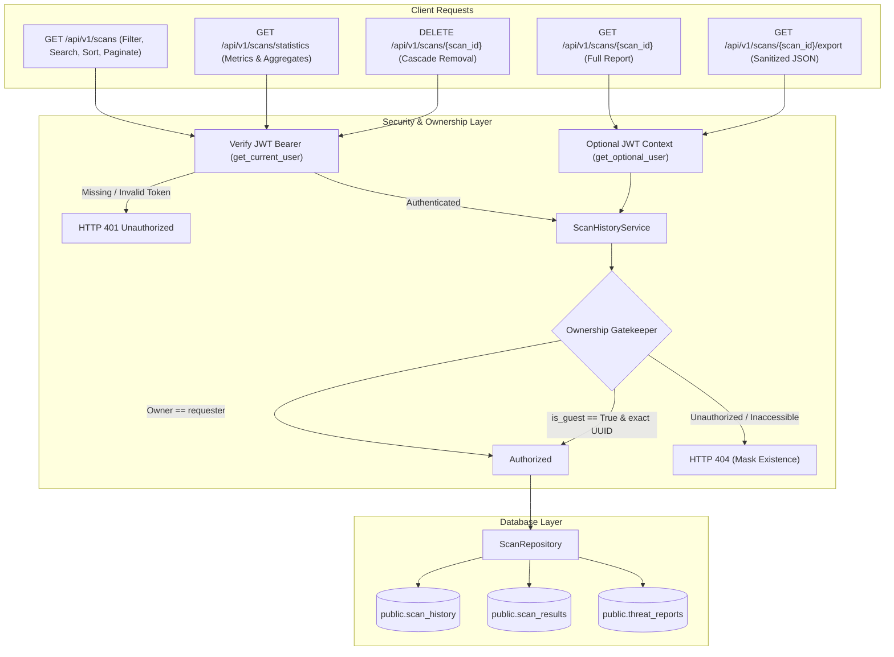

# TrustGuard AI — Scan History & Security Report Management System

**Document Version:** 1.0.0  
**Implementation Phase:** Prompt 10 — Scan History & Security Report Management System  
**Status:** COMPLETED & VERIFIED  

---

## 1. Architectural Overview

The **Scan History & Security Report Management System** provides authenticated users with access to historical scans, detailed evidence-based security reports, server-side multi-attribute search and filtering, aggregate threat statistics, report exports, and secure record deletion.



> [!IMPORTANT]
> **Anti-Enumeration Privacy Principle**  
> When an unauthorized client or unauthenticated user attempts to access a private scan record via `GET /api/v1/scans/{scan_id}` or `DELETE /api/v1/scans/{scan_id}`, the system returns **HTTP 404 Not Found** instead of HTTP 403 Forbidden. This prevents malicious actors from probing UUID spaces to confirm the existence of scans conducted by other users or organizations.

---

## 2. Database Architecture & Migration 003

The system reuses the existing `users`, `scan_history`, and `scan_results` tables while adding specialized columns and performance indexes.

### 2.1 Schema Extensions (`003_scan_history_enhancements.sql`)
```sql
ALTER TABLE public.scan_history
    ADD COLUMN IF NOT EXISTS domain VARCHAR(255),
    ADD COLUMN IF NOT EXISTS risk_score INTEGER CHECK (risk_score IS NULL OR (risk_score BETWEEN 0 AND 100)),
    ADD COLUMN IF NOT EXISTS assessment_status VARCHAR(32),
    ADD COLUMN IF NOT EXISTS assessment_coverage FLOAT CHECK (assessment_coverage IS NULL OR (assessment_coverage BETWEEN 0.0 AND 1.0)),
    ADD COLUMN IF NOT EXISTS scoring_version VARCHAR(32);

UPDATE public.scan_history
SET domain = substring(normalized_url from 'https?://([^/:]+)')
WHERE domain IS NULL;
```

### 2.2 Performance Indexes
1. `idx_scan_history_domain`: B-Tree index on `scan_history(domain)` for fast domain search.
2. `idx_scan_history_risk_level`: Fast filtering by `risk_level` (`LOW`, `MEDIUM`, `HIGH`, `CRITICAL`, `UNKNOWN`).
3. `idx_scan_history_user_created`: Composite index `(user_id, created_at DESC)` for high-performance paginated history queries.
4. `idx_scan_history_user_score`: Composite index `(user_id, trust_score DESC)` for score sorting.

### 2.3 Row Level Security Policy for Deletions
```sql
DROP POLICY IF EXISTS "Users delete own scan history" ON public.scan_history;
CREATE POLICY "Users delete own scan history"
    ON public.scan_history
    FOR DELETE
    TO authenticated
    USING (auth.uid() = user_id AND is_guest = FALSE);
```
- Related tables (`scan_results`, `community_reports`, `threat_reports`) enforce `ON DELETE CASCADE` referencing `scan_history(id)`, guaranteeing atomic, clean deletions.

---

## 3. API Endpoints Specification

### 3.1 `GET /api/v1/scans`
Retrieves a paginated list of scans submitted by the authenticated user.

- **Authentication:** Required (`Bearer <JWT>`)
- **Query Parameters:**
  - `page` (int, default: 1, min: 1): Page number (1-indexed).
  - `page_size` (int, default: 10, min: 1, max: 100): Page size guardrail.
  - `search` (string, optional, max: 255): Case-insensitive match on `domain`, `submitted_url`, or `normalized_url`.
  - `risk_level` (string, optional): `LOW_RISK`, `MODERATE_RISK`, `HIGH_RISK`, `CRITICAL_RISK`, `INSUFFICIENT_DATA`.
  - `assessment_status` (string, optional): `COMPLETE`, `PARTIAL`, `INSUFFICIENT_DATA`.
  - `date_filter` (string, optional): `today`, `last_7_days`, `last_30_days`.
  - `start_date` / `end_date` (ISO-8601, optional): Custom date range.
  - `sort_by` (string, default: `newest`): `newest`, `oldest`, `highest_score`, `lowest_score`.
  - `sort_order` (string, default: `desc`): `asc` or `desc`.

#### Example Response:
```json
{
  "total_items": 42,
  "total_pages": 5,
  "current_page": 1,
  "page_size": 10,
  "has_next": true,
  "has_prev": false,
  "items": [
    {
      "scan_id": "9b1deb4d-3b7d-4bad-9bdd-2b0d7b3dcb6d",
      "domain": "github.com",
      "submitted_url": "https://github.com/trending",
      "normalized_url": "https://github.com/trending",
      "scan_status": "complete",
      "digital_trust_score": 98,
      "risk_score": 2,
      "risk_level": "LOW",
      "risk_label": "LOW RISK",
      "assessment_status": "COMPLETE",
      "assessment_coverage": 1.0,
      "coverage_percentage": 100,
      "scoring_version": "v1.0.0",
      "created_at": "2026-11-07T16:00:00Z",
      "completed_at": "2026-11-07T16:00:03Z"
    }
  ]
}
```

---

### 3.2 `GET /api/v1/scans/{scan_id}`
Retrieves the comprehensive, evidence-based security report for a specific scan.

- **Authentication:** Optional (authenticated users access their own scans; guests access with unguessable UUID).
- **Access Rule:** If the record belongs to another user or is missing, returns `HTTP 404`.
- **Historical Integrity:** Serves persisted results without recalculating scores if models or weights change later.

#### Example Response:
```json
{
  "scan_id": "9b1deb4d-3b7d-4bad-9bdd-2b0d7b3dcb6d",
  "original_url": "https://paypal-security-alert.xyz/verify",
  "normalized_url": "https://paypal-security-alert.xyz/verify",
  "domain": "paypal-security-alert.xyz",
  "is_guest": false,
  "scan_status": "complete",
  "digital_trust_score": 15,
  "risk_score": 85,
  "risk_level": "CRITICAL",
  "risk_label": "CRITICAL RISK",
  "assessment_status": "COMPLETE",
  "assessment_coverage": 1.0,
  "coverage_percentage": 100,
  "high_severity_override": true,
  "override_reason": "VirusTotal threat intelligence confirmed active malware or phishing (6 engines).",
  "scoring_version": "v1.0.0",
  "model_version": "phishing_rf_v1.joblib",
  "submitted_at": "2026-11-07T15:30:00Z",
  "completed_at": "2026-11-07T15:30:04Z",
  "summary": "TrustGuard AI assigned this website a Digital Trust Score of 15/100 (CRITICAL RISK)...",
  "recommendations": [
    "Do NOT submit login credentials, passwords, credit card numbers, or personal identity details on this website.",
    "Close the browser tab and verify whether the intended organization uses an alternative official domain."
  ],
  "risk_indicators": [
    {
      "title": "Confirmed Malicious Security Detections",
      "description": "6 of 38 independent security vendors flagged this URL as malicious.",
      "source_module": "virustotal",
      "severity": "critical",
      "evidence": "6/38 detections",
      "affects_score": true,
      "explanation": "Multiple global security vendor consortiums independently confirmed malicious threat activity."
    }
  ],
  "positive_indicators": [],
  "unknown_indicators": [],
  "module_scores": {
    "virustotal": { "weight": 0.40, "normalized_risk": 100.0, "status": "AVAILABLE" },
    "ml_phishing": { "weight": 0.30, "normalized_risk": 92.0, "status": "AVAILABLE" },
    "url_heuristics": { "weight": 0.15, "normalized_risk": 60.0, "status": "AVAILABLE" },
    "ssl_tls": { "weight": 0.15, "normalized_risk": 0.0, "status": "AVAILABLE" }
  }
}
```

---

### 3.3 `DELETE /api/v1/scans/{scan_id}`
Permanently deletes a scan record and all associated records.

- **Authentication:** Required (`Bearer <JWT>`).
- **Access Rule:** Only the owner can delete their scan. Rejects cross-user or guest deletion attempts with `HTTP 404` / `HTTP 403`.
- **Cascading:** Deletes the record in `scan_history`, automatically deleting foreign-key dependent rows in `scan_results` and `threat_reports`.

#### Example Response:
```json
{
  "success": true,
  "scan_id": "9b1deb4d-3b7d-4bad-9bdd-2b0d7b3dcb6d",
  "message": "Scan record and associated analysis findings successfully deleted.",
  "deleted_at": "2026-11-07T16:35:00Z"
}
```

---

### 3.4 `GET /api/v1/scans/statistics`
Returns aggregated security telemetry across all scans owned by the requesting user.

- **Authentication:** Required.
- **Average DTS Rule:** Calculated **exclusively** from eligible completed assessments (`scan_status == "complete"`, `trust_score is not None`, `assessment_status != "INSUFFICIENT_DATA"`).

#### Example Response:
```json
{
  "total_scans": 25,
  "low_risk_scans": 18,
  "moderate_risk_scans": 4,
  "high_risk_scans": 2,
  "critical_risk_scans": 1,
  "incomplete_assessments": 0,
  "average_trust_score": 86.4,
  "recent_scans": [ ... ],
  "generated_at": "2026-11-07T16:35:00Z"
}
```

---

### 3.5 `GET /api/v1/scans/{scan_id}/export`
Returns a clean, portable JSON security report suitable for sharing or archiving without revealing internal database keys.

---

## 4. Guest Scanning Session Architecture

- **Guest Isolation:** Anonymous guest scans are marked with `is_guest = True` and `user_id = NULL`.
- **Batch History Exclusion:** Guest scans are strictly excluded from batch history queries (`GET /api/v1/scans`), preventing guest-to-guest data leakage.
- **Unguessable Capability URL:** Guests access their single report via the direct 128-bit UUIDv4 identifier returned upon submission (`POST /api/v1/scan`).
- **Limitation & Rationale:** Persistent multi-scan guest history (such as cookie-backed guest sessions across multiple devices) is intentionally not supported in this phase to prevent session-hijacking on shared computers. Users wanting persistent scan history and management are guided to register for a free account.

---

## 5. Verification & Test Suite

Automated verification in `backend/tests/test_scan_history.py` (15 tests):
```
tests/test_scan_history.py::test_user_with_no_scans_receives_empty_history PASSED
tests/test_scan_history.py::test_authenticated_user_retrieves_own_scans_and_pagination PASSED
tests/test_scan_history.py::test_scan_history_search_by_domain_and_url PASSED
tests/test_scan_history.py::test_scan_history_risk_level_filter PASSED
tests/test_scan_history.py::test_scan_history_date_filtering PASSED
tests/test_scan_history.py::test_scan_history_sorting_options PASSED
tests/test_scan_history.py::test_get_detailed_security_report_owner_success PASSED
tests/test_scan_history.py::test_cross_user_report_access_blocked_without_leakage PASSED
tests/test_scan_history.py::test_exportable_security_report_endpoint PASSED
tests/test_scan_history.py::test_user_can_delete_own_scan_and_cascades PASSED
tests/test_scan_history.py::test_user_cannot_delete_another_users_scan PASSED
tests/test_scan_history.py::test_delete_nonexistent_scan_returns_404 PASSED
tests/test_scan_history.py::test_scan_statistics_aggregation_and_averages PASSED
tests/test_scan_history.py::test_unauthenticated_access_to_protected_endpoints_rejected PASSED
tests/test_scan_history.py::test_guest_scans_are_isolated_from_user_history PASSED
```

**Overall Backend Test Results:** **122/122 passed in 3.85s**.  
**Linting Status:** **0 errors (Ruff clean)**.

