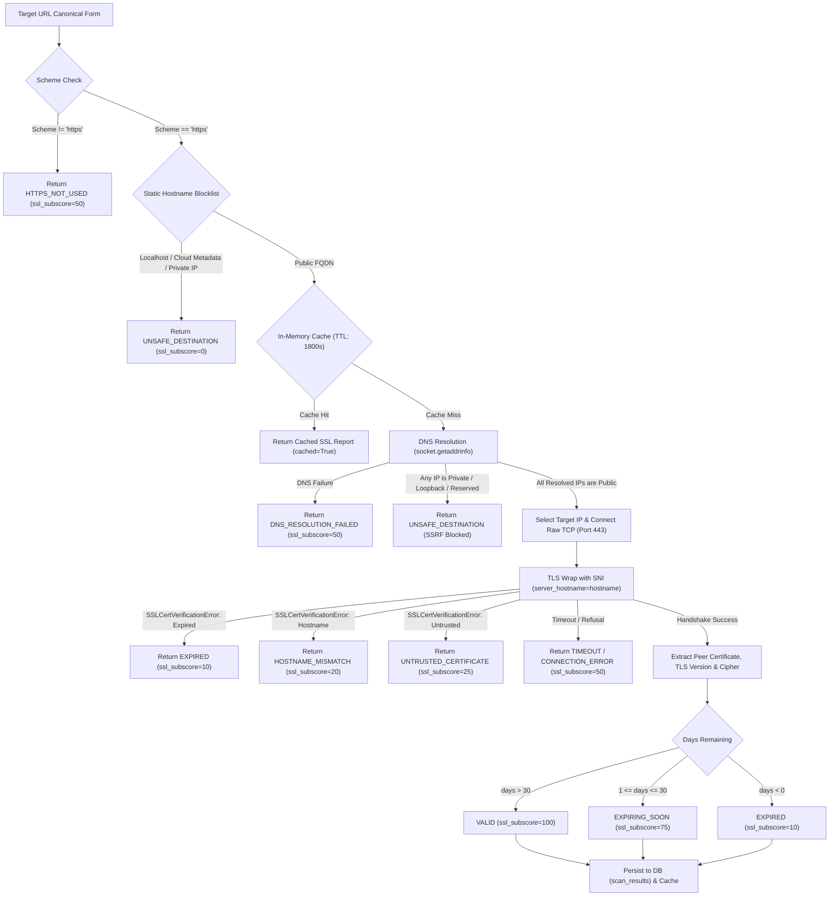

# TrustGuard AI — SSL/TLS Certificate Validation Engine

**Document Version:** 1.0.0  
**Implementation Phase:** Prompt 08 — SSL/TLS Certificate Validation Engine  
**Status:** COMPLETED & VERIFIED  

---

## 1. Architectural Overview & Security Philosophy

The **SSL/TLS Certificate Validation Engine** verifies the transport-layer security and cryptographic identity of web applications submitted to TrustGuard AI.

> [!WARNING]
> **Core Cybersecurity Philosophy: Valid HTTPS $\neq$ Legitimate Website**  
> A valid SSL/TLS certificate proves only two technical properties:
> 1. Traffic in transit between client and server is encrypted.
> 2. The entity controlling the server proved domain control to an automated CA (such as Let's Encrypt or DigiCert).
> 
> Modern phishing campaigns overwhelmingly deploy valid HTTPS certificates via free automated certificate authorities. TrustGuard AI attaches an explicit safety advisory to every SSL report to educate users against equating the green lock icon with business legitimacy.

---

## 2. Secure Network Connection & SSRF Defenses

To prevent TrustGuard AI from being weaponized as an internal network scanner or SSRF proxy:

### 2.1 Hostname Pre-Filtering
- Hostnames are validated statically before any network activity.
- Hardcoded blocks reject: `localhost`, `127.0.0.1`, `169.254.169.254` (AWS/Azure/GCP metadata), `metadata.google.internal`, `instance-data`, and private IPv4/IPv6 blocks.

### 2.2 DNS Resolution Inspection & Rebidding Prevention
1. **Full IP Enumeration:** `socket.getaddrinfo(hostname, 443, socket.AF_UNSPEC, socket.SOCK_STREAM)` resolves all $A$ and $AAAA$ records.
2. **Comprehensive Validation:** Every resolved IP address is verified against RFC 1918 (Private), RFC 3927 (Link-Local), RFC 1122 (Loopback), RFC 5771 (Multicast), and IPv6 Unique Local (`fc00::/7`). If **any** returned IP address is non-public, the connection is aborted immediately with `UNSAFE_DESTINATION`.
3. **Direct-IP Connection with SNI:** The TCP socket connects directly to the validated IP address (`sock.connect((target_ip, 443))`). This guarantees that no secondary DNS resolution takes place during connection establishment, defeating time-of-check-to-time-of-use (TOCTOU) DNS rebinding exploits.
4. **SNI Preservation:** The socket is wrapped using `context.wrap_socket(sock, server_hostname=hostname)`. This transmits the Server Name Indication (SNI) header and verifies the certificate against the intended domain name.

### 2.3 Strict Outbound Constraints
- Only port **443** is accessed.
- No HTTP requests, redirects, or payload downloads are performed.
- Strict connection and handshake timeouts (`settings.SSL_CONNECTION_TIMEOUT = 5.0s`).
- Sockets are guaranteed to close in `finally` blocks.

---

## 3. Certificate Status Classification

| Status | Trigger Criteria | Default Subscore | Security Narrative |
| :--- | :--- | :---: | :--- |
| **`VALID`** | Trusted root CA, matches hostname, $> 30$ days remaining | 100 | Certificate chain is valid and trusted by public authorities. |
| **`EXPIRING_SOON`** | Trusted root CA, matches hostname, $1-30$ days remaining | 75 | Certificate is approaching expiration; renewal required soon. |
| **`EXPIRED`** | Validity end date (`notAfter`) has passed | 10 | SSL certificate has expired; browsers will display warning intersitials. |
| **`HOSTNAME_MISMATCH`** | Hostname does not match certificate SAN / CN | 20 | Certificate was issued for a different domain (possible impersonation). |
| **`UNTRUSTED_CERTIFICATE`**| Self-signed certificate or untrusted private CA root | 25 | Certificate is not trusted by public root certificate authorities. |
| **`TLS_HANDSHAKE_FAILED`** | Protocol negotiation failure or empty certificate | 30 | Server failed to complete cryptographic TLS handshake. |
| **`HTTPS_NOT_USED`** | URL scheme is plain unencrypted `http://` | 50 | Website does not use HTTPS; traffic is vulnerable to interception. |
| **`UNSAFE_DESTINATION`** | Target resolves to internal, private, loopback, or metadata IP | 0 | Target points to non-public network space; blocked by SSRF guard. |
| **`DNS_RESOLUTION_FAILED`**| Hostname could not be resolved via DNS | 50 | Domain does not exist or authoritative nameservers failed to respond. |
| **`TIMEOUT`** | TCP connect or TLS handshake exceeded 5.0 seconds | 50 | Connection timed out while negotiating SSL/TLS. |
| **`CONNECTION_ERROR`** | Port 443 closed or connection refused | 50 | Host is reachable but refused connection on port 443. |
| **`UNKNOWN`** | Unexpected runtime exception during socket inspection | 50 | Certificate evaluation encountered an unexpected condition. |

---

## 4. Telemetry & Protocol Inspection

When a TLS connection succeeds, the engine retrieves:
- **Negotiated Protocol Version:** e.g. `TLSv1.3` (modern, optimal) or `TLSv1.2` (acceptable). Older versions (`TLSv1.0`, `TLSv1.1`, `SSLv3`) trigger automatic score penalties and warnings.
- **Negotiated Cipher Suite:** e.g. `TLS_AES_256_GCM_SHA384`.
- **Issuer & Subject DNs:** Extracted human-readable names (e.g. `"Let's Encrypt (R3)"`, `"DigiCert Inc"`).
- **Exact Timestamps:** UTC timezone-aware `valid_from` and `valid_until`.
- **Calculated `days_remaining`:** Integer counting days until expiration.

---

## 5. In-Memory Performance Caching

To avoid generating repetitive outbound TCP/TLS handshakes on popular domains or frequent user submissions:
- **Cache Store:** In-memory dictionary indexed by normalized lowercase hostname.
- **TTL:** 1,800 seconds (30 minutes).
- **Behavior:** Subsequent scans within the TTL window return the existing evaluation with `cached=True`, completing in sub-millisecond time.

---

## 6. Integration with Primary Scanner (`POST /api/v1/scan`)

The SSL/TLS evaluation is executed concurrently during URL submission in `backend/app/services/scan_service.py`:
- **Response Structure:** Populates `ssl_analysis: Optional[SSLValidationResponse]` inside `URLSubmissionResponse`.
- **Database Persistence:** Automatically updates the corresponding `scan_results` row (`ssl_status`, `ssl_valid`, `ssl_issuer`, `ssl_expiry_date`, `ssl_days_remaining`, `ssl_score`, `ssl_raw`).
- **Fault-Tolerant Isolation:** If a destination experiences a network timeout, connection refusal, or DNS failure during the SSL check, the overall scan continues uninterrupted, returning preliminary heuristic flags, ML phishing predictions, and VirusTotal reputation.

---

## 7. Automated Testing Suite

All 26 test cases in [`backend/tests/test_ssl.py`](file:///d:/HackMatrix'26/backend/tests/test_ssl.py) were executed and verified:
- HTTP scheme immediately yielding `HTTPS_NOT_USED` (0 outbound connections).
- Static SSRF blocks (`localhost`, `127.0.0.1`, `169.254.169.254`, `metadata.google.internal`).
- DNS rebinding SSRF blocks across private IPv4, loopback, link-local, multicast, and IPv6 ranges.
- Validity state evaluations: `VALID` (> 30 days), `EXPIRING_SOON` (15 days), `EXPIRED`.
- Error mapping: `HOSTNAME_MISMATCH`, `UNTRUSTED_CERTIFICATE`, `TIMEOUT`, `CONNECTION_ERROR`, `DNS_RESOLUTION_FAILED`.
- In-memory caching verification (second lookup uses 0 DNS/socket calls).
- Scan API integration (`POST /api/v1/scan`) and error fault-tolerance.

**Full Backend Pytest Status:**  
`94 passed, 1 warning in 3.36s`  
`Ruff Code Quality:` 0 errors, 100% formatted.

