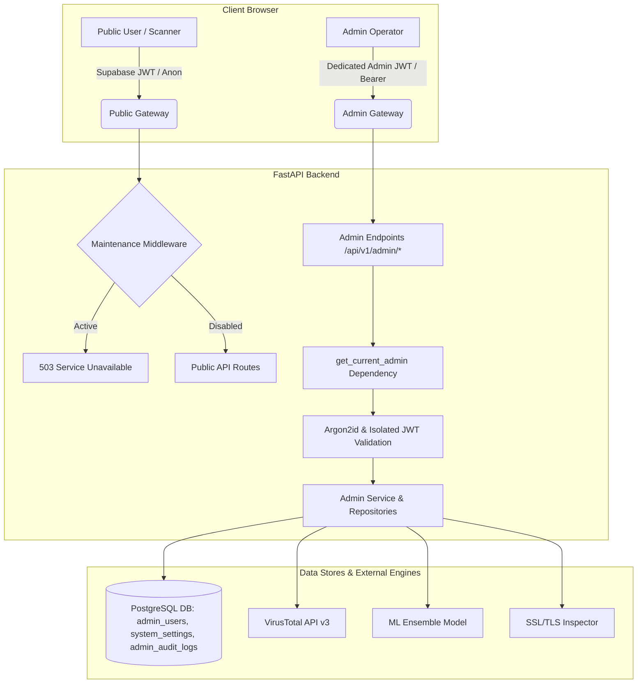

# TrustGuard AI — Administrator Panel Technical Documentation

## Executive Overview
The **TrustGuard AI Admin Panel** is a mission-critical, high-security operational interface providing authorized platform engineers and security analysts with granular oversight and control over users, community threat submissions, IOC threat intelligence feeds, system health diagnostics, and emergency website maintenance controls.

Architected specifically to adhere to the core principles of zero trust, defense-in-depth, and strict data isolation, the Admin Panel operates with separate authentication tokens, cryptographic password hashing (Argon2id), immutable audit logging, and isolated routing structures.

---

## 1. Architectural Architecture & Security Boundaries



### Security Isolation Principles
1. **No Shared JWT Tokens:** Normal users authenticate via Supabase Auth and receive user JWTs. Administrators authenticate via `/api/v1/admin/auth/login` and receive signed JWTs with the explicit payload claim `type: "admin_session"`. The admin dependency `get_current_admin` strictly rejects any token without this claim.
2. **Argon2id Password Hashing:** Admin passwords are never stored in plaintext or weak hashes. They are hashed using `argon2-cffi` adhering to RFC 9106 recommended parameters (memory cost 65536 KiB, time cost 3, parallelism 4).
3. **Dedicated Admin Login Endpoint:** `/admin/login` is completely decoupled from standard public user registration and social authentication (Google Sign-In). Social logins are strictly prohibited from authenticating administrative sessions.
4. **Rate Limiting & Lockout Protection:** The admin authentication gateway tracks consecutive failed attempts per IP and username. After 5 consecutive failures, the target account is locked for 15 minutes, neutralizing automated credential stuffing.
5. **No Public Registration:** Admin accounts cannot be self-registered. They must be provisioned via the secure CLI tool `backend/scripts/create_admin.py` or by an existing `super_admin`.

---

## 2. Administrator Roles & Permissions (RBAC)

| Role | Permissions & Access Scope |
| :--- | :--- |
| **`super_admin`** | Full platform control: User management (suspend/restore), community moderation, maintenance mode toggling, system diagnostics, viewing immutable audit logs, changing passwords. |
| **`security_analyst`** | Threat intelligence feed inspection, scan report analysis, system health monitoring, audit trail review. |
| **`moderator`** | Community threat report review, approval, rejection, duplicate tagging, evidence attachment verification. |

---

## 3. Administrator CLI Provisioning Tool

To create or rotate administrative accounts directly from the server CLI:

```bash
cd backend
# Using project python virtual environment:
.venv\Scripts\python scripts/create_admin.py --username admin --password "TrustGuard@Admin2026!" --role super_admin --email admin@trustguard.ai --name "Principal Administrator"
```

### Parameters:
- `--username`: Unique alphanumeric handle (minimum 3 characters).
- `--password`: Cryptographically strong password (minimum 8 characters).
- `--role`: One of `super_admin`, `security_analyst`, or `moderator`.
- `--email`: Administrative notification email.
- `--name`: Human-readable administrator display name.

---

## 4. Administrative API Specification (`/api/v1/admin`)

All administrative requests (except `/api/v1/admin/auth/login`) must include the HTTP header:
`Authorization: Bearer <tg_admin_token>`

### 4.1. Authentication & Session Management
- `POST /api/v1/admin/auth/login`: Authenticates administrator with username and password. Returns isolated JWT token and user profile.
- `GET /api/v1/admin/auth/me`: Retrieves current authenticated administrator session info.
- `POST /api/v1/admin/auth/logout`: Invalidates client session and records audit event.
- `POST /api/v1/admin/settings/change-password`: Changes administrator password. Requires verification of `current_password` and re-hashes with Argon2id.

### 4.2. Dashboard & Telemetry
- `GET /api/v1/admin/dashboard/stats`: Returns real database aggregations:
  - Total registered users, active vs suspended users.
  - Total completed scans and high-risk URL count.
  - Total community threat reports, pending review count, verified count, and rejected count.
  - Live maintenance mode status.
- `GET /api/v1/admin/dashboard/activity?days=30`: Historical timeline of daily scans, registrations, and report submissions for interactive Recharts visualizations (supports 7, 30, and 90-day intervals).
- `GET /api/v1/admin/dashboard/events?limit=15`: Stream of recent platform security events and audit actions.

### 4.3. User Account Management
- `GET /api/v1/admin/users`: Paginated table of registered users with search, role filter, and active status filters.
- `GET /api/v1/admin/users/{user_id}`: Detailed user record including metadata and recent scan history.
- `POST /api/v1/admin/users/{user_id}/suspend`: Suspends user access with mandatory administrative reason (recorded in audit logs).
- `POST /api/v1/admin/users/{user_id}/restore`: Restores suspended user access with mandatory administrative reason.

### 4.4. Community Threat Report Moderation
- `GET /api/v1/admin/reports`: Moderation queue supporting filters (`PENDING_REVIEW`, `VERIFIED_THREAT`, `REJECTED`, `RESOLVED`, `ALL`), category filter, search, and pagination.
- `GET /api/v1/admin/reports/{report_id}`: Comprehensive report details including submitted URL, normalized domain, submitter details, community upvotes, associated security scan result, and evidence attachments.
- `POST /api/v1/admin/reports/{report_id}/moderate`: Executes moderation decision (`approve`, `reject`, `mark_duplicate`, `archive`) with mandatory public reason and private internal administrator notes.
- `POST /api/v1/admin/reports/bulk-moderate`: Multi-select batch moderation for queue efficiency.

### 4.5. Evidence & Attachment Quarantine Management
- Evidence files (PNG, JPG, WebP, PDF, TXT) are inspected with SHA-256 integrity hashing and file-size validation.
- Potentially malicious attachments or executables are quarantined (`is_quarantined: true`) and sandboxed from direct browser execution.

### 4.6. Threat Intelligence & External Providers
- `GET /api/v1/admin/threat-intelligence/summary`: Live statistics of verified threat indicators, category breakdown, source breakdown, and operational latency probes for external engines (VirusTotal API v3, URLhaus, ML Ensemble).

### 4.7. Website Maintenance Mode
- `GET /api/v1/admin/maintenance`: Fetches current maintenance state, public message, estimated restoration time, and internal rationale.
- `POST /api/v1/admin/maintenance`: Toggles maintenance mode and updates configuration in PostgreSQL `system_settings`.
- `GET /api/v1/maintenance/status`: Public lightweight unauthenticated endpoint returning current maintenance status.
- **Gateway Enforcement:** When maintenance mode is active, `maintenance_mode_middleware` in `backend/app/main.py` intercepts all incoming public traffic and returns HTTP 503 `{"maintenance": true, "message": "...", "estimated_restore_time": "..."}`. Administrative routes (`/api/v1/admin/*`, `/api/v1/maintenance/status`, and `/api/v1/health`) bypass this block.

### 4.8. System Health Diagnostics
- `GET /api/v1/admin/system/health`: Conducts real, live diagnostic probes across:
  - FastAPI application process.
  - PostgreSQL database connectivity and query latency.
  - Supabase authentication service.
  - VirusTotal v3 API key validity and reachability.
  - Machine learning classification engine.
  - SSL/TLS certificate inspector socket.

### 4.9. Administrator Audit Logging
- `GET /api/v1/admin/audit-logs`: Immutable audit log query engine with filters for operator, action type, outcome, and date ranges. Every administrative action writes an append-only entry with client IP, timestamp, action type, target resource, and JSON payload.

---

## 5. Frontend Admin Route Map

| URL Route | Component | Guard / Access Level |
| :--- | :--- | :--- |
| `/admin/login` | `AdminLoginPage` | Public (Admin credentials required) |
| `/admin` | `AdminDashboardPage` | `ProtectedAdminRoute` (`tg_admin_token`) |
| `/admin/users` | `AdminUsersPage` | `ProtectedAdminRoute` |
| `/admin/reports` | `AdminReportsPage` | `ProtectedAdminRoute` |
| `/admin/reports/:reportId`| `AdminReportDetailPage` | `ProtectedAdminRoute` |
| `/admin/threat-intelligence` | `AdminThreatIntelPage` | `ProtectedAdminRoute` |
| `/admin/system` | `AdminSystemHealthPage` | `ProtectedAdminRoute` |
| `/admin/maintenance` | `AdminMaintenancePage` | `ProtectedAdminRoute` |
| `/admin/audit-logs` | `AdminAuditLogsPage` | `ProtectedAdminRoute` |
| `/admin/settings` | `AdminSettingsPage` | `ProtectedAdminRoute` |

---

## 6. Monochromatic UI & Design System

The Admin Panel adheres strictly to the TrustGuard AI monochromatic aesthetic:
- **Base Canvas:** Deep Black (`#080808` / `#050505`).
- **Cards & Containers:** Dark Charcoal (`#111111` / `#0e0e0e`) with refined borders (`#222222` / `#2a2a2a`).
- **Typography:** Monospaced Geist / Inter tabular numbers with crisp tracking and high-contrast white text (`#FFFFFF`, `#E5E5E5`, `#A1A1A1`).
- **Status Accents:** Monochrome badges with subtle contextual tints for high-severity alerts (`#4ade80` for operational/verified, `#f87171` for high risk/critical, `#fbbf24` for pending/degraded).
- **Responsive Layout:** Fixed desktop sidebar navigation with dynamic mobile slide-out drawer, quick links to public scanner, and instant logout.

