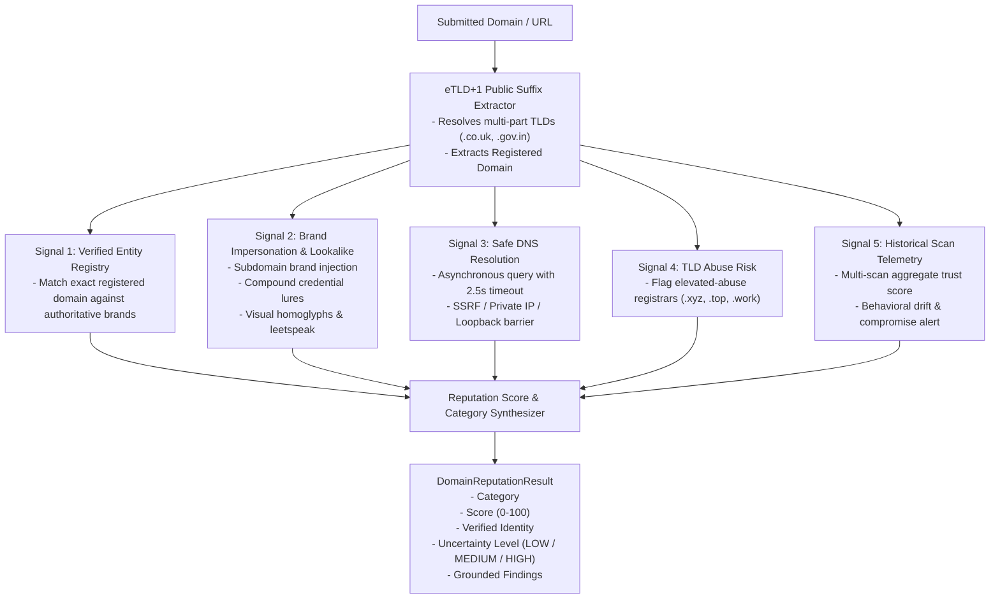

# TrustGuard AI — Domain Reputation & Brand Identity Intelligence Engine

## 1. Overview & Operational Principles
The **Domain Reputation Intelligence Engine** (`DomainReputationService`) provides evidence-based identity attribution, brand impersonation detection, and historical reputation stability tracking.

### Core Operating Principles:
1. **Popularity Does Not Prove Safety**: High traffic volume or well-known names do not immunize a domain from subdomain takeover, open redirects, or compromised WordPress plugins.
2. **New Registrations Do Not Prove Malice**: Millions of legitimate businesses and personal blogs launch daily. Novelty is an uncertainty indicator, not proof of guilt.
3. **Unfamiliarity Is Treated as Uncertainty**: Unindexed websites without threat records receive neutral scores accompanied by calibrated uncertainty warnings rather than punitive downgrades.
4. **Exact Registered Domain (eTLD+1) Is The True Security Boundary**: An attacker controlling `attacker.com` can create `google.com.attacker.com` or `paypal.account-verify.attacker.com`. TrustGuard AI resolves through multi-part public suffixes (`.co.uk`, `.gov.in`, `.com.au`) to evaluate the true registered entity.

---

## 2. Multi-Signal Pipeline & Architecture

---

## 3. Registered Domain (eTLD+1) Extraction

Standard string splitting at the last dot fails on international and organizational domains (e.g., `amazon.co.uk` would incorrectly extract `co.uk` as the domain and `amazon` as the subdomain).

TrustGuard AI implements multi-part public suffix extraction supporting:
- `.co.uk`, `.gov.uk`, `.ac.uk`, `.org.uk`
- `.com.au`, `.gov.au`, `.edu.au`
- `.co.in`, `.gov.in`, `.ac.in`, `.org.in`
- `.co.jp`, `.ne.jp`, `.go.jp`
- `.com.br`, `.gov.br`
- `.gc.ca`, `.fed.us`, `.europa.eu`

### Security Example:
- Input: `https://login.paypal.com.account-update.xyz/signin`
  - FQDN Hostname: `login.paypal.com.account-update.xyz`
  - Registered Domain: `account-update.xyz`
  - Result: Flagged immediately as **Brand Impersonation Risk** targeting PayPal on unrelated third-party infrastructure.

---

## 4. Protected Brand Target Registry & Impersonation Heuristics

TrustGuard AI protects globally recognized enterprises, financial institutions, and platforms from credential-harvesting impersonation:

### 4.1 Protected Brands
- **Search & Productivity**: Google (`google.com`, `google.co.uk`, `youtube.com`, `gmail.com`), Microsoft (`microsoft.com`, `live.com`, `office.com`, `azure.com`), Apple (`apple.com`, `icloud.com`).
- **Financial Services**: PayPal (`paypal.com`), Stripe (`stripe.com`), JPMorgan Chase (`chase.com`), Bank of America (`bankofamerica.com`), Wells Fargo (`wellsfargo.com`).
- **Cloud & Development**: GitHub (`github.com`), Amazon (`amazon.com`), Cloudflare (`cloudflare.com`), OpenAI (`openai.com`).
- **Media & Streaming**: Netflix (`netflix.com`), Spotify (`spotify.com`), LinkedIn (`linkedin.com`), Reddit (`reddit.com`).

### 4.2 Impersonation Detection Modes
1. **Subdomain Brand Infiltration**: When a brand name appears inside the subdomain levels of an unrelated registered domain (e.g. `chase.com.security-alert.net`).
2. **Compound Lure Squatting**: When a brand keyword is hyphenated with urgent credential lures in the registered domain root (e.g. `paypal-security-update.club`, `google-verify-account.info`).
3. **Homoglyph & Leetspeak Replacement**: Non-ASCII Cyrillic homoglyphs (`pаypal.com`) and numeral substitutions (`paypa1.com`, `micros0ft.com`).

When impersonation is confirmed, the engine sets:
- `category = "IMPERSONATION_RISK"`
- `reputation_score = 15`
- `is_lookalike_or_impersonation = True`
- `impersonated_brand = "<target_brand>"`
- Triggers **Rule E High-Severity Override** in the Digital Trust Score Synthesizer (forcing Risk $\ge 85$).

---

## 5. Reputation Categories & Score Calibration

| Category | Typical Score | Description | Uncertainty Level |
|---|:---:|---|:---:|
| `VERIFIED_ESTABLISHED` | 90 - 100 | Authoritative registered infrastructure of a verified global institution | LOW |
| `NEUTRAL_UNFAMILIAR` | 40 - 65 | Legitimate unindexed website without threat records or brand conflicts | HIGH |
| `IMPERSONATION_RISK` | 10 - 25 | Deceptive lookalike or lure domain mimicking a protected enterprise | LOW |
| `CONFIRMED_MALICIOUS` | 0 - 10 | SSRF violation, confirmed malware/phishing blocklist match, or malicious history | LOW |
| `SUSPICIOUS_PATTERN` | 20 - 35 | Elevated abuse TLD combined with unresolvable DNS or behavioral drift | MEDIUM |

---

## 6. Historical Scan Telemetry & Behavioral Drift Detection

The engine queries historical scan records from Supabase (`get_scans_by_domain`):
- **Stable Clean**: $\ge 3$ past scans with average trust score $\ge 80$ and 0 past threat detections.
- **Historically Malicious**: $\ge 50\%$ of historical scans flagged as HIGH or CRITICAL risk.
- **Behavioral Drift (Compromised Site Alert)**: If a historically clean domain suddenly triggers active phishing indicators or malware signatures, the engine issues an urgent warning:
  > *"Behavioral Shift Detected: Domain has a previously clean scan history, but current scan displays active phishing indicators. Investigating potential account takeover or new malicious campaign."*

