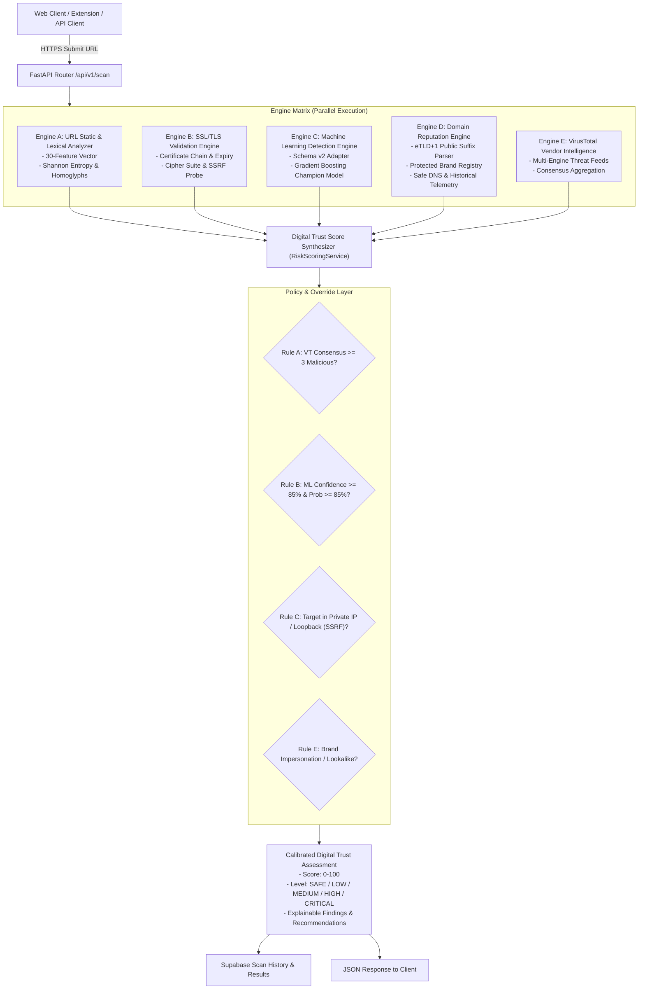

# TrustGuard AI — ML Intelligence & Multi-Signal Architecture

## 1. Executive Summary & Philosophy
TrustGuard AI is an enterprise-grade digital threat intelligence and website security platform designed to evaluate and quantify online trust. Rather than relying on fragile single-point keyword heuristics or brittle black-box classifiers, TrustGuard AI deploys a **Multi-Signal Defense-in-Depth Architecture**. 

The system treats website security as a multi-dimensional synthesis problem combining:
1. **Domain Reputation Intelligence**: Authoritative registered domain extraction (eTLD+1), verified organizational registry matching, brand impersonation/lookalike detection, and historical scan telemetry.
2. **Lexical & Statistical URL Intelligence**: 30 high-order structural and information-theoretic features, including Shannon entropy, character distribution ratios, and homoglyph detection.
3. **Machine Learning Classifier (Champion: Gradient Boosting)**: A high-precision classifier trained to identify evasive phishing campaigns with calibrated probability outputs and zero false positives on verified baselines.
4. **Technical Infrastructure & Cryptography**: Live SSL/TLS certificate validation, public key pinning, DNS hygiene, and Server-Side Request Forgery (SSRF) boundary enforcement.
5. **Global Threat Vendor Intelligence**: Live querying of VirusTotal engine telemetry with multi-scanner agreement consensus.

---

## 2. Architectural Diagram

---

## 3. Schema v2: 30-Dimensional Feature Matrix

TrustGuard AI's URL feature extraction pipeline extracts 30 orthogonal structural, lexical, and statistical dimensions from any normalized URL:

| # | Feature Name | Type | Description | Security Significance |
|---|--------------|------|-------------|-----------------------|
| 1 | `url_length` | Integer | Total character count of full URL | Phishing URLs often use elongated query paths to obscure destinations |
| 2 | `hostname_length` | Integer | Total character count of FQDN | Long hostnames often indicate dynamic DNS or multi-level subdomain masking |
| 3 | `path_length` | Integer | Character count of URL path | Complex nested paths mimic genuine corporate directories |
| 4 | `path_depth` | Integer | Number of directory slash delimiters `/` | Deep directory structures are common in phishing kits |
| 5 | `dot_count` | Integer | Count of `.` characters in URL | Excess dots indicate multi-subdomain spoofing |
| 6 | `hyphen_count` | Integer | Count of `-` characters | Hyphens are frequently used to combine brand names with lure terms |
| 7 | `underscore_count` | Integer | Count of `_` characters | High underscore counts occur in auto-generated phishing scripts |
| 8 | `digit_count` | Integer | Count of numerical digits `0-9` | Random hashes or IP obfuscation increase numerical frequency |
| 9 | `special_char_count` | Integer | Count of non-alphanumeric symbols | Obfuscation tokens, escaped symbols, and query parameters |
| 10 | `subdomain_count` | Integer | Subdomain levels above registered domain | Dynamic DNS and subdomain hijacking indicators |
| 11 | `query_param_count` | Integer | Number of parsed query parameters | Tracking tokens and session harvesting parameters |
| 12 | `uses_https` | Binary (0/1) | HTTPS scheme present | While modern phishing uses HTTPS, HTTP remains an instant security defect |
| 13 | `is_ip_address` | Binary (0/1) | Hostname is raw IPv4/IPv6 address | Raw IP hosting bypasses domain registration scrutiny and reputation systems |
| 14 | `is_shortened` | Binary (0/1) | Known URL shortener service (bit.ly, etc.) | Masking true destinations from endpoint security scanners |
| 15 | `contains_suspicious_keywords` | Binary (0/1) | Authentication/lure keywords present | e.g., `login`, `verify`, `banking`, `security`, `signin` |
| 16 | `suspicious_keyword_count` | Integer | Frequency count of detected lure keywords | Compound lures (e.g. `login-verify-account`) increase attack likelihood |
| 17 | `excessive_subdomains` | Binary (0/1) | Subdomain depth $\ge 3$ | Circumvents standard domain visibility |
| 18 | `has_at_symbol` | Binary (0/1) | `@` character present in authority string | Causes browsers to discard preceding authority, navigating to fake host |
| 19 | `has_double_slash_in_path` | Binary (0/1) | `//` present in path segment | Open redirect evasion trick |
| 20 | `has_punycode` | Binary (0/1) | `xn--` IDN prefix present | Masks non-ASCII characters visually identical to standard Latin letters |
| 21 | `has_suspicious_tld` | Binary (0/1) | High-abuse TLD (`.xyz`, `.top`, `.club`, etc.) | Low-cost registrars with disproportionately high malware hosting density |
| 22 | `has_non_standard_port` | Binary (0/1) | Port outside 80/443 specified | Backdoor services, unauthorized web servers |
| 23 | `has_brand_in_subdomain` | Binary (0/1) | Brand name in subdomain of 3rd party host | Classic credential masquerade (e.g., `paypal.com.account-update.info`) |
| 24 | `url_entropy` | Float | Shannon entropy $H(X)$ of full URL string | Measures lexical randomness and algorithmic generation |
| 25 | `hostname_entropy` | Float | Shannon entropy $H(X)$ of hostname | Distinguishes human-selected domains from DGA algorithmic domains |
| 26 | `digit_letter_ratio` | Float | Ratio of digits to alphabetic characters | High ratio indicates machine-generated hash structures |
| 27 | `vowel_consonant_ratio` | Float | Ratio of vowels to consonants | Natural language domains follow distinct phonetic vowel ratios |
| 28 | `has_homograph` | Binary (0/1) | Mixed script or character substitutions | Cyrillic/Greek substitutions (`pаypal.com`) and leetspeak (`paypa1`) |
| 29 | `has_hex_encoding` | Binary (0/1) | Percent-encoded hex tokens (`%20`, `%2e`) | Obfuscating malicious characters from string filters |
| 30 | `tld_in_path` | Binary (0/1) | TLD string embedded inside URL path | e.g. `/secure/paypal.com/auth` to fool mobile address bar previews |

---

## 4. Mathematical Formulations

### 4.1 Shannon Entropy Calculation
For a character sequence $S$ of length $N$, let $c_i$ be the unique characters in $S$, and $p(c_i) = \frac{\text{count}(c_i)}{N}$ be their empirical probability:

$$H(S) = -\sum_{i=1}^{k} p(c_i) \log_2 p(c_i)$$

- Natural language domain names typically exhibit $H(\text{hostname}) \in [2.0, 3.2]$.
- Algorithmic DGA domains and obfuscated tokens exhibit $H(\text{hostname}) > 3.6$.

### 4.2 Composite Digital Trust Score
When all modules are active, the composite risk score $R_{\text{raw}}$ is computed as:

$$R_{\text{raw}} = \sum_{m \in M} w_m \cdot R_m$$

Where weights $w_m$ normalize dynamically across available telemetry providers:
- **VirusTotal Threat Intelligence**: 40% ($w_{\text{vt}} = 0.40$)
- **Machine Learning Phishing Classifier**: 30% ($w_{\text{ml}} = 0.30$)
- **URL Lexical Heuristics**: 15% ($w_{\text{url}} = 0.15$)
- **SSL/TLS Certificate Security**: 15% ($w_{\text{ssl}} = 0.15$)

If a module is rate-limited or unavailable, its weight is proportionally redistributed to active engines:

$$w'_m = \frac{w_m}{\sum_{k \in M_{\text{active}}} w_k}$$

The baseline Digital Trust Score is derived from the synthesized risk:

$$\text{TrustScore} = \max(0, \min(100, 100 - R_{\text{raw}}))$$

### 4.3 High-Severity Safety Overrides
Regardless of individual module weights, critical threat patterns trigger non-negotiable floor overrides:
- **Rule A (Consensus Threat)**: $\ge 3$ VirusTotal security vendors confirm malicious $\implies R = 100$, TrustScore $\le 5$.
- **Rule B (High-Confidence ML)**: ML Phishing Probability $\ge 0.85$ with High Confidence $\implies R \ge 75$, TrustScore $\le 25$.
- **Rule C (SSRF Boundary)**: Target resolves to loopback (`127.0.0.0/8`), private (`10.0.0.0/8`, `192.168.0.0/16`, `172.16.0.0/12`), or cloud metadata (`169.254.169.254`) $\implies R = 100$, TrustScore $= 0$.
- **Rule E (Brand Impersonation)**: Unregistered domain mimics a protected enterprise entity $\implies R \ge 85$, TrustScore $\le 15$.

---

## 5. Defense-in-Depth & SSRF Protection
The Domain Reputation and SSL Validation services enforce strict asynchronous DNS resolution safeguards:
1. Every DNS lookup runs within a bounded timeout ($2.5\text{s}$) inside a non-blocking threadpool.
2. Every returned IP address is checked against `ipaddress.ip_address(ip).is_private` and `is_loopback`.
3. Requests targeting internal service ports or cloud credentials endpoints are aborted prior to socket connection, preventing internal network exposure.

