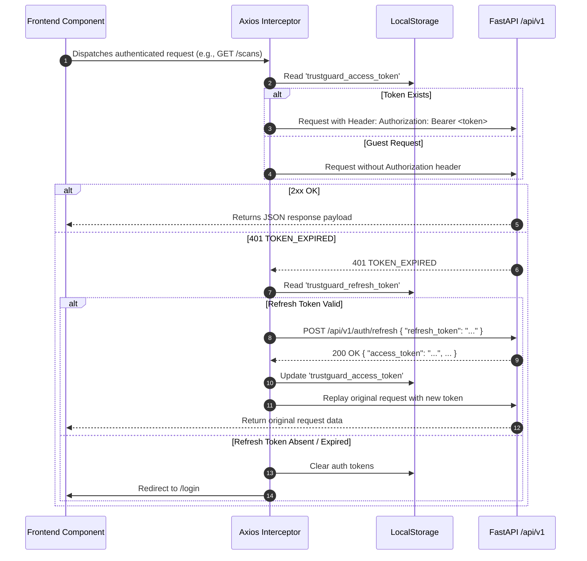

# TrustGuard AI — Frontend-to-Backend API Integration Map

**API Protocol:** REST (JSON) over HTTP/HTTPS  
**API Version Prefix:** `/api/v1`  
**Frontend Base URL Variable:** `VITE_API_BASE_URL` (default: `http://localhost:8000/api/v1`)  
**Client Authentication:** Bearer JWT in `Authorization` header (`Authorization: Bearer <access_token>`)  
**Standard Error Envelope:**
```json
{
  "error": {
    "code": "ERROR_CODE_STRING",
    "message": "Human-readable explanation of the issue."
  }
}
```

---

## 1. Architectural Integration Principles

1. **Strict Contract Preservation:**
   - The frontend communicates exclusively via typed API services (`apiClient` in `src/services/api.ts`).
   - All response and request models are mirrored in `src/types/` without ad-hoc inline schemas.
2. **Graceful Degradation over Fabrication:**
   - When external threat intelligence (e.g. VirusTotal) is unconfigured or rate-limited, the UI renders explicit **`UNAVAILABLE`** states rather than fabricated clean statistics.
   - When the Machine Learning model is unavailable or yields `UNKNOWN`, the UI displays **`MODEL UNAVAILABLE`** with no confidence rating, rather than defaulting to `BENIGN`.
   - When assessment coverage is $< 45\%$, the UI renders an **`INSUFFICIENT DATA`** notice and omits synthetic numeric trust scores.
3. **Decoupled Future Backend Extensibility:**
   - Optional modular sections (`virustotal_findings`, `ml_phishing_prediction`, `ssl_tls_validation`) are nullable. Adding new inspection engines (e.g., DNSSEC, WHOIS age) will extend the composite models without breaking existing view components.

---

## 2. Authentication & Session Management

All authenticated requests attach `Authorization: Bearer <token>` through an Axios request interceptor. 401 token expirations trigger automatic silent token refresh via `POST /api/v1/auth/refresh`.



---

## 3. Detailed Endpoint Contracts by Domain

### Domain 1: URL Scan Submission

#### `POST /api/v1/scan`
- **Frontend Service:** `scanService.submitScan(url: string, signal?: AbortSignal)`
- **Access Level:** Public / Optional Authentication (Guests allowed; authenticated user ID bound automatically via JWT).
- **Request Headers:**
  - `Content-Type: application/json`
  - `Authorization: Bearer <access_token>` *(optional)*
- **Request Schema (`ScanCreate`):**
  ```typescript
  interface ScanCreatePayload {
    url: string;      // 4 to 2048 chars, must begin with http:// or https://
    guest?: boolean;  // default: false (server infers guest status from token presence)
  }
  ```
- **Response Schema `201 Created` (`URLSubmissionResponse`):**
  ```typescript
  interface URLSubmissionResponse {
    success: boolean;                   // true
    scan_id: string;                     // UUID v4
    original_url: string;                // "https://google.com"
    normalized_url: string;              // "https://google.com/"
    validation_status: "VALID" | "SUSPICIOUS" | "INVALID";
    is_guest: boolean;
    preliminary_analysis: {
      risk_level: "LOW_CONCERN" | "MODERATE_CONCERN" | "HIGH_CONCERN" | "INSUFFICIENT_INFORMATION";
      indicators: Array<{
        name: string;
        description: string;
        severity: "low" | "medium" | "high" | "critical";
        evidence: string;
        reason: string;
      }>;
      features: Record<string, any>;     // 23 lexical & structural features
    };
    ml_prediction?: {
      prediction: "PHISHING" | "SUSPICIOUS" | "LIKELY_LEGITIMATE" | "UNKNOWN" | "MODEL_UNAVAILABLE";
      phishing_probability: number | null; // 0.0 to 1.0 (null if unavailable)
      ml_subscore: number | null;          // 0 to 100 (null if unavailable)
      confidence: "HIGH" | "MEDIUM" | "LOW" | "INSUFFICIENT";
      model_version: string;               // e.g. "rf-v1.0.0"
      model_status: "ACTIVE" | "MODEL_UNAVAILABLE" | "ERROR";
      indicators: string[];
      top_feature_importance?: Record<string, number> | null;
      summary: string;
    };
    ssl_analysis?: {
      status: "VALID" | "EXPIRING_SOON" | "EXPIRED" | "HOSTNAME_MISMATCH" | "UNTRUSTED_CERTIFICATE" | "TLS_HANDSHAKE_FAILED" | "DNS_RESOLUTION_FAILED" | "UNSAFE_DESTINATION" | "HTTPS_NOT_USED" | "TIMEOUT" | "CONNECTION_ERROR" | "UNKNOWN";
      https_enabled: boolean;
      hostname: string;
      certificate_subject?: string | null;
      certificate_issuer?: string | null;
      days_remaining?: number | null;
      tls_version?: string | null;
      ssl_subscore: number;                // 0 to 100
      message?: string;
    };
    trust_assessment?: {
      digital_trust_score: number | null;  // 0 to 100 (null if INSUFFICIENT_DATA)
      risk_score: number | null;           // 0 to 100 (null if INSUFFICIENT_DATA)
      risk_level: "SAFE" | "LOW" | "MEDIUM" | "HIGH" | "CRITICAL" | "UNKNOWN";
      risk_label: string;                  // e.g. "LOW RISK", "INSUFFICIENT DATA"
      assessment_status: "COMPLETE" | "PARTIAL" | "INSUFFICIENT_DATA";
      assessment_coverage: number;         // 0.0 to 1.0
      coverage_percentage: number;         // 0 to 100
      scoring_version: string;             // "v1.0.0"
      high_severity_override: boolean;
      override_reason?: string | null;
      summary?: string;
      recommendations: string[];
    };
    digital_trust_score?: number | null;   // Convenience top-level mirror
    risk_level?: string | null;            // Convenience top-level mirror
    message: string;
    submitted_at: string;                  // ISO 8601
  }
  ```
- **Error Responses:**
  - `422 INVALID_URL`: Submitted string is malformed or exceeds 2048 characters.
  - `422 SSRF_BLOCKED`: URL resolves to loopback (`127.0.0.1`), private RFC 1918 space (`10.0.0.0/8`, `192.168.0.0/16`), or cloud metadata (`169.254.169.254`).
  - `429 RATE_LIMIT_EXCEEDED`: Exceeded 5 scans/minute for this client IP.

---

### Domain 2: Scan Status & Engine Readiness

#### `GET /api/v1/scan/status`
- **Frontend Service:** `scanService.getScanStatus(signal?: AbortSignal)`
- **Access Level:** Public
- **Response Schema `200 OK`:**
  ```json
  {
    "message": "Scanner engine online. URL validation, normalisation, and static feature extraction active.",
    "status": "ready"
  }
  ```

#### `GET /api/v1/health`
- **Access Level:** Public
- **Response Schema `200 OK`:**
  ```json
  {
    "app_name": "TrustGuard AI",
    "app_version": "0.1.0",
    "status": "healthy",
    "environment": "development",
    "database": "connected"
  }
  ```

---

### Domain 3: Scan Report Retrieval & Export

#### `GET /api/v1/scan/{scan_id}`
- **Frontend Service:** `scanService.getScanById(scanId: string)`
- **Access Level:** Public for guest scans; Owner-only for registered scans.
- **Path Parameters:** `scan_id` (UUID v4)
- **Response Schema `200 OK` (`ScanDetailResponse`):**
  ```typescript
  interface ScanDetailResponse {
    scan: {
      id: string;
      user_id?: string | null;
      submitted_url: string;
      normalized_url: string;
      domain?: string | null;
      scan_status: "pending" | "processing" | "complete" | "error";
      risk_level?: string | null;
      trust_score?: number | null;
      risk_score?: number | null;
      assessment_status?: string | null;
      assessment_coverage?: number | null;
      scoring_version?: string | null;
      is_guest: boolean;
      created_at: string;
      completed_at?: string | null;
    };
    result?: {
      id: string;
      scan_id: string;
      trust_score: number;
      overall_risk_level: string;
      phishing_probability?: number | null;
      ml_prediction?: string | null;
      ml_score?: number | null;
      ml_features?: Record<string, any> | null;
      virustotal_detection_count?: number | null;
      virustotal_total_engines?: number | null;
      threat_intelligence_status?: string | null;
      vt_score?: number | null;
      ssl_status?: string | null;
      ssl_valid?: boolean | null;
      ssl_issuer?: string | null;
      ssl_expiry_date?: string | null;
      ssl_days_remaining?: number | null;
      ssl_score?: number | null;
      url_score?: number | null;
      score_breakdown: Record<string, any>;
      analysis_summary?: string | null;
      created_at: string;
    } | null;
  }
  ```
- **Error Codes:** `404 SCAN_NOT_FOUND`, `403 FORBIDDEN`

#### `GET /api/v1/scans/{scan_id}`
- **Frontend Service:** `scanService.getDetailedReport(scanId: string)`
- **Access Level:** Public for guest scans; Owner-only for user scans.
- **Response Schema `200 OK` (`DetailedSecurityReportResponse`):**
  ```typescript
  interface DetailedSecurityReport {
    scan_id: string;
    original_url: string;
    normalized_url: string;
    domain: string;
    is_guest: boolean;
    scan_status: string;
    digital_trust_score?: number | null;
    risk_score?: number | null;
    risk_level?: "SAFE" | "LOW" | "MEDIUM" | "HIGH" | "CRITICAL" | "UNKNOWN";
    risk_label?: string | null;
    assessment_status?: "COMPLETE" | "PARTIAL" | "INSUFFICIENT_DATA" | null;
    assessment_coverage?: number | null;
    coverage_percentage?: number | null;
    high_severity_override: boolean;
    override_reason?: string | null;
    scoring_version?: string | null;
    model_version?: string | null;
    submitted_at: string;
    completed_at?: string | null;
    summary?: string | null;
    recommendations: string[];
    risk_indicators: Array<{
      title: string;
      description: string;
      source_module: string;
      severity: "critical" | "high" | "medium" | "low" | "info";
      evidence?: string | null;
      affects_score: boolean;
      explanation?: string | null;
    }>;
    positive_indicators: Array<{ ... }>;
    unknown_indicators: Array<{ ... }>;
    module_scores?: Record<string, any>;
    url_analysis?: Record<string, any> | null;
    virustotal_findings?: Record<string, any> | null;
    ml_phishing_prediction?: Record<string, any> | null;
    ssl_tls_validation?: Record<string, any> | null;
  }
  ```

#### `GET /api/v1/scans/{scan_id}/export`
- **Frontend Service:** `scanService.exportScanReport(scanId: string)`
- **Response Schema `200 OK` (`ExportableSecurityReport`):** Sanitized portable JSON document for client-side download without internal database IDs.

#### `GET /api/v1/scans/export/csv`
- **Frontend Service:** `scanService.exportHistoryCsv(signal?: AbortSignal)`
- **Access Level:** Authenticated owner only (`Bearer <token>`).
- **Response Media Type:** `text/csv; charset=utf-8`
- **Headers:** `Content-Disposition: attachment; filename="trustguard-scan-history-YYYY-MM-DD.csv"`
- **Security Protections:** Formula injection neutralization (prepends single quote `'` to cells starting with `=`, `+`, `-`, `@`, `\t`, `\r`).
- **CSV Headers:** `Scan ID`, `Original URL`, `Normalized Domain`, `Scan Date & Time (UTC)`, `Trust Score`, `Risk Classification`, `Phishing Risk`, `SSL/TLS Status`, `Scan Status`.
- **Response Format:** RFC-4180 compliant CSV stream containing all scans owned by the authenticated user.

#### `DELETE /api/v1/scans/{scan_id}`
- **Frontend Service:** `scanService.deleteScan(scanId: string)`
- **Access Level:** Authenticated owner only (`Bearer <token>`).
- **Response Schema `200 OK`:** `{ "success": true, "scan_id": string, "message": string, "deleted_at": string }`
- **Error Codes:** `403 FORBIDDEN` (Attempting to delete another user's scan), `404 SCAN_NOT_FOUND`.

---

### Domain 4: Authentication & User Session

All session endpoints interface with Supabase Auth and manage user profile records.

| Method | Path | Request Body | Response Status & Key Fields | Error Codes |
| :--- | :--- | :--- | :--- | :--- |
| `POST` | `/api/v1/auth/register` | `{ email, password, full_name? }` | `201 Created` $\rightarrow$ `{ access_token, refresh_token, user }` | `409 USER_ALREADY_EXISTS`, `422 VALIDATION_ERROR` |
| `POST` | `/api/v1/auth/login` | `{ email, password }` | `200 OK` $\rightarrow$ `{ access_token, refresh_token, user }` | `401 INVALID_CREDENTIALS`, `403 EMAIL_NOT_CONFIRMED` |
| `POST` | `/api/v1/auth/logout` | None (Bearer header) | `200 OK` $\rightarrow$ `{ message, status: "success" }` | `401 UNAUTHORIZED` |
| `POST` | `/api/v1/auth/refresh` | `{ refresh_token }` | `200 OK` $\rightarrow$ `{ access_token, refresh_token, user }` | `401 TOKEN_EXPIRED`, `401 INVALID_TOKEN` |
| `GET` | `/api/v1/auth/me` | None (Bearer header) | `200 OK` $\rightarrow$ `{ id, email, full_name, avatar_url, role }` | `401 UNAUTHORIZED` |
| `POST` | `/api/v1/auth/forgot-password` | `{ email }` | `200 OK` $\rightarrow$ `{ message, status: "success" }` | None (Enumeration safe) |
| `POST` | `/api/v1/auth/reset-password` | `{ new_password }` | `200 OK` $\rightarrow$ `{ message: "Password successfully updated" }` | `401 UNAUTHORIZED` |
| `POST` | `/api/v1/auth/resend-verification` | `{ email }` | `200 OK` $\rightarrow$ `{ message, success: true }` | `429 RATE_LIMIT_EXCEEDED` |
| `GET` | `/api/v1/auth/oauth/google` | Query: `redirect_to?` | `200 OK` $\rightarrow$ `{ url, provider: "google" }` | `502 EXTERNAL_SERVICE_ERROR` |
| `POST` | `/api/v1/auth/oauth/callback` | `{ code?, access_token?, refresh_token? }` | `200 OK` $\rightarrow$ `{ access_token, refresh_token, user }` | `401 INVALID_TOKEN` |
| `GET` | `/api/v1/users/me` | None (Bearer header) | `200 OK` $\rightarrow$ `{ id, email, full_name, avatar_url, scan_count, is_active, threat_digest_enabled, created_at, updated_at }` | `401 UNAUTHORIZED` |
| `PATCH` | `/api/v1/users/me` | `{ full_name?, avatar_url?, threat_digest_enabled? }` | `200 OK` $\rightarrow$ `{ id, email, full_name, avatar_url, scan_count, is_active, threat_digest_enabled, created_at, updated_at }` | `401 UNAUTHORIZED`, `422 VALIDATION_ERROR` |
| `GET` | `/api/v1/users/me/notifications` | None (Bearer header) | `200 OK` $\rightarrow$ `{ threat_digest_enabled, email, updated_at, provider_configured }` | `401 UNAUTHORIZED` |
| `PATCH` | `/api/v1/users/me/notifications` | `{ threat_digest_enabled }` | `200 OK` $\rightarrow$ `{ threat_digest_enabled, email, updated_at, provider_configured }` | `401 UNAUTHORIZED`, `422 VALIDATION_ERROR` |

---

### Domain 5: Scan History & Analytics

#### `GET /api/v1/scans`
- **Access Level:** Authenticated user only (`Bearer <token>`).
- **Query Parameters:**
  - `page`: integer (default: 1)
  - `page_size`: integer (default: 10, max: 100)
  - `search`: string (case-insensitive substring filter for domain, submitted_url, normalized_url)
  - `risk_level`: string (`LOW_RISK`, `MODERATE_RISK`, `HIGH_RISK`, `CRITICAL_RISK`, `INSUFFICIENT_DATA`)
  - `assessment_status`: string (`COMPLETE`, `PARTIAL`, `INSUFFICIENT_DATA`)
  - `date_filter`: string (`today`, `last_7_days`, `last_30_days`)
  - `sort_by`: string (`newest`, `oldest`, `highest_score`, `lowest_score`, `created_at`, `trust_score`)
  - `sort_order`: string (`asc`, `desc`)
- **Response Schema `200 OK` (`PaginatedScanHistoryResponse`):**
  ```typescript
  interface PaginatedScanHistoryResponse {
    total_items: number;
    total_pages: number;
    current_page: number;
    page_size: number;
    has_next: boolean;
    has_prev: boolean;
    items: Array<{
      scan_id: string;
      domain?: string | null;
      submitted_url: string;
      normalized_url: string;
      scan_status: "pending" | "processing" | "complete" | "error";
      digital_trust_score?: number | null;
      risk_score?: number | null;
      risk_level?: string | null;
      risk_label?: string | null;
      assessment_status?: string | null;
      assessment_coverage?: number | null;
      coverage_percentage?: number | null;
      scoring_version?: string | null;
      created_at: string;
      completed_at?: string | null;
    }>;
  }
  ```

#### `GET /api/v1/scans/statistics`
- **Access Level:** Authenticated user only.
- **Response Schema `200 OK` (`ScanStatisticsResponse`):**
  ```typescript
  interface ScanStatisticsResponse {
    total_scans: number;
    low_risk_scans: number;
    moderate_risk_scans: number;
    high_risk_scans: number;
    critical_risk_scans: number;
    incomplete_assessments: number;
    average_trust_score: number | null;
    recent_scans: Array<ScanHistorySummary>;
    generated_at: string;
  }
  ```

#### `GET /api/v1/scans/activity`
- **Frontend Service:** `scanService.getActivityTimeline(days?: number)`
- **Access Level:** Authenticated user only (`Bearer <token>`).
- **Query Parameters:**
  - `days`: integer (default: 30, range: 1 to 90)
- **Response Schema `200 OK` (`DailyScanActivity[]`):**
  ```typescript
  interface DailyScanActivity {
    date: string;          // Formatted date "YYYY-MM-DD"
    scan_count: number;    // Total audits recorded on this calendar day
    threat_count: number;  // Aggregated critical and high risk threats intercepted
    safe_count: number;    // Clean and low-risk scans
    moderate_count: number;// Moderate concern scans
  }
  ```

---

### Domain 6: Community Threat Reports

#### `GET /api/v1/community/statistics`
- **Frontend Service:** `communityService.getStatistics()`
- **Access Level:** Public
- **Response `200 OK` (`CommunityStatisticsResponse`):**
  ```typescript
  interface CommunityStatistics {
    total_reports: number;
    pending_review: number;
    verified_reports: number;
    rejected_reports: number;
    resolved_reports: number;
    active_confirmations: number;
    generated_at: string;
  }
  ```

#### `POST /api/v1/community/reports`
- **Frontend Service:** `communityService.submitReport(payload)`
- **Access Level:** Authenticated user (`Bearer <token>`).
- **Request Body (`CommunityReportCreate`):**
  ```typescript
  interface CommunityReportCreate {
    submitted_url: string;
    category?: "PHISHING" | "FAKE_LOGIN_PAGE" | "MALWARE_DISTRIBUTION" | "FRAUD_OR_SCAM" | "IMPERSONATION" | "SUSPICIOUS_REDIRECT" | "OTHER";
    description?: string;
    scan_id?: string;        // Optional UUID of an existing scan
    target_brand?: string;
    attack_vector?: string;
    evidence_url?: string;
  }
  ```
- **Response `201 Created` (`CommunityReportUserResponse`):** Returns user report with `moderation_status: "PENDING"` and `verification_status: "UNVERIFIED"`.

#### `GET /api/v1/community/reports`
- **Frontend Service:** `communityService.getReports(params)`
- **Access Level:** Public (all users; optional auth to decorate `user_confirmed`).
- **Query Parameters:** `domain`, `category`, `status`, `search`, `sort_by` (`newest`, `most_confirmed`), `page`, `page_size`
- **Response `200 OK`:** `PaginatedCommunityReports<CommunityReportPublicResponse>`
  - Strictly redacts reporter `user_id`, reporter `email`, and moderation notes.

#### `GET /api/v1/community/my-reports`
- **Frontend Service:** `communityService.getMyReports(page, pageSize)`
- **Access Level:** Authenticated user.
- **Response `200 OK`:** Returns full personal submission history with status badges (`PENDING`, `UNDER_REVIEW`, `APPROVED`, `REJECTED`, `RESOLVED`).

#### `POST /api/v1/community/reports/{report_id}/confirm`
- **Frontend Service:** `communityService.toggleConfirmation(reportId)`
- **Access Level:** Authenticated user (`Bearer <token>`).
- **Response `200 OK`:** `{ "report_id": string, "confirmed": boolean, "total_confirmations": number, "message": string }`.

#### `POST /api/v1/community/reports/{report_id}/flag`
- **Frontend Service:** `communityService.flagReport(reportId, payload)`
- **Access Level:** Authenticated user (`Bearer <token>`).
- **Request Body:** `{ "flag_reason": "INACCURATE" | "ABUSIVE_OR_SPAM" | "DUPLICATE" | "RESOLVED_SAFE" | "OTHER", "notes"?: string }`
- **Response `200 OK`:** `{ "id": string, "report_id": string, "flag_reason": string, "created_at": string, "message": string }`.

#### `GET /api/v1/community/reports/{report_id}/integrity-proof`
- **Frontend Service:** `communityService.getIntegrityProof(reportId)`
- **Access Level:** Public
- **Response `200 OK` (`Web3IntegrityProofResponse`):** Cryptographic SHA-256 canonical hash, Merkle root, network metadata, and verified payload.

#### `POST /api/v1/community/reports/{report_id}/upvote`
- **Access Level:** Public / Optional Auth (Legacy backwards compatibility).
- **Response `200 OK`:** `{ "success": true, "upvotes": number }`.

---

### Domain 7: Administrator Moderation

All admin endpoints require verified JWT claims with `role == "admin"`. Non-admin access returns `403 FORBIDDEN`.

#### `GET /api/v1/admin/community/reports`
- **Query Parameters:** `moderation_status` (`PENDING`, `UNDER_REVIEW`, `APPROVED`, `REJECTED`, `DUPLICATE`), `category`, `page`, `page_size`.
- **Response `200 OK`:** `PaginatedCommunityReports<CommunityReportAdminResponse>` with full metadata and reporter ID.

#### `PATCH /api/v1/admin/community/reports/{report_id}`
- **Request Body (`CommunityReportModerationUpdate`):**
  ```typescript
  interface CommunityReportModerationUpdate {
    moderation_status: "PENDING" | "UNDER_REVIEW" | "APPROVED" | "REJECTED" | "DUPLICATE";
    verification_status?: "UNVERIFIED" | "COMMUNITY_SUPPORTED" | "ADMIN_VERIFIED" | "DISPUTED";
    moderation_notes?: string;
    duplicate_of?: string; // UUID of canonical report if marked DUPLICATE
  }
  ```
- **Response `200 OK`:** Updated `CommunityReportAdminResponse`.

---

## 4. Frontend State & Incomplete Backend Telemetry Protocol

To maintain complete security integrity and avoid fabricating false safety metrics:

| Scenario / Feed Status | Backend Value | Required Frontend Display | Disallowed Behavior |
| :--- | :--- | :--- | :--- |
| **VirusTotal Missing / Unconfigured** | `status: "API_UNAVAILABLE"` or null | Badge: `UNAVAILABLE`<br>Note: "Telemetry feed not queried or unconfigured." | **NEVER** fabricate "0/70 Detections" or "Clean Consensus". |
| **ML Model Unavailable** | `prediction: "UNKNOWN"`<br>`model_status: "MODEL_UNAVAILABLE"`<br>`phishing_probability: null` | Badge: `UNAVAILABLE`<br>Confidence: `N/A`<br>Subscore: omitted or `N/A` | **NEVER** default to "BENIGN" or fabricate confidence rating. |
| **SSL Check Timed Out / Inconclusive** | `status: "TIMEOUT"` or `"CONNECTION_ERROR"` | Status: `INCONCLUSIVE`<br>Note: "Transport security could not be verified." | **NEVER** default to "VALID TLS 1.3". |
| **Insufficient Assessment Telemetry** | `assessment_status: "INSUFFICIENT_DATA"`<br>`digital_trust_score: null` | Score: `N/A`<br>Risk Badge: `INSUFFICIENT DATA`<br>Note: "Inconclusive security evidence." | **NEVER** calculate a synthetic 100/100 score on unverified targets. |

---

## 5. Forward Compatibility Guarantee

1. **No Frontend Rewrites on Future Backend Expansions:**
   - The modular schema structure (`preliminary_analysis`, `ml_prediction`, `ssl_analysis`, `trust_assessment`) is isolated into discrete interfaces.
   - Adding new intelligence fields (e.g. DNSBL, WHOIS, SPF/DMARC) will only require adding optional properties to `DetailedSecurityReport` and rendering a new card in `ReportPage`.
2. **Centralized Endpoint Registry:**
   - All endpoint paths are defined in `src/services/apiConfig.ts`. Any backend route migration or version bump (`/api/v2`) requires touching only that single configuration file.
