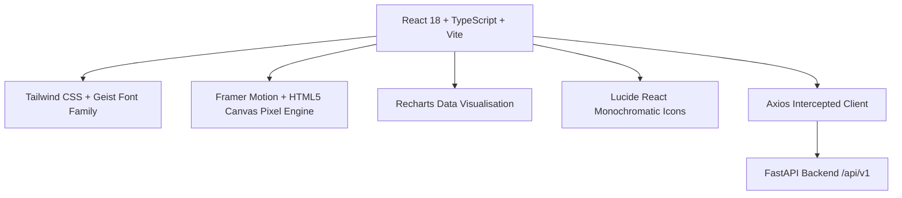
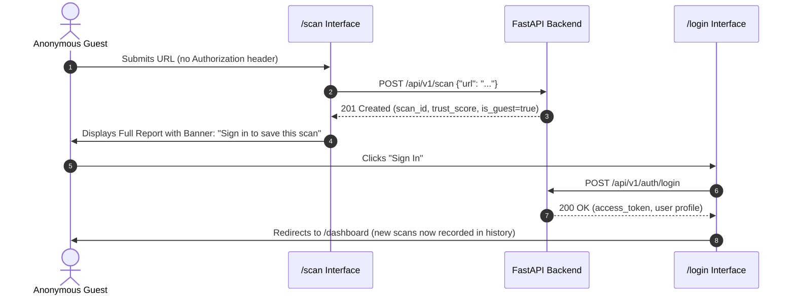
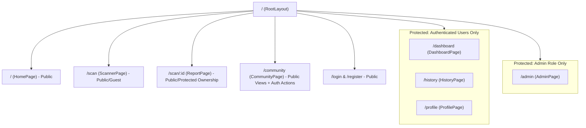

# TrustGuard AI — Frontend Architecture Specification

**Document Version:** `1.0.0`  
**Target Environment:** Single Page Application (SPA)  
**Core Framework:** React 18+ with Vite and TypeScript  
**Design Paradigm:** Premium Monochromatic Digital Minimalism with Geometric Pixel Animation  

---

## 1. Executive Summary & Architectural Vision

TrustGuard AI is an AI-powered website threat detection and digital trust intelligence platform. While the backend provides robust multi-layer threat analysis (VirusTotal API v3, Random Forest ML classifier, SSL/TLS validation engine, URL heuristics, and Digital Trust Scoring), the frontend is the critical interface through which security analysts, enterprise users, and anonymous guests interact with these insights.

The frontend is architected as a high-performance, strictly typed Single Page Application (SPA). It translates complex, multi-source telemetry and probabilistic security scores into an elegant, monochromatic, crystal-clear user experience.

### Architectural Tenets
1. **Zero Secret Leakage:** No private API keys (VirusTotal, Supabase Service Role) exist in the client bundle. All calls route to the FastAPI backend via `VITE_API_BASE_URL`.
2. **Dual-Mode Operation (Guest vs. Authenticated):** First-class support for instant, friction-free guest URL scans alongside complete authenticated workflows (session management, history querying, personal stats, and community reporting).
3. **Evidence-Based Clarity:** Distinct separation between *benign findings*, *confirmed threats*, and *unavailable/offline telemetry* (e.g., rate-limited VirusTotal or unresolvable DNS).
4. **Resilient Network Layer:** Unified Axios HTTP client with automatic JWT token attachment, silent refresh flow on 401, exponential backoff, and standardized error mapping.
5. **Deterministic State Management:** Lightweight, decoupled React Context for authentication and active scan state, coupled with custom hooks for async query handling.

---

## 2. Technology Stack & Tooling



### Core Dependencies & Rationale
- **Vite 5+:** Next-generation frontend tooling providing lightning-fast HMR and optimized production Rollup builds.
- **React 18+:** Concurrent mode rendering, transition primitives, and strict functional component architecture.
- **TypeScript 5+:** Strict type checking (`strict: true`, `noImplicitAny: true`) ensuring zero schema discrepancies with FastAPI Pydantic contracts.
- **Tailwind CSS 3.4+:** Utility-first CSS configured with custom monochromatic color scales, bespoke typography tokens, and custom animation utilities.
- **Framer Motion 11+:** Orchestrates subtle page transitions, micro-interactions, modal overlays, and collapsible disclosure panels without layout thrashing.
- **HTML5 Canvas (Custom Engine):** Dedicated 60fps render loop for mathematical geometric pixel grids and cursor-responsive particle interactions, bypassing heavy third-party WebGL runtimes (like Three.js).
- **Recharts 2.x:** Monochromatic radar charts, distribution bars, and SVG gauges for risk scores and user scan telemetry.
- **Lucide React:** Clean, lightweight SVG iconography maintaining strict 1.5px/2px stroke widths.
- **Axios 1.7+:** Promise-based HTTP client supporting request/response interceptors for seamless JWT management.

---

## 3. System Architecture & Information Architecture

```mermaid
graph LR
    subgraph Client Application [TrustGuard AI Frontend - React SPA]
        Router[React Router v6]
        AuthCtx[Auth Context]
        ScanCtx[Scan Workflow Context]
        Canvas[Pixel Animation Canvas]
        Views[Page Views]
    end

    subgraph Security Layer
        Guard[Route Guards / Role Check]
        Interceptors[Axios JWT Interceptor]
    end

    subgraph Backend Services [FastAPI v1 API]
        AuthEP[/api/v1/auth]
        ScanEP[/api/v1/scan]
        HistoryEP[/api/v1/scans]
        CommunityEP[/api/v1/community]
        AdminEP[/api/v1/admin]
    end

    Router --> Guard
    Guard --> Views
    Views --> AuthCtx
    Views --> ScanCtx
    Views --> Canvas
    AuthCtx --> Interceptors
    Interceptors --> AuthEP
    ScanCtx --> Interceptors
    Interceptors --> ScanEP
    Interceptors --> HistoryEP
    Interceptors --> CommunityEP
    Interceptors --> AdminEP
```

---

## 4. Proposed Frontend Directory Structure

The frontend lives entirely within `frontend/` at the project root, keeping backend and documentation cleanly separated:

```text
frontend/
├── index.html                      # Entry HTML with Geist fonts & dark background
├── vite.config.ts                  # Vite build config with path aliases (@/*)
├── tsconfig.json                   # Strict TypeScript compiler configuration
├── tsconfig.node.json              # TypeScript node configuration
├── tailwind.config.js              # Monochromatic design system tokens & extensions
├── postcss.config.js               # PostCSS loader
├── package.json                    # Pinned frontend dependencies
├── .env.example                    # Frontend environment template
├── .gitignore                      # Node modules, dist, and local env exclusions
│
├── public/
│   ├── favicon.svg                 # Minimal geometric pixel favicon
│   └── robots.txt
│
└── src/
    ├── main.tsx                    # Application entry point with React DOM root
    ├── App.tsx                     # Top-level Router & Context Providers wrapper
    │
    ├── assets/                     # Static SVGs, branding marks, and vector motifs
    │   └── branding/
    │
    ├── styles/                     # Global styles and Tailwind overrides
    │   ├── globals.css             # Base reset, CSS custom properties, scrollbar rules
    │   └── typography.css          # Geist font declarations and tracking classes
    │
    ├── types/                      # TypeScript type contracts mirroring backend schemas
    │   ├── api.ts                  # Standardized response envelopes and error models
    │   ├── auth.ts                 # User profile, tokens, registration, and login types
    │   ├── scan.ts                 # Raw submission, scan status, indicators, and features
    │   ├── report.ts               # Trust score, breakdown, SSL, VT, and ML prediction types
    │   ├── history.ts              # History pagination, filters, and statistics types
    │   ├── community.ts            # Community threat submissions, moderation, and public reports
    │   └── animation.ts            # Geometric pixel particle and canvas state interfaces
    │
    ├── context/                    # React Context stores
    │   ├── AuthContext.tsx         # User authentication, token lifecycle, and session restore
    │   ├── ScanContext.tsx         # Active URL scan state, cached reports, and polling
    │   └── ThemeContext.tsx        # Strict monochromatic theme controls and accessibility
    │
    ├── hooks/                      # Custom business logic & data-fetching hooks
    │   ├── useAuth.ts              # Auth operations (login, register, logout, profile update)
    │   ├── useScan.ts              # URL submission, analysis execution, and report caching
    │   ├── useHistory.ts           # History fetching, search debouncing, and pagination
    │   ├── useCommunity.ts         # Community threat reporting and upvoting
    │   ├── useAdmin.ts             # Moderation queues and administrative actions
    │   ├── usePixelCanvas.ts       # Canvas lifecycle, resize listener, and mouse coordinates
    │   └── useDebounce.ts          # Input debouncing for history and community searches
    │
    ├── services/                   # API communication layer
    │   ├── apiClient.ts            # Central Axios instance with JWT & error interceptors
    │   ├── authService.ts          # Calls to /api/v1/auth and /api/v1/users
    │   ├── scanService.ts          # Calls to /api/v1/scan and /api/v1/threat-intelligence
    │   ├── historyService.ts       # Calls to /api/v1/scans (history, stats, export, delete)
    │   ├── communityService.ts     # Calls to /api/v1/community (submit, list, upvote)
    │   └── adminService.ts         # Calls to /api/v1/admin (moderation queue, review)
    │
    ├── utils/                      # Pure helper functions
    │   ├── formatters.ts           # Date formatting, score formatting, number truncation
    │   ├── validators.ts           # Frontend URL syntax and SSRF pre-check validation
    │   ├── riskHelpers.ts          # Trust score to color/label mapping and weight explanations
    │   └── storage.ts              # Secure local token and recent guest scan persistence
    │
    ├── layouts/                    # Layout shells
    │   ├── RootLayout.tsx          # Main shell (Navbar, Canvas background layer, Footer)
    │   ├── DashboardLayout.tsx     # Authenticated console sidebar + breadcrumbs layout
    │   └── AdminLayout.tsx         # Administrative moderation console layout
    │
    ├── components/
    │   ├── common/                 # Reusable UI primitives
    │   │   ├── Navbar.tsx          # Minimal header with logo, navigation, and auth trigger
    │   │   ├── Footer.tsx          # Clean footer with system status, version, and links
    │   │   ├── Button.tsx          # Monochromatic button with hover square-pixel accents
    │   │   ├── Input.tsx           # Text input with mono labels and crisp border focus
    │   │   ├── Badge.tsx           # Minimal pill badge (status, risk level, threat tags)
    │   │   ├── Card.tsx            # #141414 card with #292929 border and subtle hover state
    │   │   ├── Modal.tsx           # Accessible dialog backdrop with Esc key handler
    │   │   ├── Skeleton.tsx        # Geometric pulse skeleton loader
    │   │   ├── AlertBanner.tsx     # Minimalist banner for notifications and error envelopes
    │   │   └── Tooltip.tsx         # Micro-metric explanation tooltip
    │   │
    │   ├── animation/              # Geometric pixel animation system
    │   │   ├── PixelBackground.tsx # Fullscreen interactive interactive canvas component
    │   │   ├── PixelScanner.tsx    # Horizontal geometric beam running during active scans
    │   │   ├── PixelGridMatrix.tsx # Abstract coordinate grid backdrop for heroes and cards
    │   │   └── PixelBadge.tsx      # Interactive micro-pixel clusters on hover
    │   │
    │   ├── scanner/                # Scanner-specific UI components
    │   │   ├── URLInputForm.tsx    # Primary scan input with protocol auto-fix and submit button
    │   │   ├── ScanProgressBar.tsx # Monochromatic progress indicator during engine execution
    │   │   ├── RecentGuestScans.tsx# Quick-access card for guest session recent analyses
    │   │   └── QuickDomainPreview.tsx# Pre-flight domain breakdown badge
    │   │
    │   ├── report/                 # Detailed report breakdown components
    │   │   ├── TrustScoreGauge.tsx # Custom SVG circular/radial score with risk category
    │   │   ├── RiskOverviewCard.tsx# High-severity override banners and executive recommendations
    │   │   ├── ModuleBreakdown.tsx # 4-column summary (URL Heuristics, ML, SSL/TLS, VirusTotal)
    │   │   ├── MLConfidenceCard.tsx# Phishing probability gauge and feature impact list
    │   │   ├── SSLStatusCard.tsx   # Cipher, TLS version, validity days, and chain trust
    │   │   ├── ThreatFeedCard.tsx  # VirusTotal multi-engine vendor breakdown (or unavailable fallback)
    │   │   ├── HeuristicsCard.tsx  # Extracted lexical features and detected indicators
    │   │   └── ExportReportBtn.tsx # Trigger for JSON export or printable summary
    │   │
    │   ├── history/                # History table and filter components
    │   │   ├── HistoryFilterBar.tsx# Search input, risk dropdown, date range, and sort toggle
    │   │   ├── HistoryTable.tsx    # Sortable table with domain, trust score, and action buttons
    │   │   ├── HistoryRow.tsx      # Table row with slide-out mini report view
    │   │   └── Pagination.tsx      # 1-indexed pagination controls
    │   │
    │   ├── dashboard/              # User dashboard widgets
    │   │   ├── StatsOverview.tsx   # Aggregated metric cards (Total Scans, Avg Score, Risk count)
    │   │   ├── RiskDistributionChart.tsx # Recharts monochromatic bar chart
    │   │   └── RecentActivityList.tsx # Mini feed of user's last 5 operations
    │   │
    │   ├── community/              # Community threat submission & review components
    │   │   ├── CommunityReportList.tsx # Public feed of verified threat reports
    │   │   ├── ReportSubmissionModal.tsx# Form for submitting new suspicious URLs
    │   │   ├── UpvoteButton.tsx    # Minimal upvote counter with debounced backend dispatch
    │   │   └── MySubmissionsTable.tsx # User's personal submission tracker with review states
    │   │
    │   └── admin/                  # Administrative moderation components
    │       ├── ModerationQueueTable.tsx # Admin queue with status filters (Pending, Under Review)
    │       ├── ModerationActionModal.tsx# Review decision dialog with moderation notes
    │       └── ReviewAuditCard.tsx # Detailed submitter IP and verification trail
    │
    └── pages/                      # Top-level route pages
        ├── HomePage.tsx            # / — Hero, live scan demo, feature grid, minimal showcase
        ├── ScannerPage.tsx         # /scan — Dedicated clean scanning console
        ├── ReportPage.tsx          # /scan/:id — Full security assessment and evidence report
        ├── LoginPage.tsx           # /login — Minimalist authentication portal
        ├── RegisterPage.tsx        # /register — Account creation with validation feedback
        ├── ForgotPasswordPage.tsx  # /forgot-password — Password recovery request
        ├── ResetPasswordPage.tsx   # /reset-password — Password update confirmation
        ├── DashboardPage.tsx       # /dashboard — User metrics and telemetry overview (Auth)
        ├── HistoryPage.tsx         # /history — Complete paginated history with filtering (Auth)
        ├── CommunityPage.tsx       # /community — Public threat feed and submission hub
        ├── ProfilePage.tsx         # /profile — Account details, avatar, and scan stats (Auth)
        ├── AdminPage.tsx           # /admin — Moderation desk and queue management (Admin)
        └── NotFoundPage.tsx        # 404 — Monochromatic pixel dissolution error view
```

---

## 5. State Management & Data Flow Architecture

### State Segregation Matrix

| State Category | Storage Scope | Management Mechanism | Persistence Strategy |
| :--- | :--- | :--- | :--- |
| **Auth Session** | Global Application | `AuthContext` + Axios Interceptor | `localStorage` (`access_token`, `refresh_token`, `user`) |
| **Active Scan** | Scan Workflow | `ScanContext` | Memory + `sessionStorage` (for guest page reload) |
| **History & Queries** | Page Level | `useHistory` + Custom Hooks | Transient memory with URL query params synchronization |
| **Animation Loop** | Canvas Layer | `usePixelCanvas` + `requestAnimationFrame` | High-frequency memory (Float32Array coordinate buffers) |
| **UI Ephemeral** | Component Level | `useState`, `useReducer` | Component lifecycle |

### Guest to Authenticated Transition Flow


---

## 6. Route Architecture & Navigation Hierarchy



### Route Guard Architecture
1. **`PublicOnlyRoute`:** Redirects already authenticated users away from `/login` and `/register` directly to `/dashboard`.
2. **`ProtectedRoute`:** Intercepts unauthenticated visitors attempting to access `/dashboard`, `/history`, or `/profile`, redirecting them to `/login?redirect=...`.
3. **`AdminRoute`:** Evaluates verified JWT user payload for `role === "admin"`. If non-admin, renders an access denied view (HTTP 403 envelope) and logs an audit boundary event. Server-side validation on `/api/v1/admin/*` remains the ultimate authority.

---

## 7. Performance & Security Safeguards

### Performance Optimizations
1. **Code Splitting & Lazy Loading:** Every top-level page (`HomePage`, `ReportPage`, `HistoryPage`, `AdminPage`) is wrapped in `React.lazy()` and `Suspense` with a custom monochromatic geometric skeleton loader.
2. **Canvas Render Optimization:** The pixel particle background runs on an offscreen HTML5 canvas buffer with dynamic DPI scaling. When the document tab is blurred or when `window.matchMedia('(prefers-reduced-motion: reduce)')` matches, frame rendering stops completely to preserve CPU cycles.
3. **Memoized Heavy Calculations:** Recharts telemetry datasets and feature breakdown lists are wrapped in `useMemo` to eliminate unnecessary re-renders.

### Security Defenses
1. **Zero Secret Footprint:** The frontend environment contains solely `VITE_API_BASE_URL`. Supabase Service Role and VirusTotal API keys are strictly backend-bound.
2. **Strict Sanitization:** URLs, domain names, and user-submitted text from community reports are treated as untrusted data and escaped to prevent XSS.
3. **SSRF Pre-Flight Check:** Frontend validates URL schemes (`http:`, `https:`) and blocks IP loopbacks (`127.0.0.1`, `localhost`, `169.254.169.254`) before the request leaves the browser, providing instant feedback while the backend SSRF guard enforces hard network boundaries.

