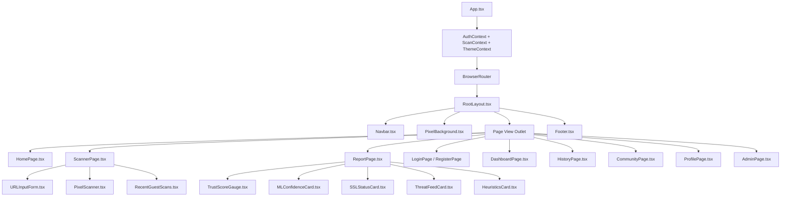

# TrustGuard AI — Frontend Component Structure & Props Specification

**Document Version:** `1.0.0`  
**Architecture:** Functional React 18+ with TypeScript & Tailwind CSS  
**Design Theme:** Premium Monochromatic Digital Minimalism  

---

## 1. High-Level Component Hierarchy



---

## 2. Common UI Component Library (`src/components/common/`)

### `Button.tsx`
A monochromatic button primitive featuring razor-sharp 1px borders, subtle opacity states, and optional corner-pixel accents on hover.
```typescript
export interface ButtonProps extends React.ButtonHTMLAttributes<HTMLButtonElement> {
  variant?: "primary" | "secondary" | "outline" | "danger" | "ghost";
  size?: "sm" | "md" | "lg";
  isLoading?: boolean;
  leftIcon?: React.ReactNode;
  rightIcon?: React.ReactNode;
  showPixelCorners?: boolean; // Renders 4 micro-pixel corner dots on hover
}
```

### `Input.tsx`
High-contrast text input with integrated Geist Mono labels, helper error envelopes, and focused geometric accent borders.
```typescript
export interface InputProps extends React.InputHTMLAttributes<HTMLInputElement> {
  label?: string;
  error?: string;
  hint?: string;
  leftElement?: React.ReactNode;
  rightElement?: React.ReactNode;
  mono?: boolean; // Uses Geist Mono font for cryptographic hashes and URLs
}
```

### `Card.tsx`
The fundamental structural unit: `#141414` background, `1px solid #292929` border, and optional geometric framing brackets.
```typescript
export interface CardProps extends React.HTMLAttributes<HTMLDivElement> {
  hoverEffect?: boolean;       // Elevates border contrast to #404040 on hover
  pixelFrame?: boolean;        // Renders minimalist corner bracket marks [  ]
  headerAction?: React.ReactNode;
  title?: string;
  subtitle?: string;
}
```

### `Badge.tsx`
Compact monochromatic pill or square indicator for statuses, risk classifications, and verification tags.
```typescript
export interface BadgeProps {
  label: string;
  variant?: "inverted" | "high-contrast" | "subtle" | "muted" | "outline";
  size?: "xs" | "sm" | "md";
  icon?: React.ReactNode;
  dotIndicator?: boolean;      // Displays a 4px flashing square indicator
}
```

### `Modal.tsx`
Accessible, focus-trapped dialog overlay with backdrop blur and smooth keyboard dismiss (`Escape`).
```typescript
export interface ModalProps {
  isOpen: boolean;
  onClose: () => void;
  title: string;
  subtitle?: string;
  children: React.ReactNode;
  footerActions?: React.ReactNode;
  maxWidth?: "sm" | "md" | "lg" | "xl";
}
```

### `Skeleton.tsx`
Monochromatic geometric placeholder with subtle shimmer animation for asynchronous states.
```typescript
export interface SkeletonProps {
  className?: string;
  variant?: "rectangle" | "circle" | "text";
  height?: string | number;
  width?: string | number;
}
```

---

## 3. Geometric Pixel Animation Suite (`src/components/animation/`)

### `PixelBackground.tsx`
Fullscreen interactive HTML5 Canvas layer rendering a mathematically distributed grid of microscopic monochromatic squares responsive to cursor coordinates.
```typescript
export interface PixelBackgroundProps {
  pixelSize?: number;          // Default: 3px
  gap?: number;                // Default: 21px (24px pitch)
  baseOpacity?: number;        // Default: 0.06
  activeOpacity?: number;      // Default: 0.45
  cursorRadius?: number;       // Default: 80px
  enableInteractivity?: boolean;// Disabled when reduced-motion is requested
}
```

### `PixelScanner.tsx`
Animated horizontal scanning line with trail dissolution effect running along active scan targets.
```typescript
export interface PixelScannerProps {
  isScanning: boolean;
  targetHeight?: number | string;
  speedMs?: number;            // Default: 2400ms
  showParticles?: boolean;     // Emits micro-particles as the beam traverses
}
```

### `PixelGridMatrix.tsx`
Abstract, decorative geometric bounding box applied behind hero banners and score visualizations.
```typescript
export interface PixelGridMatrixProps {
  rows?: number;
  cols?: number;
  intensity?: "faint" | "medium" | "strong";
  className?: string;
}
```

---

## 4. Scanner Domain Components (`src/components/scanner/`)

### `URLInputForm.tsx`
Primary submission bar featuring live syntax validation, auto-sanitization, and instant submission.
```typescript
export interface URLInputFormProps {
  onScanSubmit: (url: string) => Promise<void>;
  isLoading: boolean;
  initialValue?: string;
  error?: string | null;
  placeholder?: string;
}
```

### `RecentGuestScans.tsx`
Sidebar or bottom panel preserving the current anonymous browser session's last 5 inspected domains.
```typescript
export interface RecentGuestScansProps {
  scans: Array<{
    scanId: string;
    url: string;
    domain: string;
    score: number;
    timestamp: string;
  }>;
  onSelectScan: (scanId: string) => void;
  onClearHistory: () => void;
}
```

---

## 5. Security Assessment & Report Components (`src/components/report/`)

### `TrustScoreGauge.tsx`
Central visual anchor of the assessment report. Custom SVG circular display rendering the 0–100 Digital Trust Score with stepped geometric segments.
```typescript
export interface TrustScoreGaugeProps {
  score: number;               // 0 to 100
  riskLevel: "CRITICAL" | "HIGH" | "MEDIUM" | "LOW" | "MINIMAL";
  size?: number;               // Default: 220px
  strokeWidth?: number;        // Default: 12px
  animateOnMount?: boolean;
}
```

### `ModuleBreakdown.tsx`
4-column analytical grid comparing the 4 threat inspection engines with individual scores and confidence indicators.
```typescript
export interface ModuleBreakdownProps {
  heuristicScore: number;      // 0-100
  mlScore: number;             // 0-100
  sslScore: number;            // 0-100
  vtScore: number | null;      // null when VirusTotal API is offline
  isVtAvailable: boolean;
}
```

### `MLConfidenceCard.tsx`
Presents the Random Forest machine learning classification verdict, phishing probability score, confidence level, and extracted feature weights.
```typescript
export interface MLConfidenceCardProps {
  prediction: "PHISHING" | "BENIGN";
  phishingProbability: number; // 0.00 to 1.00
  confidence: "HIGH" | "MEDIUM" | "LOW";
  modelVersion: string;
  modelStatus: "ACTIVE" | "DEGRADED" | "OFFLINE";
  features?: Record<string, number | boolean>;
}
```

### `SSLStatusCard.tsx`
Comprehensive cryptographic analysis card detailing TLS handshake status, expiration countdown, CA issuer, and SAN host validation.
```typescript
export interface SSLStatusCardProps {
  status: "VALID" | "EXPIRED" | "SELF_SIGNED" | "UNTRUSTED" | "NO_SSL";
  httpsEnabled: boolean;
  hostname: string;
  daysRemaining?: number;
  hostnameVerified: boolean;
  certificateTrusted: boolean;
  tlsVersion?: string;
  sslSubscore: number;
}
```

### `ThreatFeedCard.tsx`
Renders VirusTotal multi-vendor security intelligence. When telemetry is offline, gracefully renders an explicit "Feed Unavailable" status without impacting score validity.
```typescript
export interface ThreatFeedCardProps {
  status: "SUCCESS" | "API_UNAVAILABLE" | "NOT_FOUND" | "ERROR";
  positives: number;
  totalEngines: number;
  reputationScore: number;
  vendorResults: Record<string, { category: string; result: string; method: string }>;
  permalink?: string;
}
```

### `HeuristicsCard.tsx`
Details URL structural analysis, lexical anomalies, entropy metrics, and detected risk indicators.
```typescript
export interface HeuristicsCardProps {
  indicators: Array<{
    name: string;
    description: string;
    severity: "low" | "medium" | "high" | "critical";
    evidence?: string;
    reason?: string;
  }>;
  features: {
    url_length: number;
    hostname_length: number;
    path_depth: number;
    dot_count: number;
    hyphen_count: number;
    uses_https: boolean;
    is_ip_address: boolean;
    is_shortened: boolean;
    contains_suspicious_keywords: boolean;
  };
}
```

---

## 6. Scan History & User Telemetry Components (`src/components/history/`)

### `HistoryFilterBar.tsx`
Full-featured control toolbar for filtering, querying, and sorting scan records.
```typescript
export interface HistoryFilterBarProps {
  searchQuery: string;
  onSearchChange: (query: string) => void;
  selectedRisk: string;
  onRiskChange: (risk: string) => void;
  selectedDateFilter: string;
  onDateFilterChange: (dateFilter: string) => void;
  sortBy: string;
  onSortByChange: (sort: string) => void;
  onResetFilters: () => void;
}
```

### `HistoryTable.tsx`
Responsive, paginated data table displaying user scan records with inline actions.
```typescript
export interface HistoryTableProps {
  items: Array<{
    scan_id: string;
    original_url: string;
    domain: string;
    scan_status: string;
    digital_trust_score: number;
    risk_level: string;
    submitted_at: string;
  }>;
  isLoading: boolean;
  onViewReport: (scanId: string) => void;
  onExportReport: (scanId: string) => void;
  onDeleteScan: (scanId: string) => void;
}
```

---

## 7. Community & Moderation Components (`src/components/community/` & `src/components/admin/`)

### `CommunityReportList.tsx`
Public threat feed component with category filtering and instant upvoting.
```typescript
export interface CommunityReportListProps {
  reports: Array<{
    id: string;
    domain: string;
    category: string;
    target_brand?: string;
    attack_vector?: string;
    description: string;
    upvotes: number;
    verification_status: string;
    created_at: string;
  }>;
  onUpvote: (reportId: string) => Promise<void>;
  isLoading: boolean;
}
```

### `ModerationQueueTable.tsx`
Administrative table allowing authorized analysts to inspect lifecycle states and take moderation action.
```typescript
export interface ModerationQueueTableProps {
  reports: Array<any>;
  onModerate: (reportId: string, status: string, notes: string) => Promise<void>;
  isLoading: boolean;
}
```

