# TrustGuard AI — Frontend Development Roadmap

**Document Version:** `1.0.0`  
**Execution Horizon:** 48-Hour Hackathon Delivery Model  
**Methodology:** Incremental, Test-Driven Component Assembly  

---

## 1. Phased Development Roadmap Overview

```mermaid
flowchart LR
    Phase1[Phase 1: Project Setup & System Foundation] --> Phase2[Phase 2: Auth & Session Management]
    Phase2 --> Phase3[Phase 3: Core Scanner & Geometric Animation]
    Phase3 --> Phase4[Phase 4: Comprehensive Security Report]
    Phase4 --> Phase5[Phase 5: User Dashboard & Scan History]
    Phase5 --> Phase6[Phase 6: Community Threat Intelligence]
    Phase6 --> Phase7[Phase 7: Admin Moderation Console]
    Phase7 --> Phase8[Phase 8: End-to-End Audit & Polish]
```

---

## 2. Detailed Phase Specifications

### Phase 1 — Project Initialization & Design Foundation
- **Objectives:**
  1. Initialize Vite project with React 18 and strict TypeScript template in `frontend/`.
  2. Install and configure Tailwind CSS with custom monochromatic design tokens (`#080808`, `#101010`, `#141414`, `#292929`, `#666666`, `#A1A1A1`, `#F5F5F5`).
  3. Configure Geist Sans and Geist Mono web fonts.
  4. Build the core HTML5 Canvas interactive pixel background (`PixelBackground.tsx`).
  5. Implement common primitives: `Button`, `Input`, `Card`, `Badge`, `Skeleton`.
  6. Assemble `RootLayout` with sticky `Navbar` and responsive `Footer`.
- **Exit Criteria:**
  - `npm run build` generates clean output with 0 TypeScript or linting errors.
  - Monochromatic canvas animation renders smoothly at 60 FPS without layout shifts.

---

### Phase 2 — Authentication, Session Lifecycle & Route Guards
- **Objectives:**
  1. Configure Axios client (`apiClient.ts`) with base URL (`VITE_API_BASE_URL`) and request/response interceptors.
  2. Implement `AuthContext` to manage JWT tokens, refresh lifecycle, and current user profile.
  3. Build `LoginPage` (`/login`), `RegisterPage` (`/register`), and password recovery workflows.
  4. Create route guards: `ProtectedRoute`, `PublicOnlyRoute`, and `AdminRoute`.
  5. Implement profile header dropdown and secure logout mechanism.
- **Exit Criteria:**
  - User can register, log in, view authenticated identity, and log out.
  - Expired tokens seamlessly trigger silent refresh via `POST /api/v1/auth/refresh`.

---

### Phase 3 — Core URL Scanner & Geometric Beam Animation
- **Objectives:**
  1. Implement `ScanContext` and custom hook `useScan`.
  2. Build `URLInputForm` with pre-flight URL validation (syntax and protocol handling).
  3. Create `PixelScanner` scanning-line beam animation triggered during active API processing.
  4. Connect scanner directly to `POST /api/v1/scan` (supporting both guest and authenticated users).
  5. Build guest recent scans caching in `sessionStorage` (`RecentGuestScans.tsx`).
- **Exit Criteria:**
  - Anonymous visitor can submit a URL, watch the scanning animation, and receive a scan result.
  - Malformed URLs and SSRF loopback inputs trigger immediate, user-friendly error banners.

---

### Phase 4 — Comprehensive Security Assessment & Report View
- **Objectives:**
  1. Build `/scan/:id` page displaying the full assessment.
  2. Construct SVG `TrustScoreGauge` (0–100 score, stepped circular progress, and risk label).
  3. Build the 4-module evidence cards:
     - `MLConfidenceCard`: Phishing prediction, probability bar, model version.
     - `SSLStatusCard`: Handshake validity, days remaining, cipher, trusted chain.
     - `ThreatFeedCard`: Multi-vendor VirusTotal detection (or "Feed Unavailable" clean fallback).
     - `HeuristicsCard`: Extracted lexical anomalies and detected indicator badges.
  4. Implement "Export Report" button downloading sanitized JSON via `GET /api/v1/scans/{id}/export`.
- **Exit Criteria:**
  - High-severity override scenarios (e.g. 98% ML phishing detection) render high-contrast warning banners.
  - Offline VirusTotal keys display transparent "Feed Unavailable" status without breaking the UI.

---

### Phase 5 — User Dashboard & Paginated Scan History
- **Objectives:**
  1. Build `/dashboard` featuring aggregate metrics (`total_scans`, `average_trust_score`, `risk_distribution`).
  2. Construct Recharts monochromatic bar chart displaying risk level breakdown.
  3. Build `/history` featuring server-side paginated scan history table.
  4. Implement `HistoryFilterBar` with debounced search, risk level dropdown, and date filters.
  5. Enable secure scan record deletion with confirmation dialog.
- **Exit Criteria:**
  - Fast filter transitions without page reloads.
  - Paginated navigation synchronizes smoothly with backend database queries.

---

### Phase 6 — Community Threat Intelligence Hub
- **Objectives:**
  1. Build `/community` featuring public feed of verified threat reports (`GET /api/v1/community/reports`).
  2. Implement category filter pills (`PHISHING`, `MALWARE`, `FRAUD_OR_SCAM`, etc.).
  3. Build `ReportSubmissionModal` for submitting suspicious URLs (`POST /api/v1/community/reports`).
  4. Implement debounced upvote button (`POST /api/v1/community/reports/{id}/upvote`).
  5. Build "My Submissions" tab tracking personal submission statuses (`PENDING`, `APPROVED`, etc.).
- **Exit Criteria:**
  - Whistleblower identities remain strictly private on the frontend.
  - Confirmed duplicate submissions render friendly duplicate notices.

---

### Phase 7 — Administrative Moderation Console
- **Objectives:**
  1. Build `/admin` moderation console protected by `AdminRoute`.
  2. Construct `ModerationQueueTable` querying `GET /api/v1/admin/community/reports`.
  3. Implement slide-out review drawer with automated scanner cross-referencing.
  4. Connect moderation action dialog to `PATCH /api/v1/admin/community/reports/{id}` (`APPROVED`, `REJECTED`, `DUPLICATE`).
- **Exit Criteria:**
  - Non-admin users attempting to navigate to `/admin` receive a clean 403 Access Denied view.
  - Moderation actions instantly update the report status and moderation notes.

---

### Phase 8 — End-to-End Integration, Accessibility & Performance Audit
- **Objectives:**
  1. Run cross-browser compatibility checks (Chrome, Firefox, Safari, Edge).
  2. Verify responsive layouts across mobile (375px), tablet (768px), and desktop (1440px).
  3. Audit accessibility: ARIA attributes, keyboard navigation, color contrast, and `prefers-reduced-motion`.
  4. Verify production build bundle size ($< 350\text{ KB}$ gzipped initial chunk).
- **Exit Criteria:**
  - Complete, end-to-end integration verified against all 29 backend API endpoints.
  - Lighthouse performance, accessibility, and best practices scores $\ge 95$.

